

    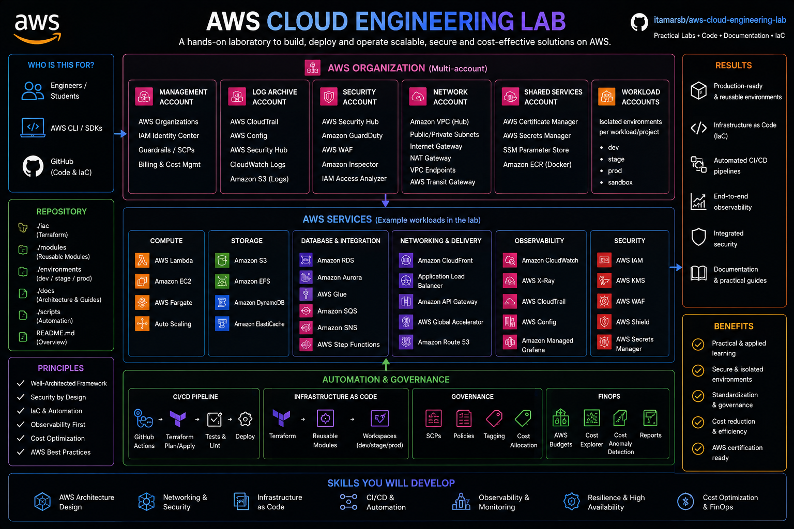

**Idioma:** [English](README.md) | **Português (Brasil)**

# AWS Cloud Engineering Lab

> **Especialização cloud-native (planejamento):** Este repositório concentra os estudos de construção de imagens Docker, Docker Compose, Amazon ECR, Amazon ECS Fargate e pipelines de entrega de contêineres. Consulte a [trilha de aprendizagem de Docker a ECS](docs/cloud-native-roadmap.md). Kubernetes, Helm, GitOps e EKS pertencem ao [repositório complementar de Kubernetes](https://github.com/itamarsb/aws-cloud-devops-sre-operations-lab). Os itens planejados não constituem evidência de execução concluída.

Projeto prático desenvolvido para estudar, aprofundar e demonstrar conhecimentos em:

- AWS EC2
- AWS SSM
- AWS IAM
- AWS VPC
- AWS Security Groups
- AWS Systems Manager
- AWS RDS
- AWS ECR
- AWS ECS
- AWS CloudWatch
- Contêineres
- Docker
- Docker Compose
- Terraform

Objetivo: construir progressivamente uma arquitetura de nuvem semelhante às utilizadas em ambientes de produção, com foco em alto desempenho.

## **Observação sobre otimização de custos**

> Ao longo deste repositório, a mesma instância EC2 é reutilizada intencionalmente em diferentes laboratórios.
>
> Essa abordagem aproxima os exercícios de práticas reais de engenharia, pois permite:
>
> - reduzir os custos de infraestrutura;
> - minimizar a criação desnecessária de recursos;
> - incentivar a reutilização da infraestrutura;
> - aplicar princípios de FinOps durante o aprendizado.
>
> Após a conclusão do último laboratório baseado em EC2, os recursos AWS devem ser removidos conforme as instruções de limpeza (*cleanup*) dos respectivos laboratórios.

---

## Estrutura do repositório

O repositório está organizado em duas trilhas complementares de aprendizagem: **laboratórios manuais na AWS**, documentados em `labs/`, e **laboratórios de Infraestrutura como Código (IaC)**, documentados em `terraform/`. As implementações em Terraform são adicionadas progressivamente; nem todo laboratório manual possui uma implementação equivalente em Terraform.

A árvore abaixo representa os diretórios e arquivos **atualmente presentes na branch `main`**. Os laboratórios 04 a 26 aparecem no roteiro de desenvolvimento, mas ainda não possuem diretórios de implementação manual.

~~~text
aws-cloud-engineering-lab/
├── README.md
├── README.pt-BR.md
├── docs/
│   ├── architecture/
│   ├── diagrams/
│   ├── screenshots/
│   ├── lessons-learned/
│   ├── lab-notes/
│   └── cloud-native-roadmap.md
├── labs/
│   ├── 01-ec2-and-ssm/
│   ├── 02-ec2-monitoring-with-cloudwatch-agent/
│   └── 03-iam-roles-and-policies/
├── terraform/
│   ├── README.md
│   ├── 00-workstation-and-aws-authentication/
│   └── 01-ec2-and-ssm/
└── scripts/
    └── README.md
~~~

### Laboratórios disponíveis e navegação

| Trilha | Laboratório | Material disponível |
| --- | --- | --- |
| Manual | [Lab 01 — EC2 e SSM](labs/01-ec2-and-ssm/README.pt-BR.md) | Guia passo a passo e capturas de tela |
| Manual | [Lab 02 — Monitoramento de EC2 com CloudWatch Agent](labs/02-ec2-monitoring-with-cloudwatch-agent/README.pt-BR.md) | Guia passo a passo e capturas de tela |
| Manual | [Lab 03 — Funções e políticas do IAM](labs/03-iam-roles-and-policies/README.pt-BR.md) | Guia passo a passo, arquivos de políticas e capturas de tela |
| Terraform | [Lab 00 — Preparação da estação de trabalho e autenticação AWS](terraform/00-workstation-and-aws-authentication/README.pt-BR.md) | Guia de preparação do ambiente (fora da contagem dos Labs 01–26) |
| Terraform | [Lab 01 — EC2 e SSM](terraform/01-ec2-and-ssm/README.md) | Configuração Terraform e documentação em desenvolvimento |

Consulte também a [trilha de Terraform](terraform/README.md) e o [roteiro de aprendizagem cloud-native](docs/cloud-native-roadmap.md). Os itens referentes a laboratórios futuros representam planejamento e não apontam para diretórios já implementados.

> **Idioma dos laboratórios:** os Labs 01, 02 e 03 (manuais) e o Lab 00 de Terraform já possuem versões em português. O Lab 01 de Terraform permanece em inglês até que sua tradução seja publicada.

### Fluxo de aprendizagem

Nos laboratórios que possuem implementações manual e Terraform, o fluxo de aprendizagem previsto é:

~~~text
Provisionamento manual
        ↓
Validação da arquitetura
        ↓
Reprodução com Terraform
        ↓
Comparação das infraestruturas
        ↓
Limpeza automatizada
        ↓
Verificação após a destruição dos recursos
        ↓
Lições aprendidas
~~~

### Relação entre as implementações

Quando as duas implementações estão disponíveis, os diretórios dos laboratórios manuais e de Terraform apresentam nomes correspondentes:

~~~text
labs/01-ec2-and-ssm/
        ↕
terraform/01-ec2-and-ssm/
~~~

A implementação manual explica, passo a passo, como criar e validar os recursos na AWS.

A trilha de Terraform busca reproduzir essa arquitetura por meio de Infraestrutura como Código. Conforme o estágio de desenvolvimento, cada laboratório pode incluir:

- requisitos de provedores e versões;
- variáveis de entrada;
- consultas a fontes de dados (*data sources*);
- provisionamento de recursos;
- valores de saída (*outputs*);
- comandos de validação;
- considerações de custos;
- destruição automatizada dos recursos;
- verificação após a destruição dos recursos.

> [!IMPORTANT]
> As implementações em Terraform são adicionadas progressivamente, após a conclusão e validação dos laboratórios manuais correspondentes.
>
> A infraestrutura gerenciada pelo Terraform pode ser criada temporariamente junto à infraestrutura manual, utilizando nomes e etiquetas (*tags*) distintos, e posteriormente removida por um procedimento automatizado de limpeza.

---

## Roteiro de desenvolvimento

O roteiro de laboratórios manuais abrange os Labs **01 a 26**. Atualmente, existem diretórios e documentação de apoio para os Labs **01 a 03**; os Labs **04 a 26** estão apenas planejados. Uma tarefa não marcada representa uma atividade futura, e não uma evidência de execução.

A trilha de Terraform possui um [guia de preparação no Lab 00](terraform/00-workstation-and-aws-authentication/README.pt-BR.md) e uma [implementação do Lab 01 em desenvolvimento](terraform/01-ec2-and-ssm/README.md). A presença de arquivos de código não comprova, por si só, que recursos AWS foram implantados ou validados.

### AWS Cloud Engineering Lab — roteiro de aprendizagem

## 🎯 Objetivo

Este repositório documenta estudos práticos e implementações relacionados a engenharia de nuvem AWS, infraestrutura, observabilidade, automação, contêineres e práticas de DevOps.

O objetivo é desenvolver experiência prática com ambientes de nuvem próximos de situações reais, consolidando competências aplicáveis a Engenharia de Nuvem, DevOps, Engenharia de Plataformas, Engenharia de Confiabilidade de Sites (SRE) e Operações de Infraestrutura.

---

# Fase 1 — Fundamentos de AWS

## Lab 01 — Instância EC2 com acesso via SSM

* [X] Configurar função IAM

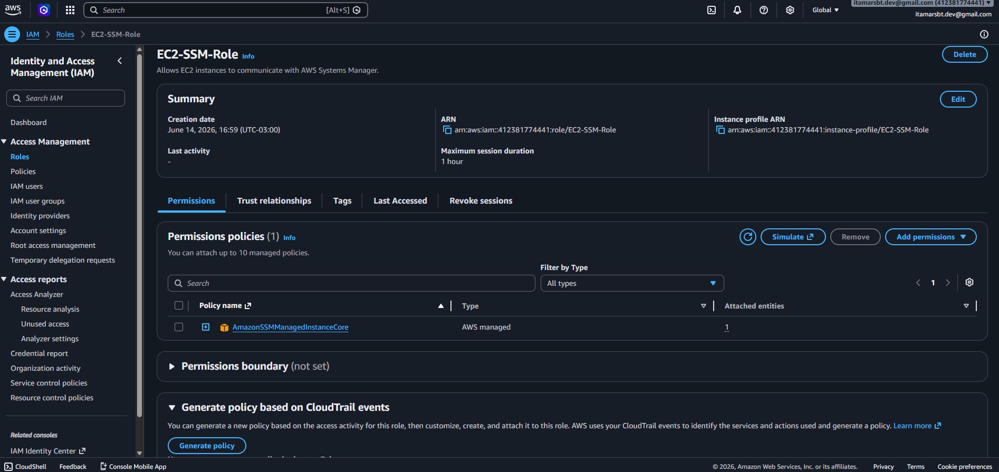

* [X] Criar uma instância EC2

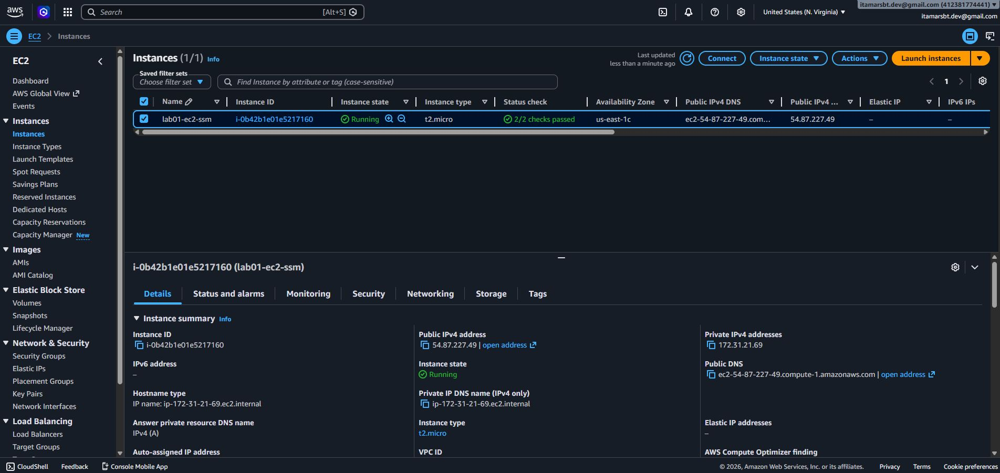

* [X] Configurar o AWS Systems Manager

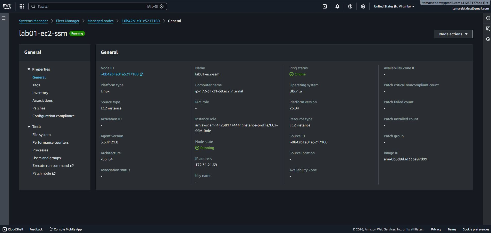

* [X] Conectar-se pelo Session Manager

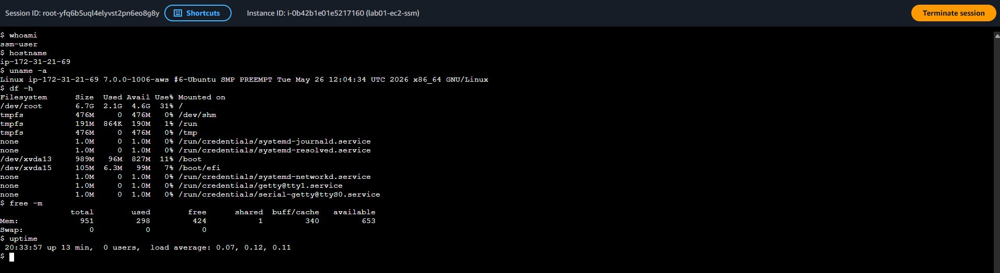

### Documentação do laboratório

Laboratório manual: [Lab 01 — EC2 e SSM](labs/01-ec2-and-ssm/README.pt-BR.md)

Laboratório Terraform (em desenvolvimento): [Lab 01 — EC2 e SSM](terraform/01-ec2-and-ssm/README.md)

## Lab 02 — Monitoramento moderno de EC2 com CloudWatch Agent

* [X] Iniciar a instância EC2 existente

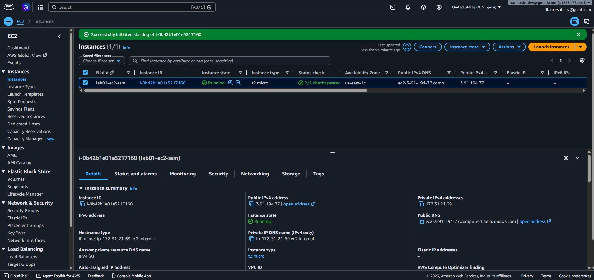

* [X] Instalar o CloudWatch Agent

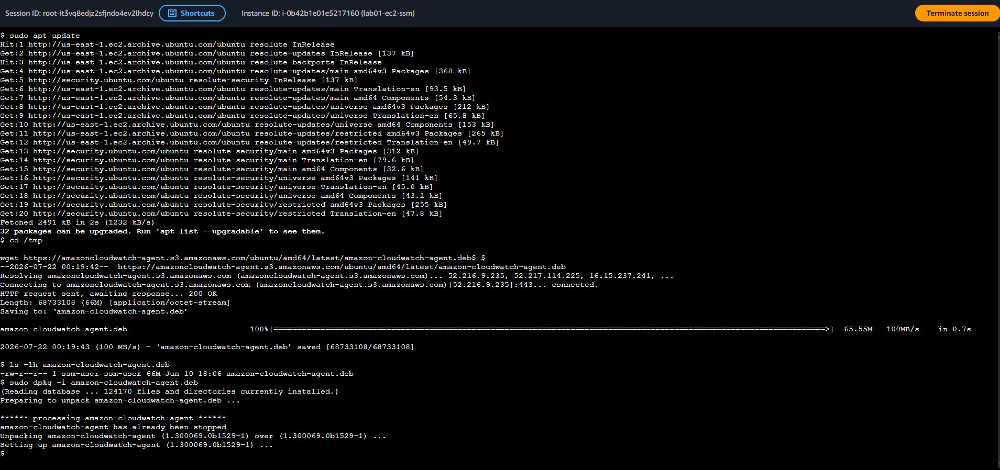

* [X] Configurar o CloudWatch Agent

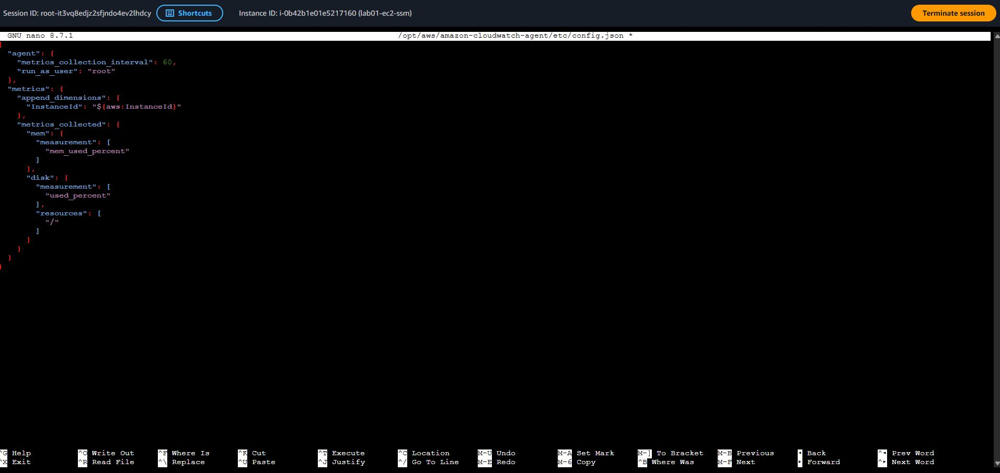

* [X] Iniciar o agente

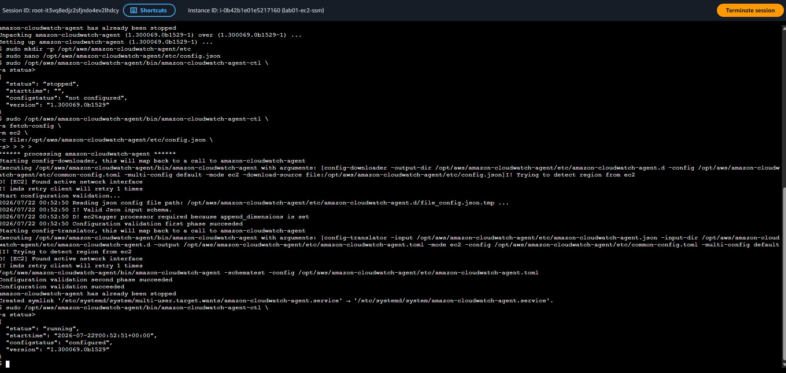

* [X] Verificar as métricas

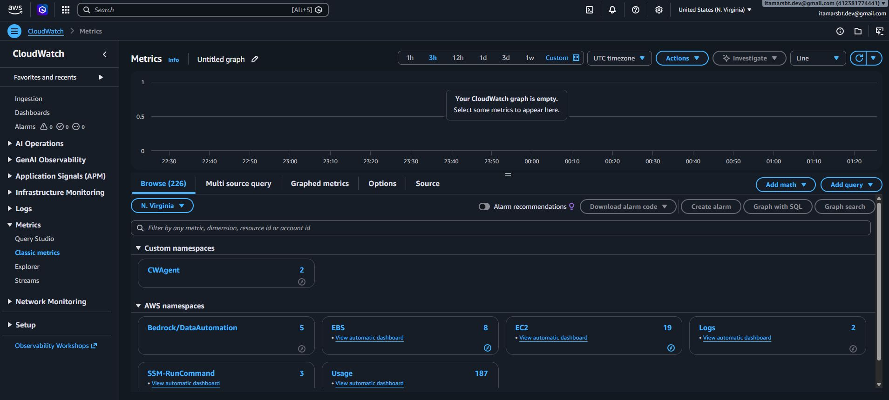

* [X] Criar um dashboard

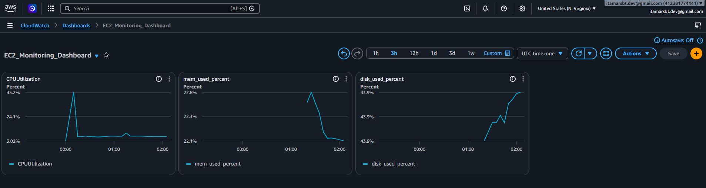

### Documentação do laboratório

Laboratório manual: [Lab 02 — CloudWatch Agent](labs/02-ec2-monitoring-with-cloudwatch-agent/README.pt-BR.md)

Laboratório Terraform: ainda não disponível.

### Lab 03 — Identidade moderna na AWS, funções IAM e políticas de privilégio mínimo

- [X] Compreender os modelos modernos de identidade da AWS

~~~markdown
                    MODELOS MODERNOS DE IDENTIDADE AWS

       IDENTIDADE DE PESSOAS            IDENTIDADE DE CARGAS DE TRABALHO
       Usuários humanos                 Aplicações / Recursos AWS
             │                                      │
             ▼                                      ▼
     IAM Identity Center                         Função IAM
             │                                      │
             ▼                                      ▼
      Acesso federado                     Credenciais temporárias
             │                                      │
             ▼                                      ▼
        Contas AWS                              Serviços AWS
~~~

~~~markdown
                    PRINCÍPIOS DE SEGURANÇA

        ✓ Credenciais temporárias
        ✓ Privilégio mínimo
        ✓ Federação para acesso humano
        ✓ Funções IAM para cargas de trabalho
        ✗ Evitar chaves de acesso de longa duração
~~~

- [X] Comparar identidades de usuários e de cargas de trabalho

~~~markdown
Identidade de pessoas
Pessoa → IAM Identity Center → AWS

Identidade de carga de trabalho
EC2 → Função IAM → Credenciais temporárias → AWS
~~~

- [X] Analisar o IAM Identity Center e o acesso federado

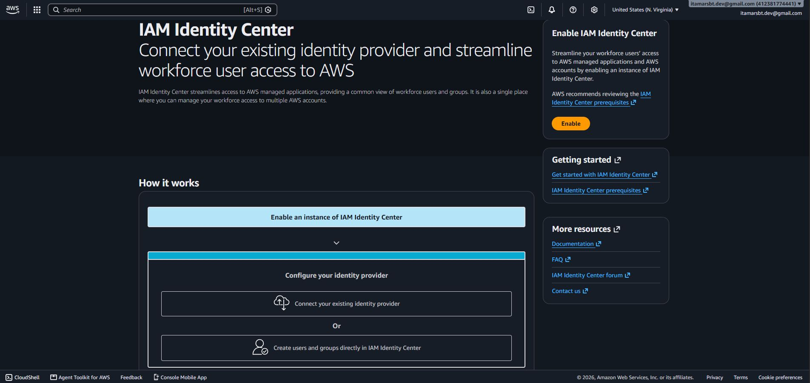

- [X] Examinar a autenticação do EC2 baseada em funções IAM

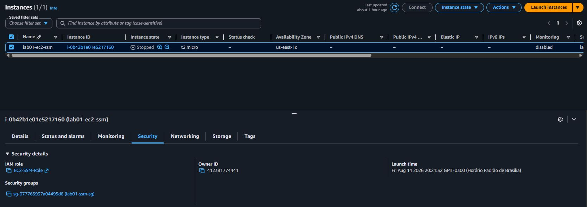

- [X] Compreender as diferenças entre políticas de confiança e de permissões

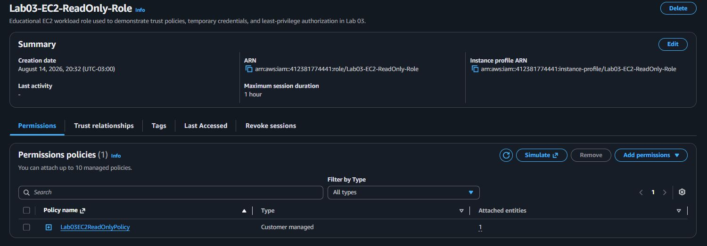

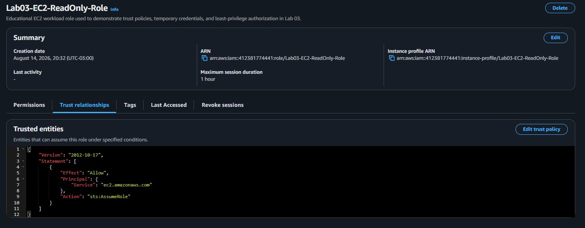

- [X] Criar uma política gerenciada pelo cliente com privilégio mínimo

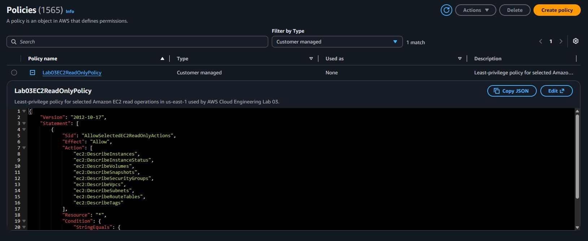

- [X] Criar uma função IAM dedicada ao EC2

### Documentação do laboratório

Laboratório manual: [Lab 03 — Funções e políticas do IAM](labs/03-iam-roles-and-policies/README.pt-BR.md)

Laboratório Terraform: ainda não disponível.

## Lab 04 — Volumes e snapshots do EBS

* [ ] Criar volume EBS
* [ ] Anexar o volume
* [ ] Criar snapshot
* [ ] Restaurar snapshot

## Lab 05 — VPC com sub-rede pública

* [ ] Criar VPC
* [ ] Criar sub-rede pública
* [ ] Configurar Internet Gateway
* [ ] Configurar tabelas de roteamento

## Lab 06 — VPC com sub-rede privada e NAT Gateway

* [ ] Criar sub-rede privada
* [ ] Configurar NAT Gateway
* [ ] Validar acesso à internet
* [ ] Testar a segurança da arquitetura

---

# Fase 2 — Contêineres

## Lab 07 — Instalação do Docker no EC2

* [ ] Instalar o Docker
* [ ] Executar o primeiro contêiner
* [ ] Gerenciar o ciclo de vida dos contêineres
* [ ] Aplicar boas práticas de segurança

## Lab 08 — Aplicação com Docker Compose

* [ ] Implantar aplicação com múltiplos contêineres
* [ ] Configurar redes
* [ ] Configurar volumes
* [ ] Garantir a persistência dos dados

## Lab 09 — Proxy reverso com NGINX

* [ ] Instalar o NGINX
* [ ] Configurar proxy reverso
* [ ] Testar o roteamento HTTP
* [ ] Validar o acesso à aplicação

---

# Fase 3 — Bancos de dados e armazenamento

## Lab 10 — Amazon RDS com PostgreSQL

* [ ] Implantar PostgreSQL
* [ ] Configurar grupos de segurança
* [ ] Estabelecer conexão a partir do EC2
* [ ] Executar consultas SQL

## Lab 11 — Hospedagem de site estático no Amazon S3

* [ ] Criar bucket
* [ ] Habilitar hospedagem estática
* [ ] Enviar os arquivos do site
* [ ] Configurar acesso público

## Lab 12 — Estratégia de backup na AWS

* [ ] Definir política de backup
* [ ] Fazer backup do EBS
* [ ] Fazer backup do RDS
* [ ] Testar a recuperação

---

# Fase 4 — Observabilidade

## Lab 13 — Logs no CloudWatch

* [ ] Criar grupos de logs
* [ ] Coletar logs da aplicação
* [ ] Consultar logs
* [ ] Analisar eventos

## Lab 14 — Métricas no CloudWatch

* [ ] Analisar métricas
* [ ] Criar dashboards
* [ ] Monitorar recursos
* [ ] Configurar métricas personalizadas

## Lab 15 — Alarmes no CloudWatch

* [ ] Criar alarme de CPU
* [ ] Criar alarme de memória
* [ ] Configurar notificações
* [ ] Testar alertas

## Lab 16 — Notificações com SNS

* [ ] Criar tópico SNS
* [ ] Configurar notificações por e-mail
* [ ] Integrar ao CloudWatch
* [ ] Validar o recebimento dos alertas

---

# Fase 5 — Serviços de contêineres

## Lab 17 — Amazon ECR

* [ ] Criar repositório
* [ ] Construir imagem Docker
* [ ] Enviar imagem ao registro
* [ ] Baixar imagem do registro

## Lab 18 — Amazon ECS Fargate

* [ ] Criar cluster ECS
* [ ] Configurar Fargate
* [ ] Implantar contêiner
* [ ] Validar o serviço

## Lab 19 — Gerenciamento de serviços ECS

* [ ] Criar serviço ECS
* [ ] Configurar a quantidade desejada de tarefas
* [ ] Testar disponibilidade
* [ ] Examinar logs

## Lab 20 — Application Load Balancer

* [ ] Criar balanceador de carga
* [ ] Configurar grupo de destinos (*target group*)
* [ ] Realizar roteamento de tráfego
* [ ] Validar verificações de integridade (*health checks*)

---

# Fase 6 — Infraestrutura como Código

## Lab 21 — Implantação de EC2 com Terraform

* [ ] Instalar o Terraform
* [ ] Criar infraestrutura EC2
* [ ] Aplicar a configuração
* [ ] Destruir os recursos

## Lab 22 — Implantação de VPC com Terraform

* [ ] Escrever o código da VPC
* [ ] Implantar a rede
* [ ] Validar a infraestrutura
* [ ] Refatorar módulos

## Lab 23 — Implantação de ECS com Terraform

* [ ] Criar recursos ECS
* [ ] Implantar contêineres
* [ ] Validar a automação
* [ ] Reutilizar módulos

---

# Fase 7 — DevOps e CI/CD

## Lab 24 — Pipeline de build com GitHub Actions

* [ ] Criar workflow
* [ ] Construir a aplicação
* [ ] Validar o pipeline
* [ ] Examinar logs

## Lab 25 — Pipeline de implantação com GitHub Actions

* [ ] Configurar credenciais AWS
* [ ] Implantar a infraestrutura
* [ ] Validar a implantação
* [ ] Automatizar as publicações

## Lab 26 — Pipeline completo de CI/CD

* [ ] Construir a aplicação
* [ ] Executar testes
* [ ] Publicar artefato
* [ ] Implantar automaticamente
* [ ] Validar o fluxo de produção

---

## Progresso

**Laboratórios manuais documentados:** 03 / 26 (Labs 01–03).

**Próximo laboratório manual planejado:** Lab 04 — Volumes e snapshots do EBS. Seu diretório ainda não foi criado.

**Laboratórios Terraform marcados como concluídos:** 00 / 26. O [guia de preparação do Lab 00](terraform/00-workstation-and-aws-authentication/README.pt-BR.md) é um pré-requisito fora da sequência de 26 laboratórios. O [Lab 01 de Terraform](terraform/01-ec2-and-ssm/README.md) possui arquivos de configuração e documentação parcial; não há declaração de conclusão nem de execução na nuvem.

---

## 📈 Métricas do repositório

  

