# Lab 01 — Instância EC2 com acesso via SSM

**Idioma:** [English (principal)](README.md) | **Português (Brasil)**

## Visão geral

Este laboratório demonstra como implantar uma instância Amazon EC2 e acessá-la com segurança pelo AWS Systems Manager Session Manager, sem utilizar chaves SSH nem abrir portas de entrada para SSH.

O objetivo é aplicar boas práticas modernas de segurança na AWS e adquirir experiência prática com EC2, IAM e Systems Manager.

---

## Arquitetura

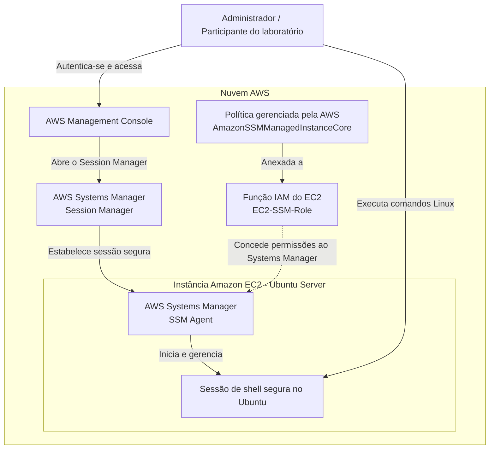

*Figura 1 — Arquitetura do Lab 01. O administrador acessa a instância EC2 com Ubuntu por meio do AWS Systems Manager Session Manager. O SSM Agent, executado na instância, estabelece a sessão gerenciada utilizando as permissões concedidas pela função `EC2-SSM-Role` e pela política `AmazonSSMManagedInstanceCore`.*

---

## Objetivos de aprendizagem

Ao concluir este laboratório, será possível:

* Criar uma instância EC2
* Configurar funções IAM
* Configurar o AWS Systems Manager
* Registrar um nó gerenciado (*managed node*)
* Acessar o Linux pelo Session Manager
* Validar a configuração do sistema
* Aplicar boas práticas de segurança na AWS

---

## Pré-requisitos

* Conta AWS
* Usuário IAM com a política `AdministratorAccess`
* Região AWS: `us-east-1`

> [!NOTE]
> Esta arquitetura não exige uma regra de entrada para SSH nem uma chave pública SSH.  
> O acesso administrativo é realizado por meio do AWS Systems Manager Session Manager.

---

# Tutorial passo a passo

## Etapa 1 — Criar função IAM

### Objetivo

Criar uma função IAM que permita à instância EC2 comunicar-se com segurança com o AWS Systems Manager (SSM).

Posteriormente, essa função será associada à instância EC2, permitindo o acesso via Session Manager sem chaves SSH e sem abertura de portas de entrada.

---

### Por que esta etapa é necessária

O AWS Systems Manager exige permissões para:

- Registrar a instância como nó gerenciado
- Estabelecer conexões do Session Manager
- Recuperar dados de configuração
- Comunicar-se com segurança com os serviços do AWS Systems Manager

Sem uma função IAM, a instância EC2 não consegue se autenticar nas APIs da AWS.

Essa abordagem segue boas práticas de segurança ao utilizar credenciais temporárias em vez de chaves de acesso estáticas.

---

### Etapa 1.1 — Abrir o console do IAM

Acesse:

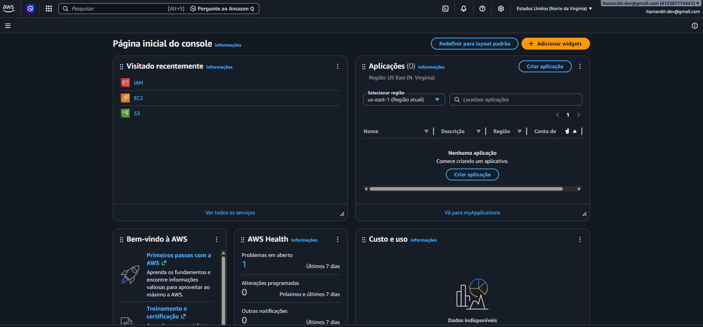

IAM → Roles (Funções)

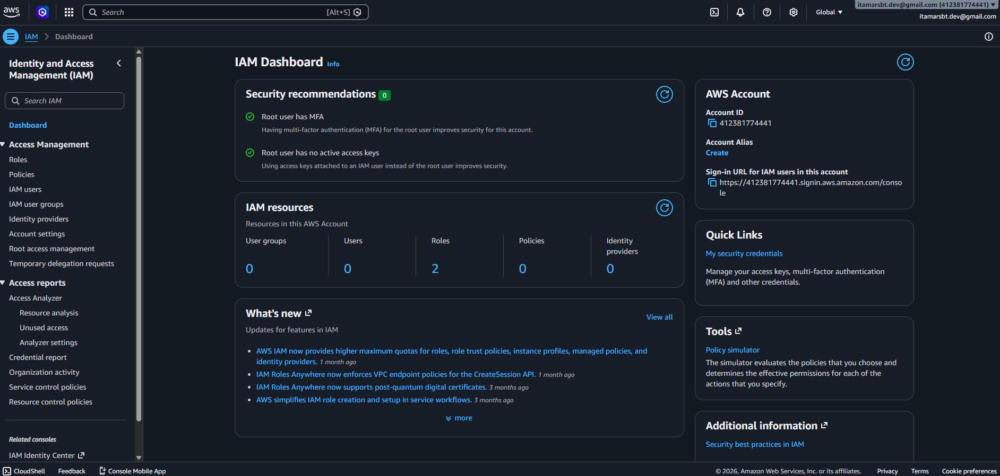

Clique em **Create role** (Criar função).

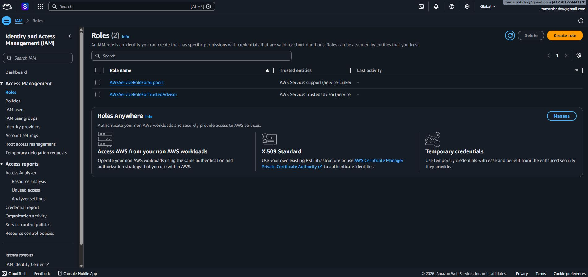

---

### Etapa 1.2 — Selecionar a entidade confiável

Selecione:

- Tipo de entidade confiável (*Trusted entity type*): AWS service

- Serviço: EC2

- Caso de uso: EC2

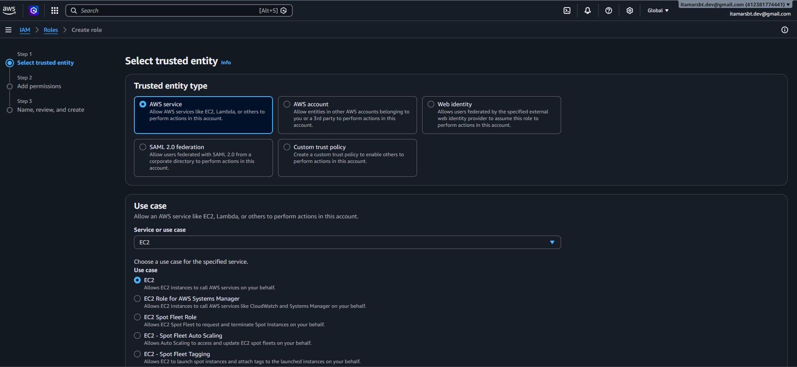

Clique em **Next** (Próximo).

---

### Por que selecionar o EC2

Essa configuração estabelece uma relação de confiança entre o Amazon EC2 e o IAM.

Ela permite que as instâncias EC2 assumam essa função e recebam credenciais temporárias automaticamente.

Não é necessário configurar nomes de usuário, senhas ou chaves de acesso para a instância.

---

Pesquise por:

```bash
AmazonSSMManagedInstanceCore
```

Selecione a política.

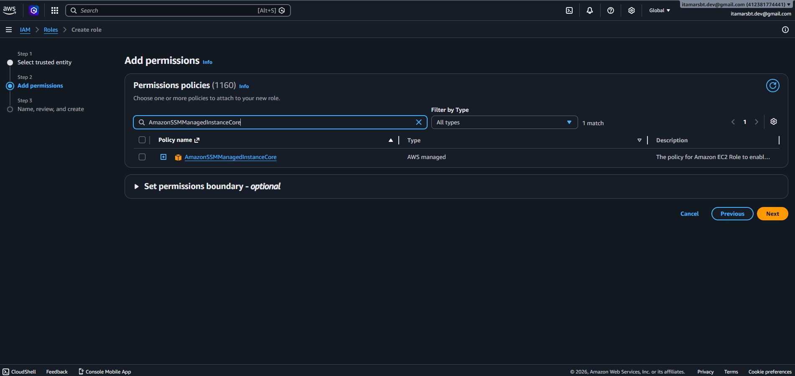

Clique em **Next** (Próximo).

A política `AmazonSSMManagedInstanceCore` concede as permissões básicas necessárias para:

- Session Manager
- Systems Manager Inventory
- Patch Manager
- Run Command
- Registro da instância gerenciada

Isso segue o princípio do privilégio mínimo.

Nome da função:

```bash
EC2-SSM-Role
```

Descrição:

```bash
Allows EC2 instances to communicate with AWS Systems Manager.
```

Revise:

- Entidade confiável: EC2
- Política: `AmazonSSMManagedInstanceCore`
- Nome da função: `EC2-SSM-Role`

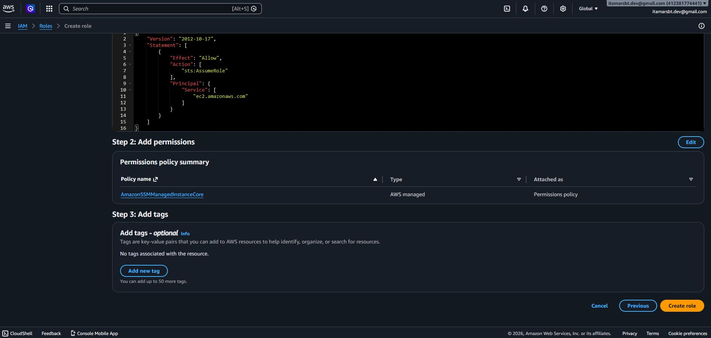

Clique em **Create role** (Criar função).

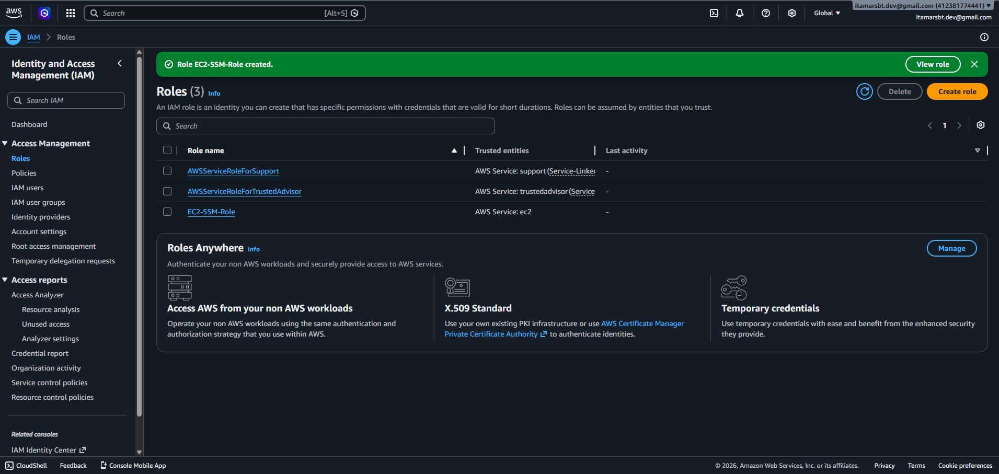

---

## Validação

Confirme que:

- O nome da função aparece no IAM.
- A política `AmazonSSMManagedInstanceCore` está anexada.
- A relação de confiança inclui o serviço EC2.

Resultado da validação:

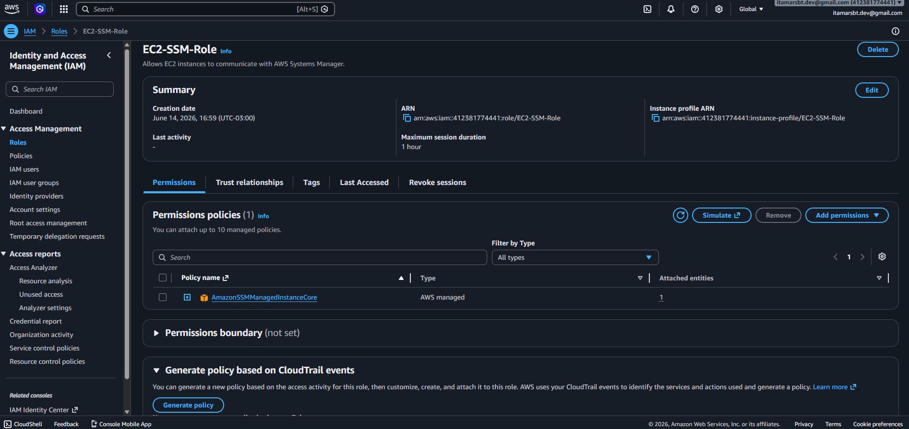

## Boas práticas da AWS aplicadas

✔ Uso de função IAM em vez de chaves de acesso

✔ Credenciais temporárias da AWS

✔ Princípio do privilégio mínimo

✔ Integração nativa com o AWS Systems Manager

✔ Ausência de segredos inseridos diretamente no código

## Principais aprendizados

Uma função IAM é o mecanismo preferencial para conceder permissões aos recursos da AWS.

Em vez de inserir credenciais diretamente nos servidores, a AWS fornece automaticamente credenciais temporárias pelo Instance Metadata Service (IMDS).

Isso reduz significativamente a complexidade operacional e os riscos de segurança.

---

# Etapa 2 — Iniciar instância EC2

## Objetivo

Nesta etapa, uma instância Amazon EC2 com Ubuntu Server 26.04 LTS é iniciada e associada à função IAM criada na Etapa 1.

Depois disso, a instância será administrada pelo AWS Systems Manager Session Manager, sem exigir acesso SSH.

---

## Arquitetura

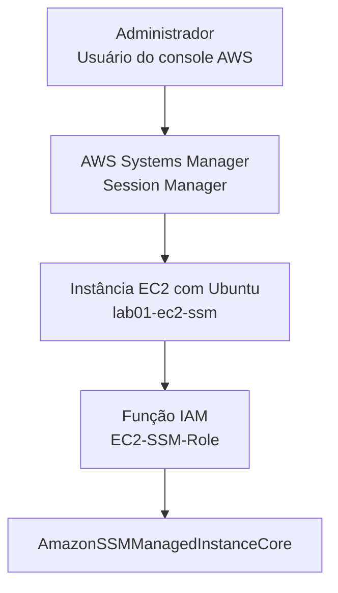

---

## Etapa 2.1 — Abrir o console do EC2

Acesse:

```Text
AWS Console
→ EC2
```

Clique em:

```Text
Launch Instance
```

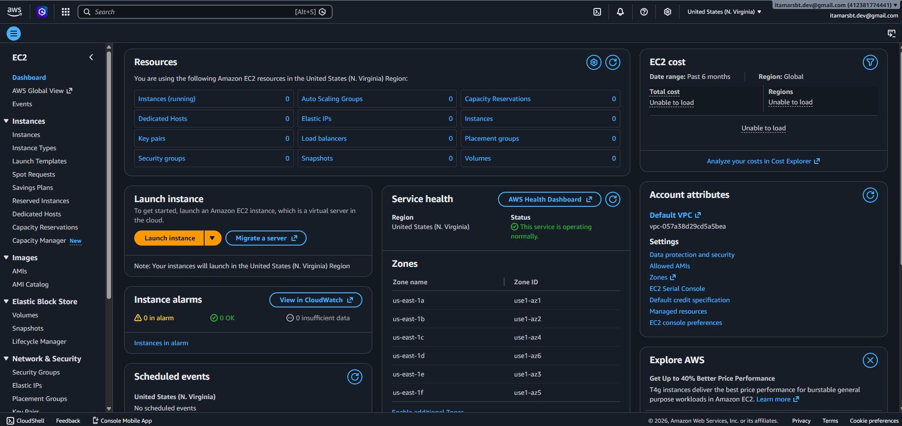

## Etapa 2.2 — Configurar o nome da instância

Na seção:

```Text
Name and tags
```

Informe:

```Text
lab01-ec2-ssm
```

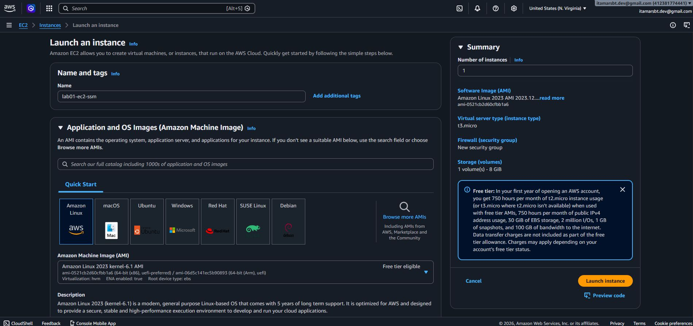

---

Por que a nomenclatura é importante

O uso de nomes descritivos facilita:

- Identificar os recursos
- Acompanhar os custos
- Investigar problemas nos ambientes
- Aplicar padrões de governança

---

## Etapa 2.3 — Selecionar a AMI do Ubuntu

Selecione:

```Text
Ubuntu Server 26.04 LTS
```

Arquitetura:

```Text
64-bit (x86)
```

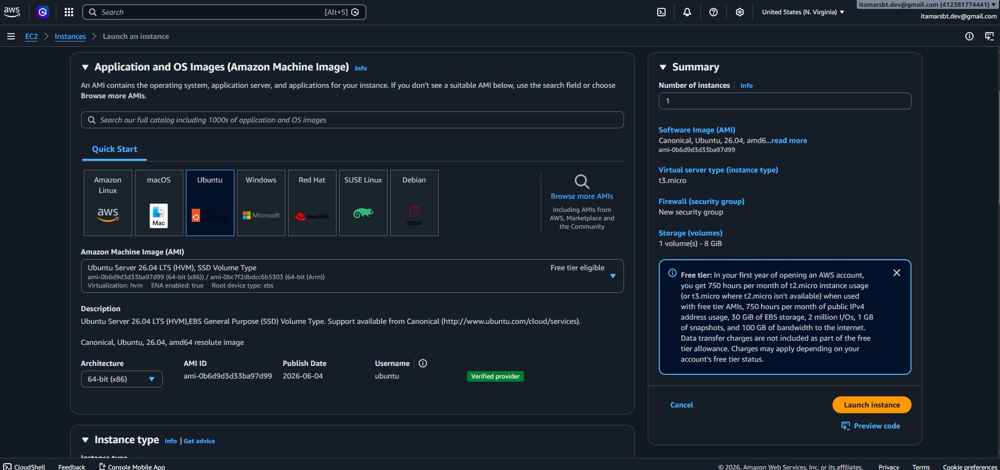

---

## Por que utilizar Ubuntu?

O Ubuntu é amplamente adotado em:

- Engenharia de Nuvem
- DevOps
- Engenharia de Plataformas
- SRE
- Desenvolvimento back-end

Ele também apresenta boa integração com:

- Docker
- Kubernetes
- FastAPI
- Prometheus
- Grafana
- OpenTelemetry

---

## Etapa 2.4 — Selecionar o tipo de instância

Selecione:

```Text
t2.micro
```

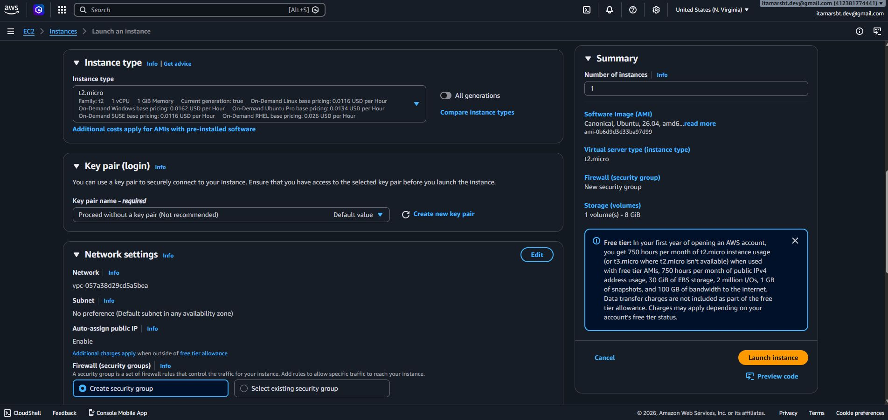

---

## Por que utilizar t2.micro?

Este laboratório precisa apenas de:

- Ubuntu Linux
- SSM Agent
- AWS Systems Manager

Uma instância de pequeno porte é suficiente para esse objetivo.

---

## Etapa 2.5 — Não configurar par de chaves SSH

Na seção:

```Text
Key pair (login)
```

Selecione:

```Text
Proceed without a key pair
```


---

Por que não utilizar SSH?

A administração tradicional geralmente exige:

- Porta 22 aberta
- Gerenciamento de chaves SSH
- Hosts bastion

Neste laboratório, utiliza-se:

```Text
AWS Systems Manager Session Manager
```

Essa abordagem elimina a necessidade desses elementos.

Benefícios:

- Ausência de exposição do SSH
- Dispensa de gerenciamento de chaves SSH
- Melhoria da postura de segurança

---

## Etapa 2.6 — Configurar a rede

Mantenha:

```Text
Default VPC
Default Subnet
Auto Assign Public IP = Enable
```

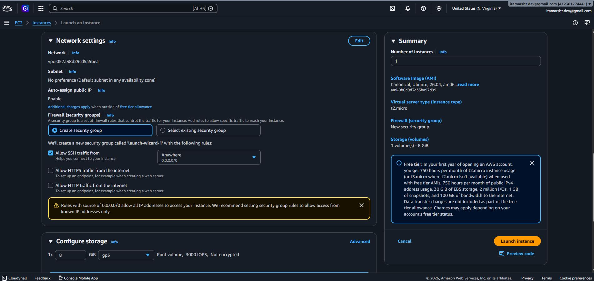

---

## Etapa 2.7 — Criar grupo de segurança

Crie um grupo de segurança (*Security Group*):

```Text
lab01-ssm-sg
```

Descrição:

```Text
Security Group for SSM managed instance
```

Remova:

```Text
Allow SSH traffic
```

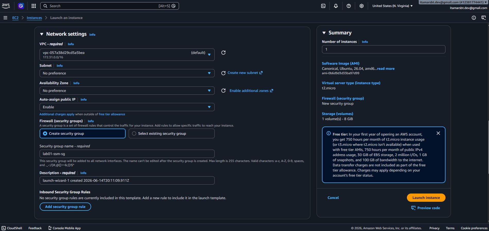

---

## Observação de segurança

Não são necessárias regras de entrada porque o acesso será realizado pelo Systems Manager.

Essa configuração atende ao princípio de redução da superfície de ataque.

Resultado:

```Text
Inbound Rules = 0
```

---

## Etapa 2.8 — Configurar o armazenamento

Mantenha:

```Text
8 GiB
gp3
```


---

## Etapa 2.9 — Associar a função IAM

Expanda:

```Text
Advanced Details
```

Selecione:

```Text
IAM Instance Profile:
EC2-SSM-Role
```

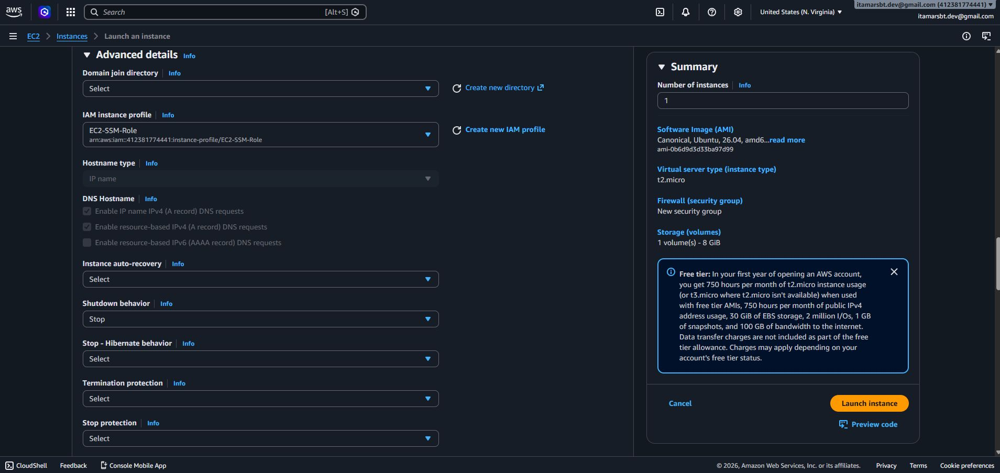

---

## Por que essa função é necessária

Essa função permite que a instância:

- Seja registrada no Systems Manager
- Receba comandos
- Abra conexões do Session Manager

Sem essa função, o SSM não funcionará conforme o procedimento deste laboratório.

---

## Etapa 2.10 — Iniciar a instância

Clique em:

```Text
Launch Instance
```

Resultado:

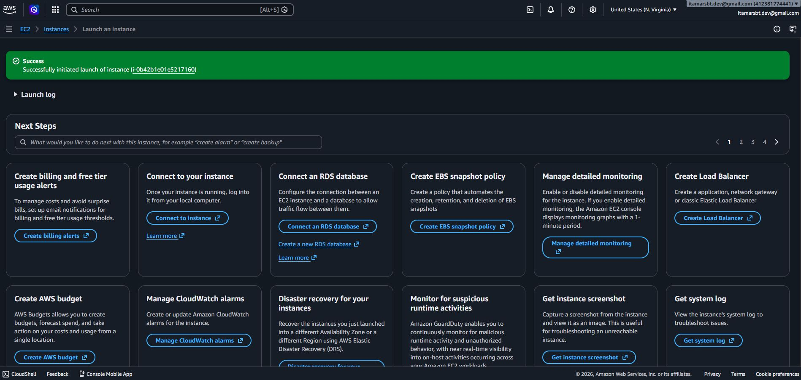

---

## Validação

Acesse:

```Text
EC2
→ Instances
```

Verifique:

```Text
Instance State = Running
Status Checks = 2/2 Passed
```

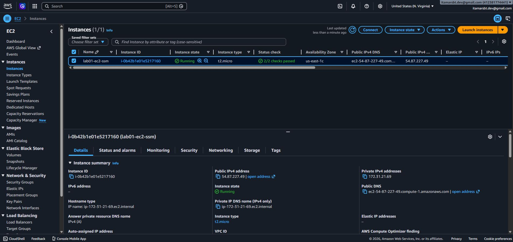

---

# Etapa 3 — Configurar o AWS Systems Manager

## Objetivo

Nesta etapa, é verificado se a instância EC2 criada na Etapa 2 foi registrada corretamente como nó gerenciado no AWS Systems Manager.

Isso confirma o funcionamento da função IAM, do SSM Agent, da conectividade de rede e da integração com o Systems Manager.

---

## Etapa 3.1 — Abrir o AWS Systems Manager

Acesse:

```text
AWS Console
→ Systems Manager
```

O AWS Systems Manager é utilizado para gerenciar, operar e acessar recursos de nuvem de maneira segura.

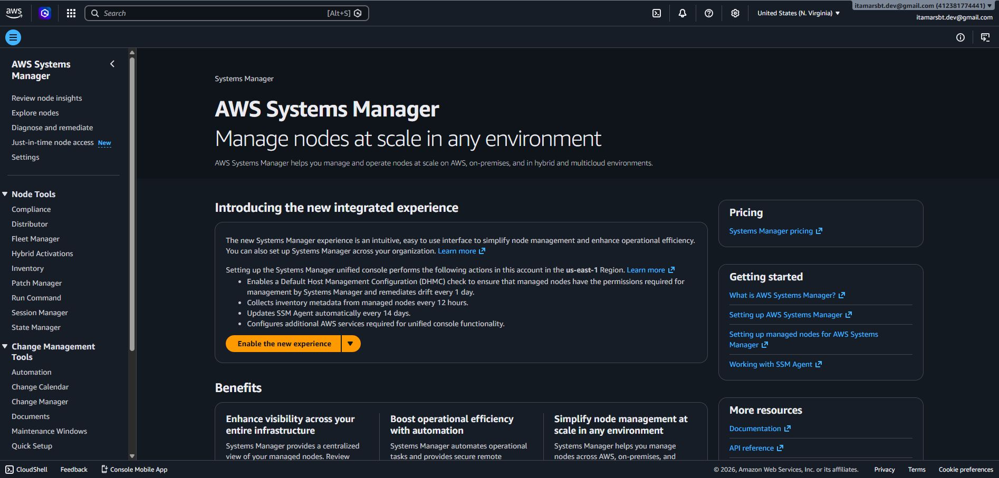

---

## Por que utilizar Systems Manager?

O AWS Systems Manager permite administrar instâncias EC2 sem expor diretamente o acesso administrativo pela rede.

Neste laboratório, o Systems Manager é necessário porque a conexão com a instância EC2 será feita pelo Session Manager, em vez de SSH.

Isso ajuda a reduzir a superfície de ataque ao evitar:

- Chaves SSH
- Portas de entrada SSH abertas
- Hosts bastion
- Exposição direta do acesso administrativo à internet

---

## Etapa 3.2 — Abrir o Fleet Manager

No menu lateral do Systems Manager, acesse:

```text
Node Tools
→ Fleet Manager
```

O Fleet Manager permite visualizar os nós gerenciados registrados no AWS Systems Manager.

---

## Etapa 3.3 — Validar o registro do nó gerenciado

No Fleet Manager, confirme que a instância EC2 aparece como nó gerenciado.

Nome esperado da instância:

```text
lab01-ec2-ssm
```

Estado esperado do nó:

```text
Running
```

Status de comunicação esperado:

```text
Online
```

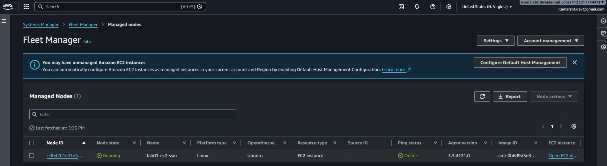

---

## O que essa validação significa

Se a instância aparece como `Online`, isso indica que:

- A instância EC2 está em execução;
- O SSM Agent está ativo;
- A função IAM está associada corretamente;
- A política `AmazonSSMManagedInstanceCore` está funcionando;
- A instância consegue se comunicar com o AWS Systems Manager.

Essa é uma validação essencial antes de tentar estabelecer uma conexão pelo Session Manager.

---

## Etapa 3.4 — Abrir os detalhes do nó gerenciado

Clique no nó gerenciado para examinar seus detalhes.

Valide as seguintes informações:

| Campo | Valor esperado |
| --- | --- |
| Nome | lab01-ec2-ssm |
| Tipo de plataforma | Linux |
| Sistema operacional | Ubuntu |
| Versão da plataforma | 26.04 |
| Estado do nó | Running |
| Status de comunicação | Online |
| Função da instância | EC2-SSM-Role |
| Versão do agente | 3.3.4121.0 |

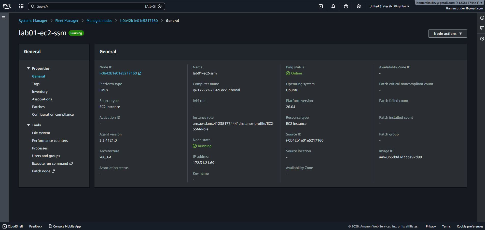

---

## Observação importante

A função IAM exibida no Systems Manager pode aparecer como um ARN de perfil de instância (*instance profile*).

Exemplo:

```text
arn:aws:iam::<account-id>:instance-profile/EC2-SSM-Role
```

Esse comportamento é esperado.

O perfil de instância IAM é o mecanismo utilizado pela AWS para associar uma função IAM a uma instância EC2.

---

# Etapa 4 — Conectar pelo Session Manager

## Objetivo

Nesta última etapa, a conexão com a instância EC2 é estabelecida pelo AWS Systems Manager Session Manager.

Essa etapa valida que:

- A instância EC2 está em execução
- A função IAM está configurada corretamente
- O SSM Agent está operacional
- A conectividade do Session Manager está funcionando
- O acesso administrativo pode ser realizado sem SSH

---

## Etapa 4.1 — Abrir o console do EC2

Acesse:

```text
AWS Console
→ EC2
→ Instances
```

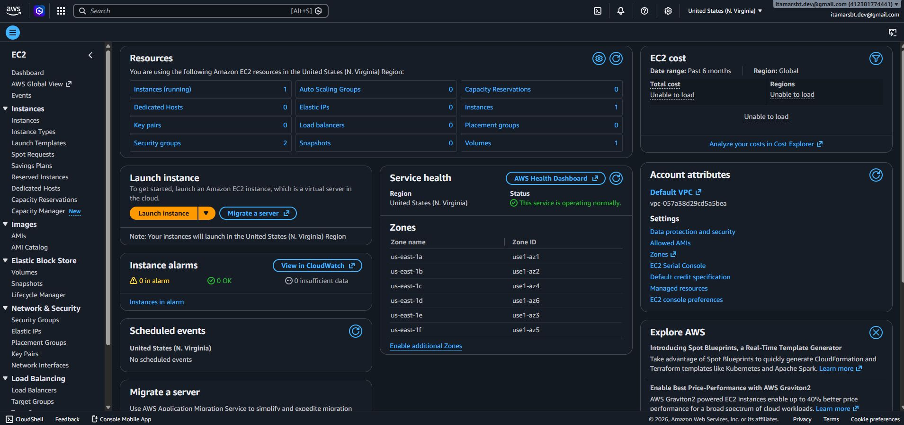

Selecione a instância criada neste laboratório:

```text
lab01-ec2-ssm
```

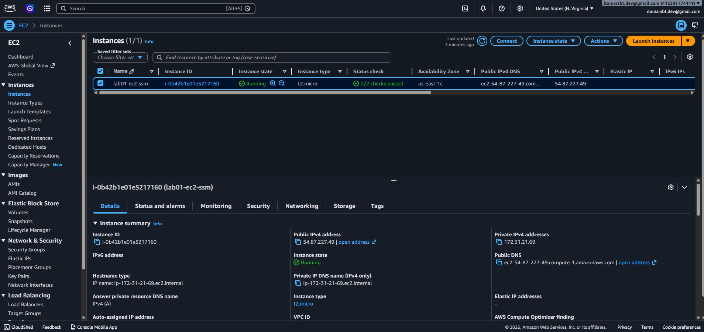

---

## Etapa 4.3 — Analisar os métodos de conexão disponíveis

A aba exibida por padrão costuma ser:

```text
EC2 Instance Connect
```

Esse método exige acesso direto pela rede à instância.

O objetivo deste laboratório é diferente.

A conexão deve ser realizada sem:

- Chaves SSH
- Hosts bastion
- Portas de entrada abertas
- Acesso administrativo público direto

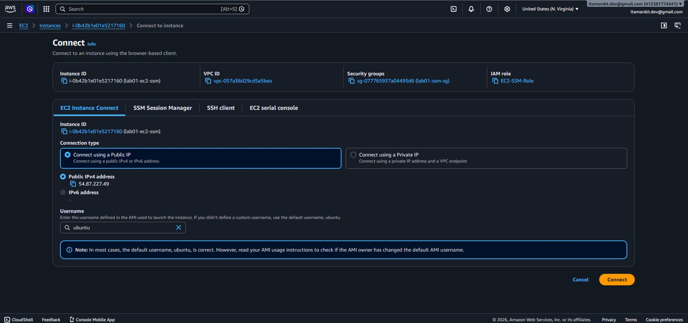

---

## Etapa 4.4 — Selecionar SSM Session Manager

Selecione a aba:

```text
SSM Session Manager
```

Verifique os seguintes indicadores:

- Status de comunicação (*Ping Status*): `Online`
- Status do Session Manager: `Connected`
- Versão do agente (*Agent Version*): `Available`

Esses indicadores confirmam que a instância está pronta para receber sessões do Systems Manager.

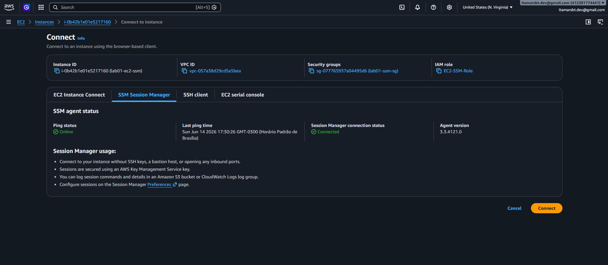

---

## Etapa 4.5 — Iniciar uma sessão

Clique em:

```text
Connect
```

A AWS abrirá uma sessão de shell no navegador diretamente pelo console.

Não é necessário utilizar par de chaves SSH.

Não é necessária nenhuma regra de entrada no grupo de segurança.

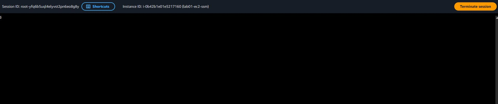

---

## Etapa 4.6 — Validar o acesso à instância

Execute os seguintes comandos:

```text
whoami
```
```text
hostname
```
```text
uname -a
```
```text
df -h
```
```text
free -m
```
```text
uptime
```

Esses comandos permitem validar:

✔ Identidade do usuário

✔ Nome do host

✔ Sistema operacional

✔ Utilização do disco

✔ Utilização da memória

✔ Tempo de atividade do sistema

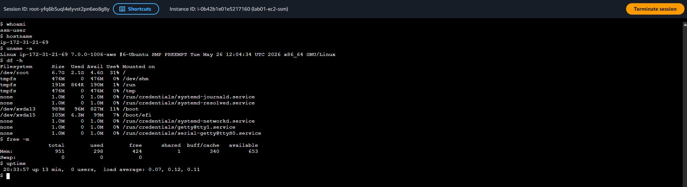

---

## Explicação dos comandos

### Usuário atual

```text
whoami
```

Saída esperada:

```text
ssm-user
```

O Session Manager cria automaticamente uma sessão de usuário gerenciada.

### Nome do host

```text
hostname
```

Exibe o nome interno do host da instância EC2.

### Informações do kernel

```text
uname -a
```

Exibe:

- Versão do kernel Linux
- Arquitetura
- Detalhes do sistema operacional

### Uso do disco

```text
df -h
```

Exibe a utilização dos sistemas de arquivos.

Verificação importante:

```text
/dev/root
```

Deve estar montado corretamente.

### Uso da memória

```text
free -m
```

Exibe o consumo de memória RAM.

Para uma instância t2.micro, espera-se aproximadamente:

```text
1 GB RAM
```

### Tempo de atividade do sistema

```text
uptime
```

Exibe:

- Tempo de funcionamento
- Média atual de carga (*load average*)

---

## Etapa 4.7 — Validar as informações do sistema operacional

Execute:

```text
cat /etc/os-release
```

Saída esperada:

```text
Ubuntu 26.04 LTS
```

Isso confirma o sistema operacional selecionado durante a criação da instância.

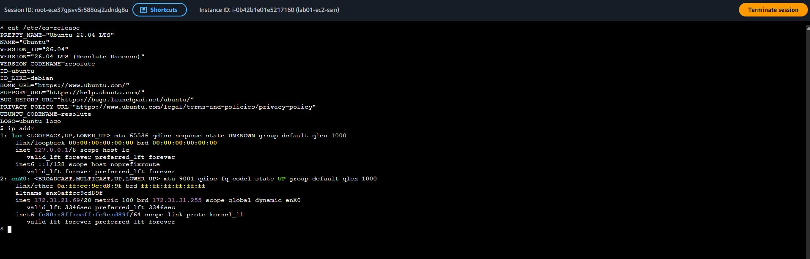

---

## Etapa 4.8 — Validar a configuração de rede

Execute:

```text
ip addr
```

O comando exibe:

- Interfaces de rede
- Endereço IPv4 privado
- Estado das interfaces

O endereço IP privado deve corresponder ao informado no console do EC2.


---

## Etapa 4.9 — Encerrar a sessão

Após concluir as verificações, encerre a sessão de shell.

É possível usar:

```exit
exit
```

ou clicar em:

```exit
Terminate Session
```

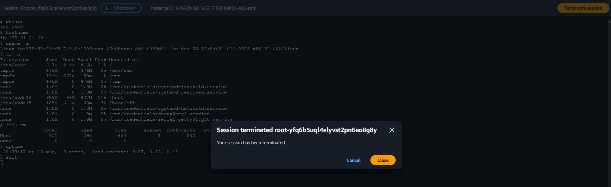

---

## Etapa 4.10 — Parar a instância EC2

Para evitar cobranças desnecessárias na AWS, selecione a instância e a opção:

```exit
Instance State
→ Stop Instance
```

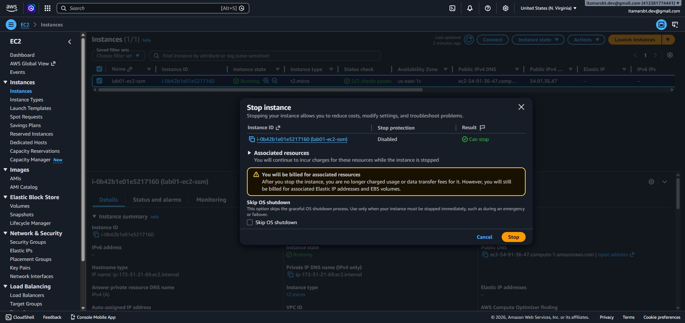

---

## Etapa 4.11 — Confirmar que a instância está parada

Aguarde até que a instância apresente o estado:

```text
Stopped
```

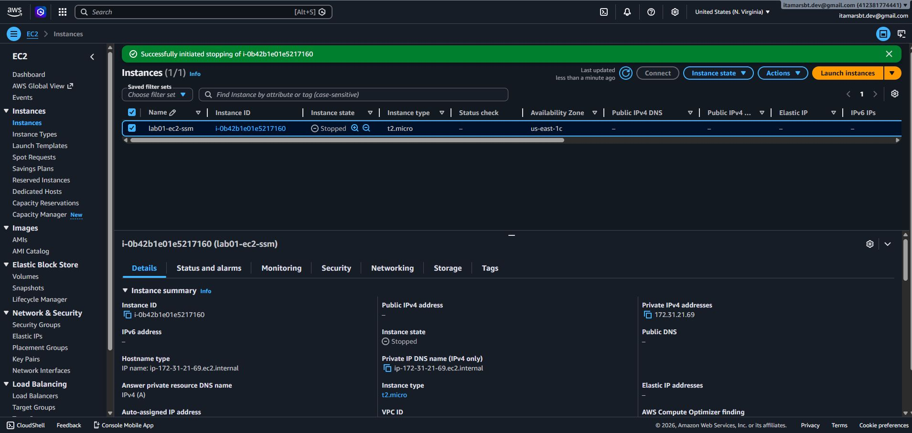

---

## Por que parar a instância?

Parar a instância ajuda a evitar custos desnecessários de computação.

Embora os custos de armazenamento do EBS ainda sejam cobrados, a interrupção evita a cobrança horária de computação da instância EC2.

Essa é uma prática recomendada para ambientes de aprendizagem.

---

## Benefícios de segurança do Session Manager

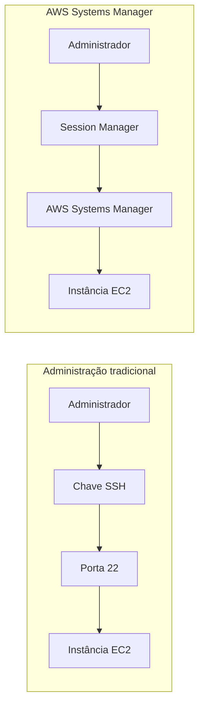

### Vantagens

✔ Dispensa de chaves SSH

✔ Ausência de portas SSH abertas para entrada

✔ Controle de acesso centralizado

✔ Permissões baseadas no IAM

✔ Auditoria de sessões

✔ Redução da superfície de ataque

---

## Laboratório concluído

Parabéns!

Uma instância EC2 foi implantada e administrada com sucesso pelo AWS Systems Manager Session Manager.

Neste laboratório, foram abordados:

- Funções IAM
- Perfis de instância
- Processo de inicialização do EC2
- AWS Systems Manager
- Fleet Manager
- Session Manager
- Nós gerenciados
- Administração pelo navegador
- Acesso seguro sem SSH

Essa arquitetura exemplifica uma prática moderna de operação na AWS para administrar instâncias EC2 com segurança.

---

Dúvidas, problemas ou sugestões sobre o tutorial podem ser enviados para itamarsbt@gmail.com ou itamarsbt.dev@gmail.com.

Obrigado!

---

## Considerações para ambientes de produção

Para simplificar o procedimento, a aplicação de etiquetas (*tags*) aos recursos foi intencionalmente omitida neste laboratório.

Em ambientes de produção, recomenda-se aplicar etiquetas a todos os recursos AWS para apoiar:

- Alocação de custos
- Governança
- Identificação dos responsáveis pelos recursos
- Automação
- Conformidade

## Por que utilizar Session Manager em vez de SSH?

Este laboratório evita intencionalmente o acesso SSH e adota um modelo moderno de operação na AWS, baseado no Systems Manager Session Manager.

Entre os benefícios estão:

- Ausência de gerenciamento de chaves SSH
- Ausência de portas SSH abertas para entrada
- Redução da superfície de ataque
- Controle de acesso centralizado por meio do IAM
- Melhoria da auditoria e da governança

O SSH continua sendo um método importante e amplamente utilizado para administração de sistemas, mas o Session Manager oferece uma alternativa moderna, frequentemente adotada em ambientes AWS.

O Session Manager foi escolhido por dispensar a exposição da porta 22, reduzir a necessidade de gerenciar chaves SSH, integrar-se ao IAM e melhorar a rastreabilidade dos acessos. Entretanto, o SSH continua sendo amplamente utilizado e necessário em diferentes cenários, inclusive fora do ecossistema AWS, como em ambientes Azure e GCP.
