# Lab 02 — Monitoramento moderno de EC2 com Amazon CloudWatch Agent

**Idioma:** [English (principal)](README.md) | **Português (Brasil)**


## Objetivos de aprendizagem

Ao concluir este laboratório, será possível:

- Reutilizar uma instância EC2 existente
- Instalar o Amazon CloudWatch Agent
- Configurar o agente por meio de um arquivo JSON
- Coletar métricas de memória
- Coletar métricas de disco
- Enviar métricas personalizadas ao Amazon CloudWatch
- Criar um dashboard no CloudWatch
- Validar as métricas coletadas

## Serviços AWS

```text
| Serviço             | Finalidade                               |
| ------------------- | ------------------------------------- |
| Amazon EC2          | Máquina virtual Linux                 |
| AWS Systems Manager | Acesso seguro ao shell (Session Manager) |
| Amazon CloudWatch   | Métricas e dashboard                 |
| IAM                 | Permissões para o CloudWatch Agent      |
```


---

## Arquitetura

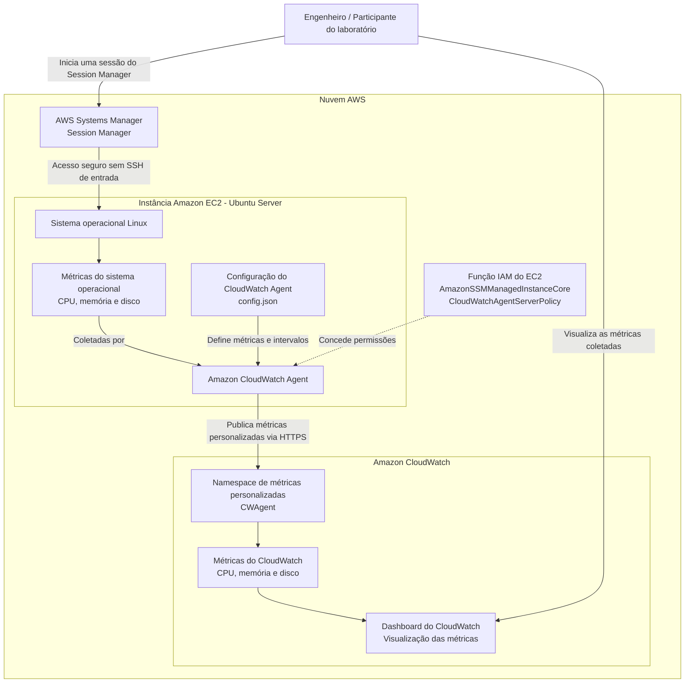

*Figura 1 — Arquitetura do Lab 02. A instância EC2 é acessada com segurança pelo AWS Systems Manager Session Manager. O CloudWatch Agent coleta métricas do sistema operacional conforme a configuração do arquivo `config.json` e as publica no namespace `CWAgent` do Amazon CloudWatch.*


---

### Tempo estimado

```text
25–30 minutos
```

---

### Custo estimado
```text
Elegível ao Free Tier

t2.micro

Métricas personalizadas do CloudWatch
≈ alguns centavos durante o laboratório
```

---


## Pré-requisitos

Antes de iniciar este laboratório, é necessário ter concluído:

- ✅ Lab 01 — EC2 com Session Manager
- Uma instância EC2 com Ubuntu já criada
- Uma função IAM com a política:

```text
AmazonSSMManagedInstanceCore
```
e também com:
```text
CloudWatchAgentServerPolicy
```

A instância utilizada é a mesma criada no Lab 01.


### Políticas IAM necessárias

| Política | Finalidade |
|---------|----------|
| AmazonSSMManagedInstanceCore | Permite o acesso pelo Session Manager |
| CloudWatchAgentServerPolicy | Permite ao CloudWatch Agent publicar métricas e logs |


### Antes

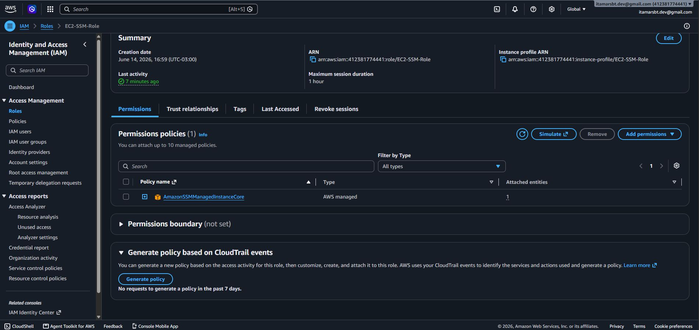

Apenas uma política estava anexada.

❌ A política `CloudWatchAgentServerPolicy` estava ausente.

---

### Depois

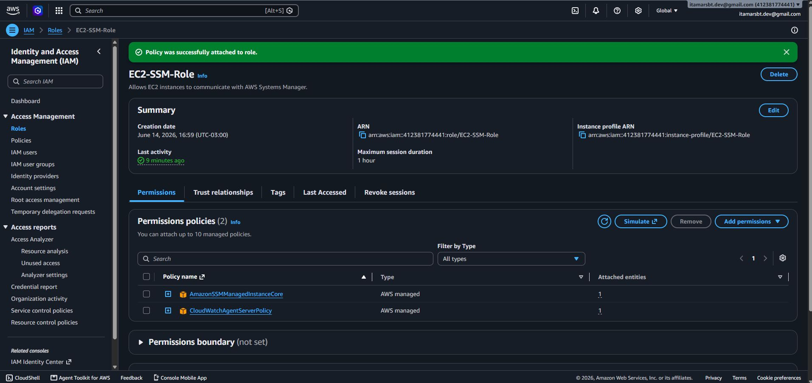

Ambas as políticas foram anexadas.

✅ Pronto para continuar.

---

## Etapa 1 — Iniciar a instância EC2

Inicie a instância EC2 criada durante o Lab 01.

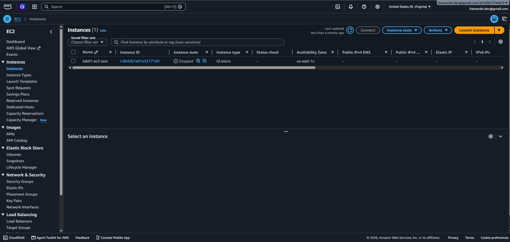

Em seguida:

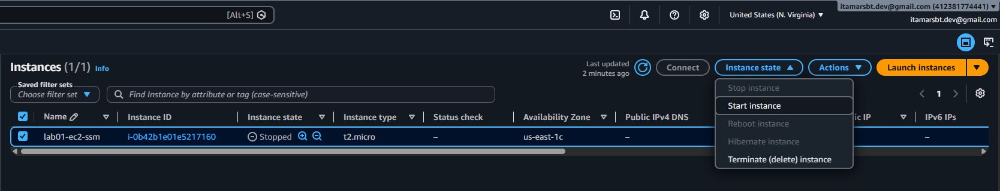

Estado esperado:

```text
Running
```

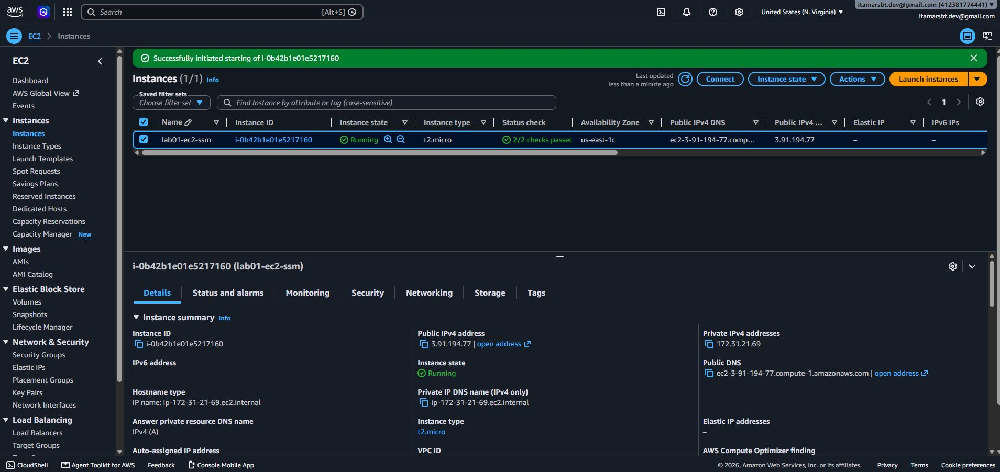

---

## Etapa 2 — Conectar pelo Session Manager

```text
EC2

↓

Instance

↓

Connect

↓

Session Manager

↓

Connect
```

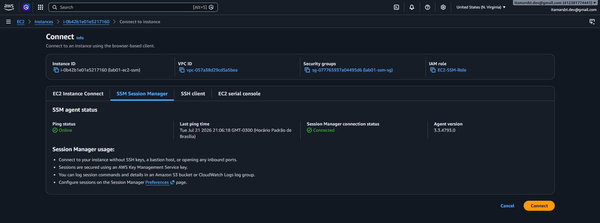


---

## Etapa 3 — Atualizar o Ubuntu

Execute:

```text
sudo apt update
```

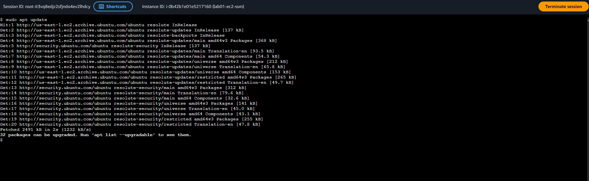


---

## Etapa 4 — Baixar o CloudWatch Agent

Em vez de tentar instalar o agente pelo `apt`, utilize o pacote oficial da AWS, conforme o procedimento documentado para o Ubuntu:

```text
cd /tmp

wget https://amazoncloudwatch-agent.s3.amazonaws.com/ubuntu/amd64/latest/amazon-cloudwatch-agent.deb
```

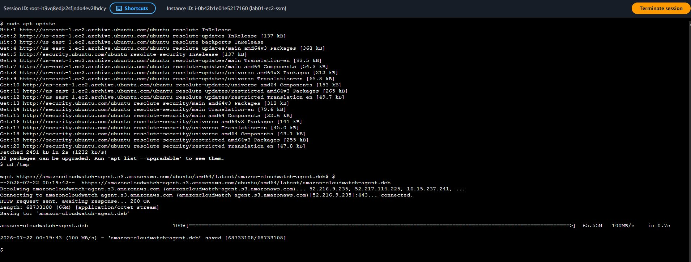

Verifique o arquivo baixado:

```text
ls -lh amazon-cloudwatch-agent.deb
```

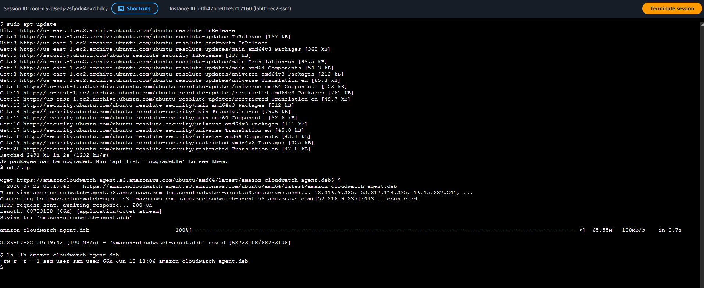


---

## Etapa 5 — Instalar o agente

Execute:

```text
sudo dpkg -i amazon-cloudwatch-agent.deb
```

Saída esperada:

```text
Setting up amazon-cloudwatch-agent...
```

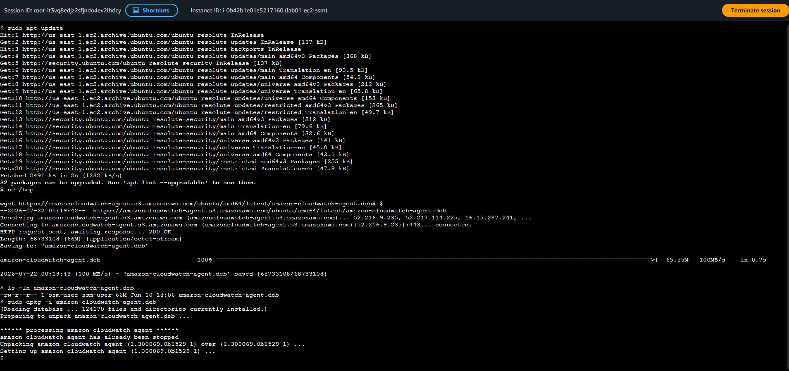


---

## Etapa 6 — Criar o arquivo de configuração

Crie manualmente o diretório de configuração:

```text
sudo mkdir -p /opt/aws/amazon-cloudwatch-agent/etc
```

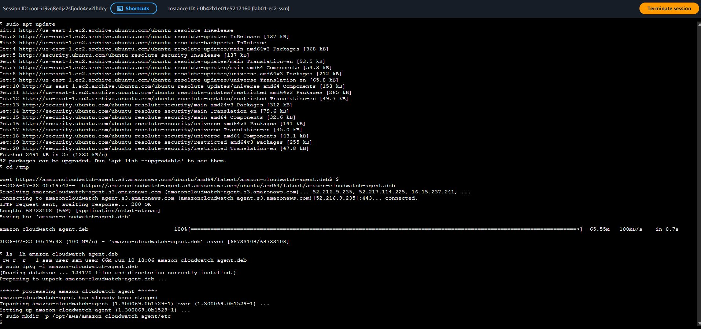


Abra o editor:
```text
sudo nano /opt/aws/amazon-cloudwatch-agent/etc/config.json
```

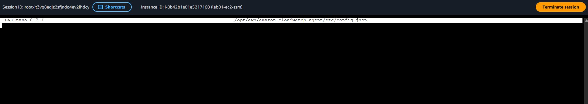


Insira o conteúdo JSON abaixo:

```JSON
{
  "agent": {
    "metrics_collection_interval": 60,
    "run_as_user": "root"
  },
  "metrics": {
    "append_dimensions": {
      "InstanceId": "${aws:InstanceId}"
    },
    "metrics_collected": {
      "mem": {
        "measurement": [
          "mem_used_percent"
        ]
      },
      "disk": {
        "measurement": [
          "used_percent"
        ],
        "resources": [
          "/"
        ]
      }
    }
  }
}
```

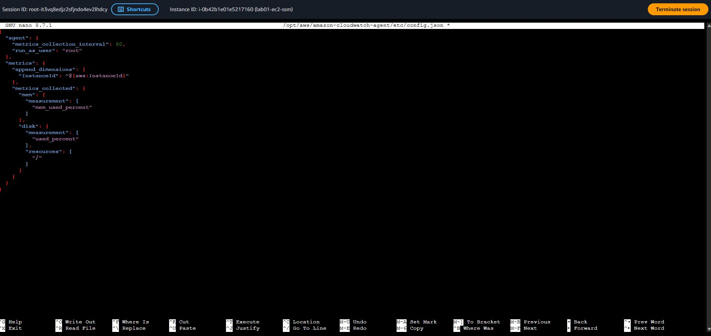


Salve o arquivo:

```text
CTRL + O

ENTER

CTRL + X
```

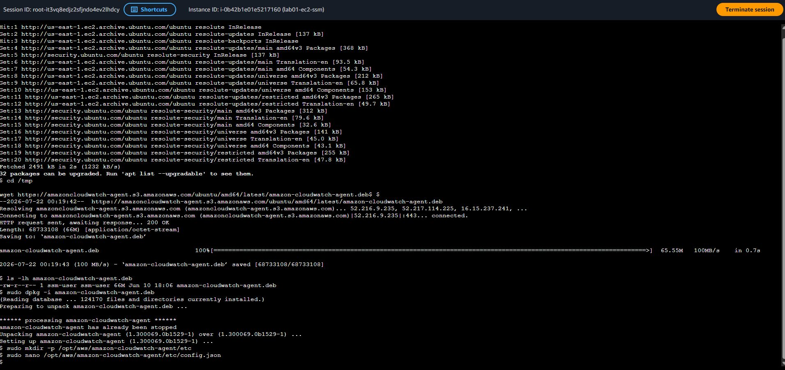


---

## Etapa 7 — Iniciar o agente

Execute:

```text
sudo /opt/aws/amazon-cloudwatch-agent/bin/amazon-cloudwatch-agent-ctl \
-a fetch-config \
-m ec2 \
-c file:/opt/aws/amazon-cloudwatch-agent/etc/config.json \
-s
```


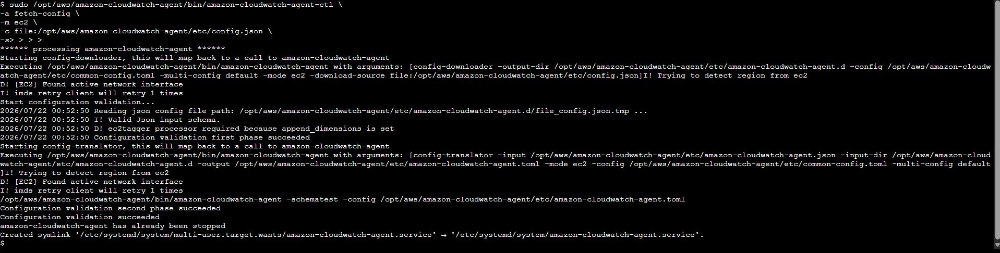


---

## Etapa 8 — Verificar o status do agente

Execute:

```text
sudo /opt/aws/amazon-cloudwatch-agent/bin/amazon-cloudwatch-agent-ctl \
-a status
```

Saída esperada:

```text
{
  "status":"running"
}
```

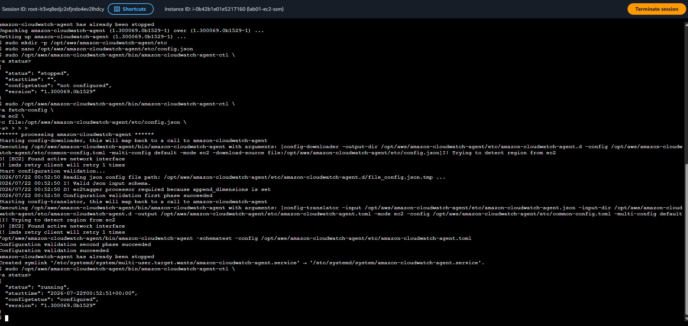


---

## Etapa 9 — Verificar as métricas

No console AWS, acesse:

```text
CloudWatch

↓

Metrics

↓

Classic metrics

↓

CWAgent
```

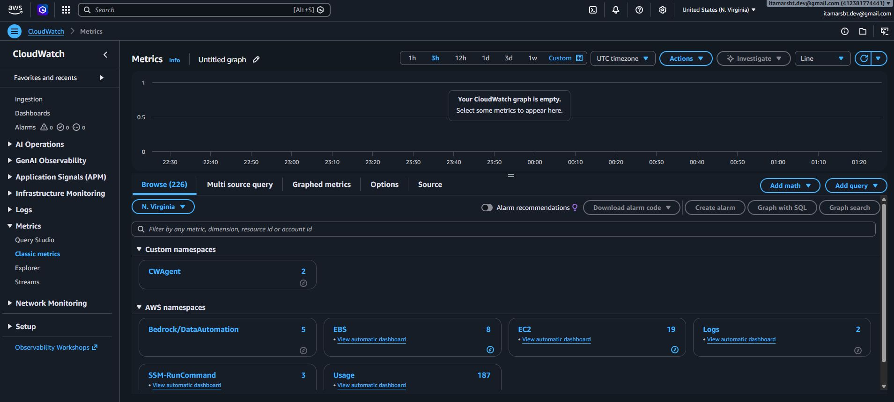

Verifique as métricas:

```text
mem_used_percent

disk_used_percent
```

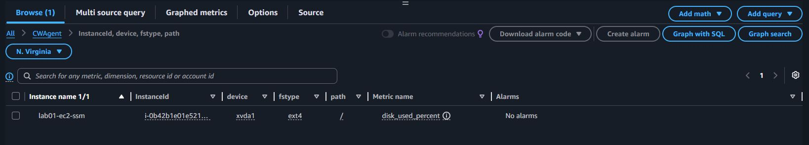

Em seguida:

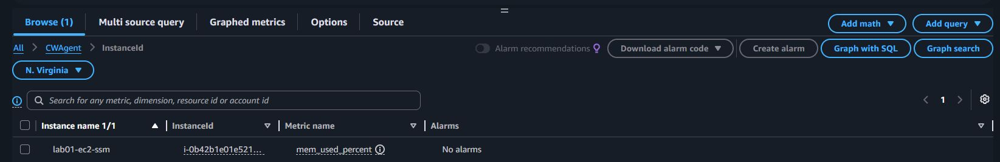


---


## Etapa 10 — Criar o dashboard

No console AWS, acesse:

```text
CloudWatch

↓

Dashboards

↓

Create Dashboard
```

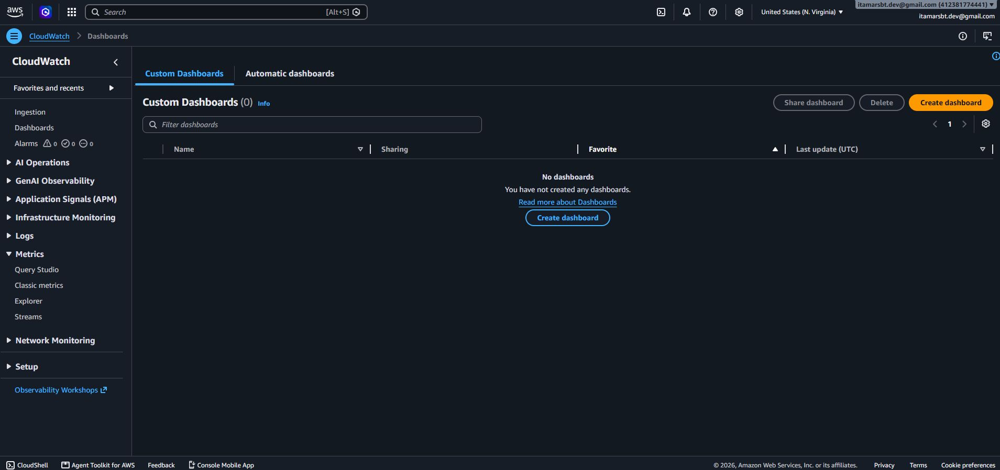


Nome sugerido:

```text
EC2_Monitoring_Dashboard
```

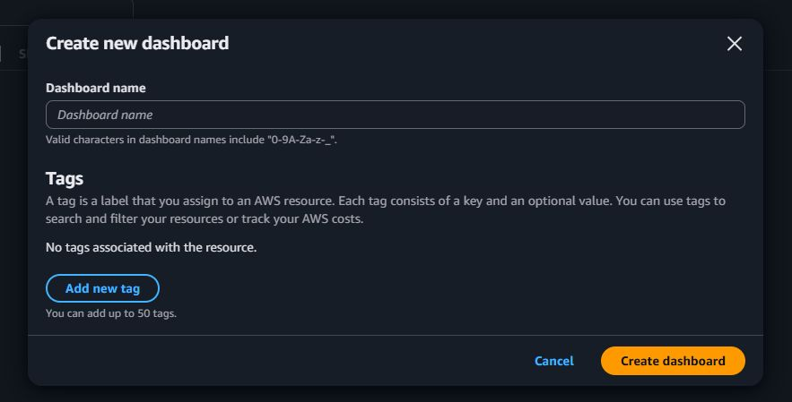


Na tela atual, mantenha as opções:

- Fonte de dados: CloudWatch (já selecionada)
- Tipo de dados: Metrics (já selecionado)
- Tipo de widget: Line (já selecionado)

Clique em:

```text
Next
```

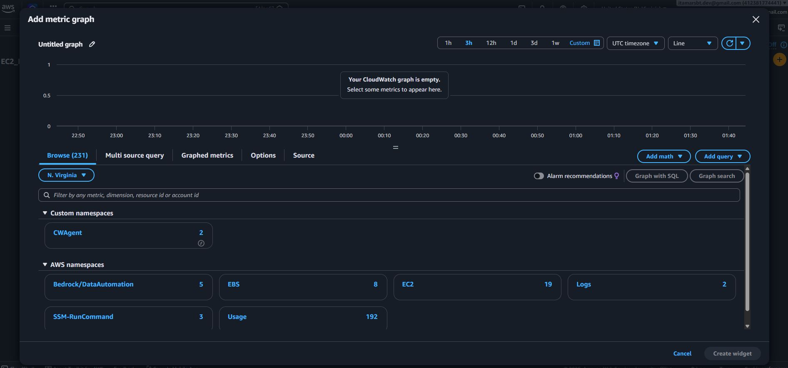

Selecione:

```text
EC2
```

Escolha a categoria:

```text
Per-Instance Metrics
```

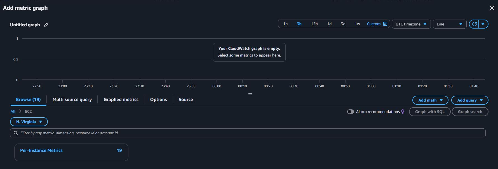


### Widget 1 — Utilização da CPU (%)

Na lista de métricas, procure por:

```text
CPUUtilization
```

Marque a caixa de seleção correspondente à instância (`lab01-ec2-ssm`).

O gráfico deverá aparecer imediatamente na parte superior da tela.

Depois, clique em:

```text
Create widget
```

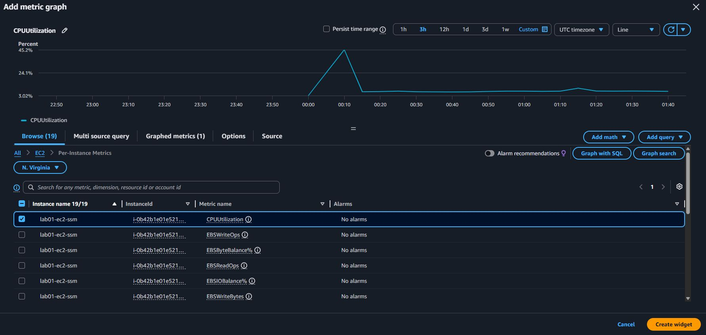


### Widget 2 — Utilização da memória (%)

Depois de criar o primeiro widget:

1. Clique novamente no botão **+** do dashboard.

2. Selecione **Metrics**.

3. Clique em **CWAgent**.

A tela deverá exibir duas categorias (indicadas pelo número "2" ao lado de CWAgent).

Selecione a segunda categoria.

Procure por:

```text
mem_used_percent
```

Selecione:

```text
Create widget
```

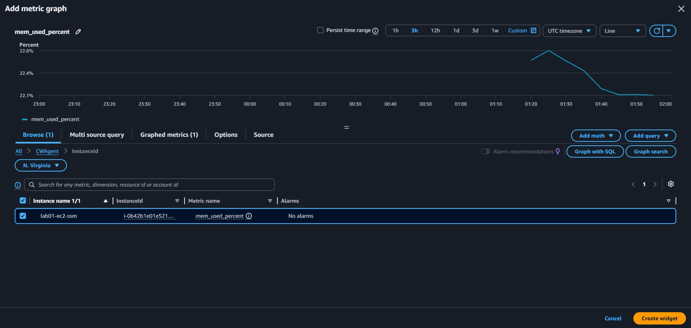


### Widget 3 — Utilização do disco (%)

Repita o procedimento:

```text
+
↓
Metrics
↓
CWAgent
```

Selecione a outra categoria.

Procure por:

```text
disk_used_percent
```

Selecione a métrica referente ao disco principal (`/`).

Selecione:

```text
Create widget
```

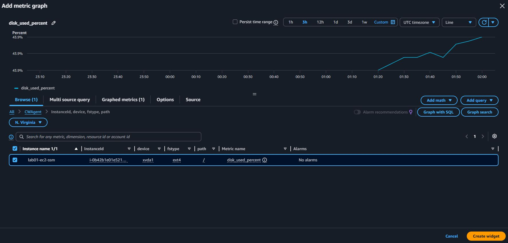


### Resultado final

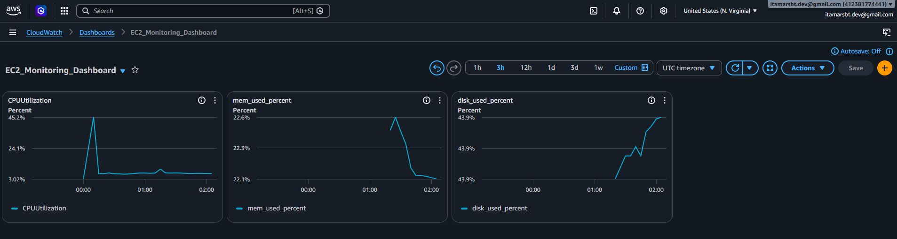


---


> [!TIP]
> **Lição aprendida**
>
> Durante a execução deste laboratório, o CloudWatch Agent foi instalado com sucesso, mas nenhuma métrica apareceu no CloudWatch.
>
> A causa identificada foi a ausência de uma política IAM:
>
> - CloudWatchAgentServerPolicy
>
> Após anexar essa política à função IAM da instância EC2, o agente começou a publicar as métricas.


---
---

## Considerações para ambientes de produção

Para simplificar o procedimento, a aplicação de etiquetas (*tags*) aos recursos foi intencionalmente omitida neste laboratório.

Em ambientes de produção, recomenda-se aplicar etiquetas aos recursos AWS para apoiar:
- Alocação de custos
- Governança
- Identificação dos responsáveis pelos recursos
- Automação
- Conformidade
