# Lab 03 — Identidade moderna na AWS, funções IAM e políticas de privilégio mínimo

> **AWS Cloud Engineering Lab — Implementação manual**

Este laboratório explora práticas modernas de gerenciamento de identidade e acesso na AWS, com foco em **credenciais temporárias**, **funções IAM**, **políticas de privilégio mínimo**, **identidades de cargas de trabalho** e no modelo atual de **acesso de colaboradores** da AWS.

A implementação evita intencionalmente a criação de usuários IAM, grupos de usuários IAM, chaves de acesso de longa duração ou credenciais permanentes como parte dos procedimentos.

Em vez disso, o laboratório utiliza a carga de trabalho EC2 já existente nos laboratórios anteriores para examinar o acesso baseado em funções. Também cria uma função IAM dedicada e uma política gerenciada pelo cliente para estudar relações de confiança, permissões, validação de políticas e comportamento da autorização.

---

## Sumário

- [Visão geral](#visão-geral)
- [Por que este laboratório utiliza um modelo moderno de identidade](#por-que-este-laboratório-utiliza-um-modelo-moderno-de-identidade)
- [Arquitetura](#arquitetura)
- [Objetivos de aprendizagem](#objetivos-de-aprendizagem)
- [Serviços e recursos da AWS](#serviços-e-recursos-da-aws)
- [Tempo estimado](#tempo-estimado)
- [Custo estimado](#custo-estimado)
- [Pré-requisitos](#pré-requisitos)
- [Conceitos fundamentais de identidade](#conceitos-fundamentais-de-identidade)
  - [Identidades humanas e de colaboradores](#identidades-humanas-e-de-colaboradores)
  - [Identidades de cargas de trabalho](#identidades-de-cargas-de-trabalho)
  - [Funções IAM](#funções-iam)
  - [Credenciais temporárias](#credenciais-temporárias)
  - [Políticas de confiança](#políticas-de-confiança)
  - [Políticas de permissões](#políticas-de-permissões)
  - [Usuários IAM](#usuários-iam)
  - [Privilégio mínimo](#privilégio-mínimo)
  - [IAM Access Analyzer](#iam-access-analyzer)
- [Recursos do laboratório](#recursos-do-laboratório)
- [Implementação passo a passo](#implementação-passo-a-passo)
  - [Etapa 1 — Analisar o modelo moderno de identidade da AWS](#etapa-1-analisar-o-modelo-moderno-de-identidade-da-aws)
  - [Etapa 2 — Inspecionar a função IAM existente da carga de trabalho EC2](#etapa-2-inspecionar-a-função-iam-existente-da-carga-de-trabalho-ec2)
  - [Etapa 3 — Verificar a identidade baseada em função a partir da instância EC2](#etapa-3-verificar-a-identidade-baseada-em-função-a-partir-da-instância-ec2)
  - [Etapa 4 — Criar uma política gerenciada pelo cliente com privilégio mínimo](#etapa-4-criar-uma-política-gerenciada-pelo-cliente-com-privilégio-mínimo)
  - [Etapa 5 — Validar a política com o IAM Access Analyzer](#etapa-5-validar-a-política-com-o-iam-access-analyzer)
  - [Etapa 6 — Criar uma função IAM dedicada ao EC2](#etapa-6-criar-uma-função-iam-dedicada-ao-ec2)
  - [Etapa 7 — Associar a política de privilégio mínimo à função](#etapa-7-associar-a-política-de-privilégio-mínimo-à-função)
  - [Etapa 8 — Avaliar ações permitidas e negadas](#etapa-8-avaliar-ações-permitidas-e-negadas)
  - [Etapa 9 — Comparar o acesso de pessoas e de cargas de trabalho](#etapa-9-comparar-o-acesso-de-pessoas-e-de-cargas-de-trabalho)
- [Validação](#validação)
- [Boas práticas de segurança aplicadas](#boas-práticas-de-segurança-aplicadas)
- [Limpeza dos recursos](#limpeza-dos-recursos)
- [Validação após a limpeza](#validação-após-a-limpeza)
- [Solução de problemas](#solução-de-problemas)
- [Principais aprendizados](#principais-aprendizados)
- [Estrutura do repositório](#estrutura-do-repositório)
- [Próximo laboratório](#próximo-laboratório)

---

# Visão geral

O AWS Identity and Access Management (**IAM**) fornece a base de autorização utilizada para controlar o acesso aos serviços e recursos da AWS.

O modelo moderno de identidade da AWS distingue duas grandes categorias:

```text
Human / Workforce Identities
        │
        ├── Federation
        ├── IAM Identity Center
        ├── Permission Sets / IAM Roles
        └── Temporary Credentials

Workload Identities
        │
        ├── IAM Roles
        ├── Trust Policies
        ├── Permissions Policies
        └── Temporary Credentials
```

Este laboratório concentra-se principalmente no **modelo de identidade de cargas de trabalho**, pois o repositório já contém uma instância EC2 que utiliza a função `EC2-SSM-Role` criada nos laboratórios anteriores.

Também é apresentado o modelo moderno de acesso humano na AWS, para que usuários IAM e credenciais de longa duração não sejam tratados como a arquitetura padrão de acesso dos colaboradores.

A implementação prática irá:

1. Inspecionar a função IAM existente do EC2.
2. Verificar que a carga de trabalho EC2 utiliza uma identidade baseada em função.
3. Criar uma política gerenciada pelo cliente com privilégio mínimo.
4. Validar a política utilizando o IAM Access Analyzer.
5. Criar uma função de serviço EC2 dedicada.
6. Associar a política à função.
7. Avaliar as ações que devem ser permitidas e negadas.
8. Comparar a identidade de carga de trabalho ao modelo moderno de acesso de colaboradores.

Não é necessário criar usuários IAM nem chaves de acesso.


---

# Por que este laboratório utiliza um modelo moderno de identidade

Tutoriais tradicionais de IAM costumam utilizar o seguinte modelo:

```text
IAM User
   │
   ▼
IAM Group
   │
   ▼
IAM Policy
   │
   ▼
AWS Resources
```

Os usuários e grupos IAM continuam sendo conceitos válidos na AWS e podem existir em ambientes legados ou casos de uso específicos.

Entretanto, **não são o modelo padrão preferencial para o acesso moderno de colaboradores**.

Para usuários humanos, os ambientes modernos da AWS geralmente utilizam:

```text
Human User
    │
    ▼
Identity Provider / IAM Identity Center
    │
    ▼
Permission Assignment
    │
    ▼
IAM Role
    │
    ▼
Temporary Credentials
    │
    ▼
AWS Resources
```

Para cargas de trabalho AWS, como o EC2:

```text
EC2 Instance
    │
    ▼
IAM Role
    │
    ▼
Temporary Credentials
    │
    ▼
AWS APIs
```

Assim, este laboratório apresenta os usuários IAM como um conceito importante, mas **não** cria um usuário IAM como parte central do aprendizado.

---

# Arquitetura

O diagrama a seguir representa os modelos de identidade estudados neste laboratório.

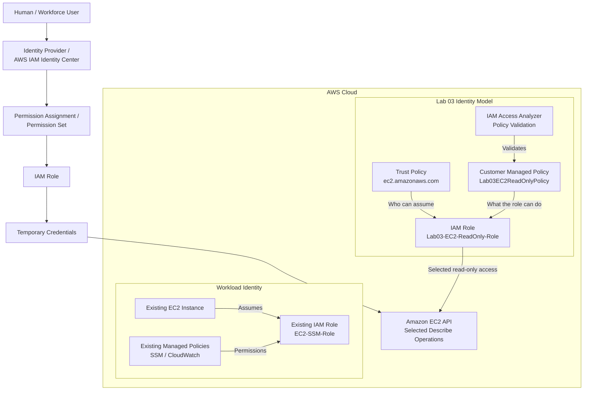

O laboratório aborda duas situações distintas de identidade:

### Acesso de colaboradores

```text
Human
  ↓
Federated Identity
  ↓
Role
  ↓
Temporary Credentials
```

### Acesso de cargas de trabalho

```text
AWS Workload
  ↓
IAM Role
  ↓
Temporary Credentials
```

O princípio de segurança comum é:

> Sempre que possível, dê preferência a credenciais temporárias e acesso baseado em funções em vez de credenciais estáticas de longa duração.

---

# Objetivos de aprendizagem

Ao concluir este laboratório, será possível:

- Explicar a diferença entre autenticação e autorização.
- Distinguir identidades humanas de identidades de cargas de trabalho.
- Explicar por que credenciais temporárias são preferíveis às de longa duração.
- Compreender a função do AWS IAM Identity Center no acesso moderno de colaboradores.
- Explicar por que funções IAM são preferíveis para cargas de trabalho na AWS.
- Compreender a relação entre perfis de instância EC2 e funções IAM.
- Explicar a diferença entre uma política de confiança e uma política de permissões.
- Criar uma política IAM gerenciada pelo cliente.
- Aplicar o princípio do privilégio mínimo.
- Utilizar condições IAM para restringir permissões.
- Validar políticas IAM utilizando o IAM Access Analyzer.
- Criar uma função de serviço EC2.
- Avaliar ações que devem ser permitidas e negadas.
- Reconhecer casos em que usuários IAM ainda podem existir, sem tratá-los como modelo padrão de acesso humano.
- Remover com segurança os recursos IAM temporários do laboratório.

---

# Serviços e recursos da AWS

| Serviço / Recurso | Finalidade |
|---|---|
| AWS IAM | Gerenciamento de identidade e acesso |
| Funções IAM | Identidades temporárias baseadas em funções |
| Políticas IAM | Definem as permissões de autorização |
| Políticas de confiança IAM | Definem quem ou o que pode assumir uma função |
| IAM Access Analyzer | Validação de políticas e identificação de ocorrências de segurança |
| AWS STS | Serviço de credenciais de segurança temporárias |
| Amazon EC2 | Carga de trabalho existente e serviço de API de destino |
| Perfil de instância EC2 | Disponibiliza uma função IAM para uma instância EC2 |
| AWS Systems Manager | Acesso seguro à instância EC2 existente |
| IAM Identity Center | Modelo moderno de acesso centralizado de colaboradores |

---

# Tempo estimado

Aproximadamente:

```text
45–60 minutes
```

A duração real depende da familiaridade com IAM, EC2 e o AWS Management Console.

---

# Custo estimado

Os recursos IAM criados neste laboratório normalmente não geram cobranças adicionais.

Custo estimado dos recursos IAM do Lab 03:

```text
$0.00
```

A instância EC2 existente e outros recursos utilizados nos laboratórios anteriores podem continuar gerando cobranças independentemente.

> Consulte sempre o **AWS Billing and Cost Management** ao manter ambientes de laboratório na nuvem.

---

# Pré-requisitos

Antes de iniciar este laboratório, é necessário ter:

- Uma conta AWS ativa.
- Acesso ao AWS Management Console.
- Permissões administrativas ou delegadas suficientes para gerenciar os recursos IAM utilizados.
- Concluído ou revisado o **Lab 01 — Instância EC2 com acesso via SSM**.
- Concluído ou revisado o **Lab 02 — Monitoramento de EC2 com CloudWatch Agent**.
- Uma instância EC2 existente dos laboratórios anteriores.
- Uma função IAM existente com o nome:

```text
EC2-SSM-Role
```

- Acesso à instância pelo **AWS Systems Manager Session Manager**.
- Conhecimento básico da sintaxe JSON.

Região recomendada para os recursos regionais:

```text
us-east-1
```

> **Importante:** o IAM é predominantemente um serviço global da AWS. A política de privilégio mínimo criada neste laboratório utiliza uma condição IAM para restringir as solicitações compatíveis da API EC2 à região `us-east-1`.


---

# Conceitos fundamentais de identidade

## Identidades humanas e de colaboradores

Uma **identidade humana** representa uma pessoa que precisa acessar a AWS.

Alguns exemplos:

- Engenheiros de nuvem
- Desenvolvedores
- Administradores de sistemas
- Engenheiros de segurança
- Operadores
- Auditores

Em ambientes modernos da AWS, os usuários humanos geralmente devem acessar a AWS por **federação** e receber **credenciais temporárias**.

Uma arquitetura comum utiliza:

```text
Corporate / External Identity Provider
             │
             ▼
      IAM Identity Center
             │
             ▼
       Permission Set
             │
             ▼
          IAM Role
             │
             ▼
    Temporary Credentials
```

O IAM Identity Center oferece gerenciamento centralizado de acesso e pode integrar-se a provedores externos de identidade.

Conjuntos de permissões (*permission sets*) definem as permissões recebidas pelos colaboradores ao acessar contas AWS.


---

## Identidades de cargas de trabalho

Uma **identidade de carga de trabalho** representa um software ou infraestrutura que precisa chamar APIs da AWS.

Alguns exemplos:

- Instâncias EC2
- Funções Lambda
- Tarefas ECS
- Cargas de trabalho EKS
- Pipelines de CI/CD
- Aplicações executadas fora da AWS

Sempre que possível, as cargas de trabalho devem utilizar mecanismos que forneçam **credenciais temporárias**, em vez de chaves de acesso estáticas.

Para o EC2:

```text
EC2 Instance
     │
     ▼
Instance Profile
     │
     ▼
IAM Role
     │
     ▼
Temporary Credentials
```

A carga de trabalho pode utilizar essas credenciais para chamar APIs da AWS conforme as políticas associadas à função IAM.

---

## Funções IAM

Uma **função IAM** é uma identidade AWS que pode ser assumida por uma entidade principal confiável.

As funções não possuem credenciais permanentes associadas.

Quando uma função é assumida, o AWS Security Token Service (**STS**) fornece credenciais de segurança temporárias para a sessão dessa função.

Casos comuns de uso de funções incluem:

- Acesso de cargas de trabalho EC2
- Execução de funções Lambda
- Funções de tarefas ECS
- Acesso entre contas
- Acesso federado de colaboradores
- Pipelines de CI/CD
- Cargas de trabalho externas por mecanismos baseados em funções

---

## Credenciais temporárias

As credenciais temporárias de segurança contêm:

```text
Access Key ID
Secret Access Key
Session Token
Expiration
```

Diferentemente das chaves de acesso de longa duração dos usuários IAM, as credenciais temporárias possuem validade limitada.

Aplicações executadas em serviços compatíveis de computação AWS geralmente podem obter e renovar credenciais temporárias automaticamente.

Isso reduz a necessidade de:

- Criar chaves de acesso permanentes.
- Armazenar segredos em arquivos de configuração.
- Fazer rotação manual de credenciais estáticas.
- Enviar credenciais acidentalmente ao controle de versão.

---

## Políticas de confiança

A **política de confiança** de uma função determina:

> **QUEM ou O QUE tem permissão para assumir essa função?**

No caso de uma função de serviço EC2, a entidade principal confiável normalmente é:

```text
ec2.amazonaws.com
```

Exemplo:

```json
{
  "Version": "2012-10-17",
  "Statement": [
    {
      "Effect": "Allow",
      "Principal": {
        "Service": "ec2.amazonaws.com"
      },
      "Action": "sts:AssumeRole"
    }
  ]
}
```

Conceitualmente:

```text
Trust Policy
     │
     └── WHO can assume the role?
```

---

## Políticas de permissões

Uma política de permissões determina:

> **O QUE a identidade pode fazer após receber as permissões?**

Por exemplo:

```json
{
  "Effect": "Allow",
  "Action": "ec2:DescribeInstances",
  "Resource": "*"
}
```

Conceitualmente:

```text
Permissions Policy
        │
        └── WHAT actions are allowed?
```

Portanto:

```text
Trust Policy       → WHO / WHAT can assume the role

Permissions Policy → WHAT the role is allowed to do
```

Essas são decisões de autorização distintas.

---

## Usuários IAM

Um **usuário IAM** é uma identidade persistente em uma conta AWS.

Usuários IAM podem possuir credenciais de longa duração, como:

- Senhas do console
- Chaves de acesso

Usuários IAM continuam sendo compatíveis com a AWS e podem ser necessários em casos de uso específicos.

Entretanto, este laboratório não cria um usuário IAM, pois o acesso moderno de colaboradores normalmente deve usar federação e credenciais temporárias quando possível.

Assim, os usuários IAM devem ser entendidos como:

```text
Important IAM concept
        │
        ├── Still supported
        ├── Present in legacy environments
        ├── Required for some specific use cases
        └── Not the preferred default for workforce access
```

---

## Privilégio mínimo

O **princípio do privilégio mínimo** significa conceder apenas as permissões necessárias para uma tarefa específica.

Em vez de:

```text
AdministratorAccess
```

ou:

```json
"Action": "*"
```

este laboratório cria uma política que contém apenas determinadas operações de leitura do EC2.

O modelo da política é:

```text
Amazon EC2 only
       +
Selected Describe actions only
       +
us-east-1 condition
```

Nenhuma permissão de escrita ou destrutiva do EC2 é concedida intencionalmente.

---

## IAM Access Analyzer

O IAM Access Analyzer oferece ferramentas que ajudam a avaliar políticas IAM e configurações de acesso.

Neste laboratório, ele é utilizado para validar a política gerenciada pelo cliente antes de confiar nela.

A validação de políticas pode identificar:

- Erros de sintaxe
- Alertas de segurança
- Avisos gerais
- Sugestões
- Elementos da política que podem não funcionar conforme o esperado

A validação da política é um complemento importante da revisão manual.


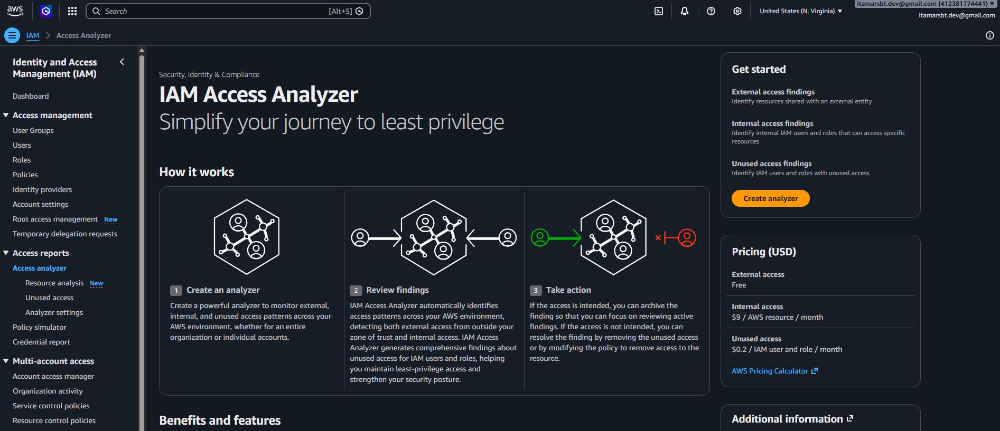


---

# Recursos do laboratório

Serão criados os seguintes recursos temporários:

| Recurso | Nome | Finalidade |
|---|---|---|
| Política gerenciada pelo cliente | `Lab03EC2ReadOnlyPolicy` | Permissões de leitura EC2 com privilégio mínimo |
| Função IAM | `Lab03-EC2-ReadOnly-Role` | Demonstra a identidade de carga de trabalho EC2 |
| Arquivo de política de confiança | `lab03-ec2-role-trust-policy.json` | Documenta a relação de confiança do EC2 |
| Arquivo de política de permissões | `lab03-ec2-read-only-policy.json` | Artefato de política reutilizável |

O seguinte recurso existente será apenas inspecionado:

| Recurso | Nome |
|---|---|
| Função IAM | `EC2-SSM-Role` |
| Instância EC2 | Instância existente dos Labs 01 e 02 |


> **Não exclua nem substitua `EC2-SSM-Role`.** Essa função faz parte dos laboratórios anteriores e poderá ser necessária novamente.


---

# Implementação passo a passo

# Etapa 1 — Analisar o modelo moderno de identidade da AWS

Antes de alterar qualquer configuração do IAM, é importante identificar o modelo de identidade utilizado ao longo deste laboratório.

O laboratório distingue intencionalmente:

```text
HUMANS
  │
  └── Federation / IAM Identity Center
          │
          └── IAM Roles
                 │
                 └── Temporary Credentials
```

de:

```text
WORKLOADS
   │
   └── IAM Roles
          │
          └── Temporary Credentials
```

A parte prática se concentra na **identidade de cargas de trabalho**, enquanto o IAM Identity Center é analisado como a arquitetura moderna preferencial para acesso de colaboradores.

Não é necessário criar usuários IAM nem chaves de acesso de longa duração.


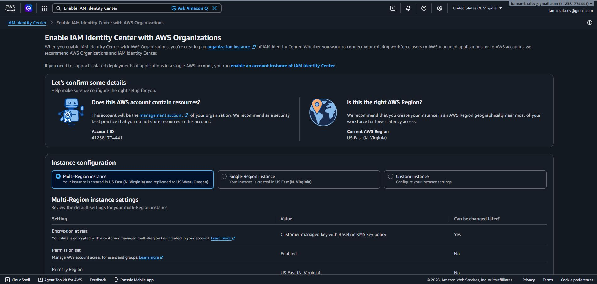


---

# Etapa 2 — Inspecionar a função IAM existente da carga de trabalho EC2

Navigate to:

```text
AWS Management Console
        ↓
IAM
        ↓
Roles
```

Search for:

```text
EC2-SSM-Role
```

Open the role.


## Examinar as permissões associadas

Open the **Permissions** section.

Depending on the previous labs, policies may include:

```text
AmazonSSMManagedInstanceCore
CloudWatchAgentServerPolicy
```

These policies determine what the EC2 workload can do after receiving the role credentials.

Do not modify the role.


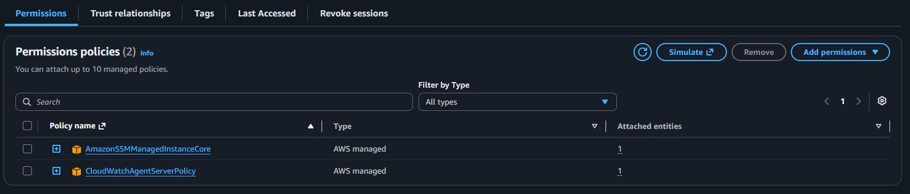


## Examinar a relação de confiança

Open:

```text
Trust relationships
```

The trust policy should identify EC2 as a trusted service principal.

Look for:

```text
ec2.amazonaws.com
```

This means the role is designed to be assumed by the EC2 service.

The relationship is:

```text
EC2
 │
 │ sts:AssumeRole
 ▼
EC2-SSM-Role
 │
 ▼
Temporary Role Credentials
```

This is the workload identity pattern used by the existing EC2 instance.


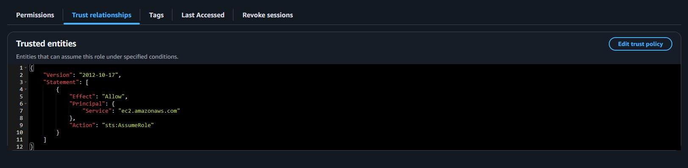


---

# Etapa 3 — Verificar a identidade baseada em função a partir da instância EC2

Open the existing EC2 instance through **AWS Systems Manager Session Manager**.

The objective is to verify that the instance has a role available through the EC2 Instance Metadata Service without exposing credential values.

## Consultar o nome da função no perfil de instância

Run:

```bash
TOKEN=$(curl -sS -X PUT \
  -H "X-aws-ec2-metadata-token-ttl-seconds: 21600" \
  http://169.254.169.254/latest/api/token)
```

Then:

```bash
curl -sS \
  -H "X-aws-ec2-metadata-token: $TOKEN" \
  http://169.254.169.254/latest/meta-data/iam/security-credentials/
```

Expected output:

```text
EC2-SSM-Role
```

This demonstrates that the EC2 instance has access to an IAM role through its instance profile.

> **Security Note:** Do not request, display, copy, save, or commit the credential values returned by the deeper `/iam/security-credentials/<role-name>` metadata endpoint. The role name alone is sufficient for this laboratory.


## Opcional — Verificar a identidade de quem chama a API AWS

If the AWS CLI is already installed on the instance, run:

```bash
aws sts get-caller-identity
```

The result should reference an assumed-role session associated with `EC2-SSM-Role`.

Do not install or configure static credentials merely to perform this optional check.

The important principle is:

```text
No ~/.aws static access keys required
              │
              ▼
EC2 role credentials are provided automatically
```

---

# Etapa 4 — Criar uma política gerenciada pelo cliente com privilégio mínimo

Navigate to:

```text
IAM
 ↓
Policies
 ↓
Create policy
```


Choose the **JSON** policy editor.

Use:

```json
{
  "Version": "2012-10-17",
  "Statement": [
    {
      "Sid": "AllowSelectedEC2ReadOnlyActions",
      "Effect": "Allow",
      "Action": [
        "ec2:DescribeInstances",
        "ec2:DescribeInstanceStatus",
        "ec2:DescribeVolumes",
        "ec2:DescribeSnapshots",
        "ec2:DescribeSecurityGroups",
        "ec2:DescribeVpcs",
        "ec2:DescribeSubnets",
        "ec2:DescribeRouteTables",
        "ec2:DescribeTags"
      ],
      "Resource": "*",
      "Condition": {
        "StringEquals": {
          "aws:RequestedRegion": "us-east-1"
        }
      }
    }
  ]
}
```

A repository copy is maintained at:

```text
policies/lab03-ec2-read-only-policy.json
```


Click:
```text
Next
```


## Estrutura da política

### Ações explícitas

Only selected EC2 read operations are allowed.

The policy does **not** include:

```text
ec2:RunInstances
ec2:StartInstances
ec2:StopInstances
ec2:TerminateInstances
```

### Recurso

The statement uses:

```json
"Resource": "*"
```

because many EC2 `Describe` APIs do not support resource-level permissions.

The scope is still restricted by the explicit list of allowed actions.

### Condição regional

The condition:

```json
"aws:RequestedRegion": "us-east-1"
```

adds another authorization constraint.

The intended permission model is therefore:

```text
Selected EC2 read APIs
          +
       us-east-1
```


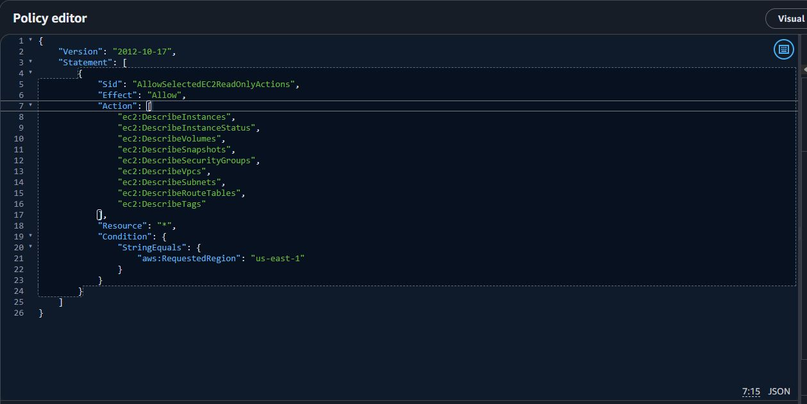


---

# Etapa 5 — Validar a política com o IAM Access Analyzer

Before creating the policy, review the policy validation results shown by the IAM console.

IAM Access Analyzer policy validation checks the document against IAM policy grammar and security best practices.

Review all findings.

Pay particular attention to:

```text
ERROR
SECURITY_WARNING
WARNING
SUGGESTION
```

If an error appears, do not proceed until it is understood and corrected.

After reviewing the findings, create the policy using:

```text
Policy name:
Lab03EC2ReadOnlyPolicy
```

Suggested description:

```text
Least-privilege policy for selected Amazon EC2 read operations in us-east-1 used by AWS Cloud Engineering Lab 03.
```


After creation, confirm that the policy appears under **Customer managed policies**.

> Policy validation helps identify problems, but it does not replace authorization testing or broader security review.


---

# Etapa 6 — Criar uma função IAM dedicada ao EC2

Create a laboratory role that demonstrates workload identity without modifying the running instance from previous labs.

Navigate to:

```text
IAM
 ↓
Roles
 ↓
Create role
```

Select:

```text
Trusted entity type:
AWS service
```

Choose:

```text
Service or use case:
EC2
```


The resulting trust relationship should allow:

```text
ec2.amazonaws.com
```

to assume the role.

Use the role name:

```text
Lab03-EC2-ReadOnly-Role
```

Suggested description:

```text
Educational EC2 workload role used to demonstrate trust policies, temporary credentials, and least-privilege authorization in Lab 03.
```

The equivalent trust policy is maintained in:

```text
policies/lab03-ec2-role-trust-policy.json
```

The important relationship is:

```text
EC2 Service Principal
        │
        │ Allowed by trust policy
        ▼
Lab03-EC2-ReadOnly-Role
```

> This role is intentionally **not attached to the existing Lab 01/02 EC2 instance**. Replacing the instance profile could disrupt SSM or monitoring access. The existing `EC2-SSM-Role` remains unchanged.


---

# Etapa 7 — Associar a política de privilégio mínimo à função

Open:

```text
IAM
 ↓
Roles
 ↓
Lab03-EC2-ReadOnly-Role
 ↓
Permissions
```


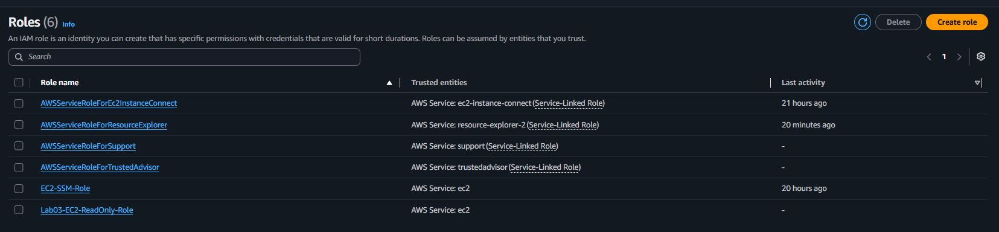


Attach:

```text
Lab03EC2ReadOnlyPolicy
```


The role now contains two separate security relationships:

```text
Trust Policy
     │
     └── EC2 may assume the role
```

and:

```text
Permissions Policy
        │
        └── Role may perform selected EC2 Describe actions
```

The complete authorization model is:

```text
EC2
 │
 │ Trust relationship
 ▼
Lab03-EC2-ReadOnly-Role
 │
 │ Permissions policy
 ▼
Lab03EC2ReadOnlyPolicy
 │
 ▼
Selected EC2 Describe APIs
 │
 ▼
us-east-1
```


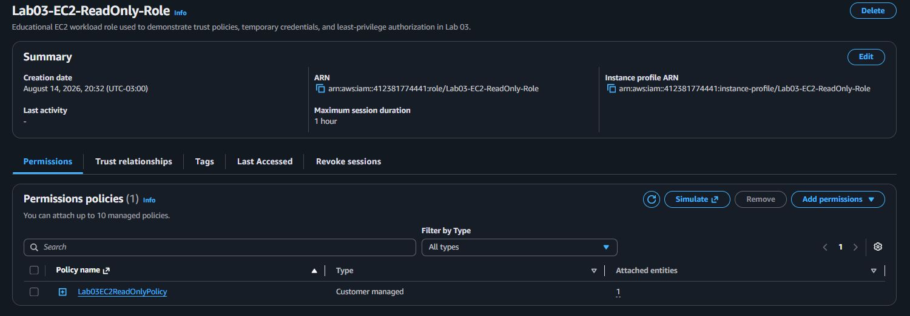

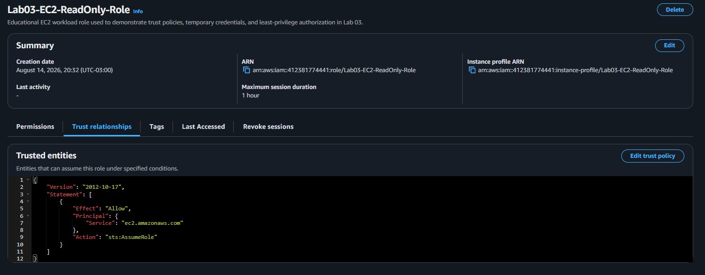


---

# Etapa 8 — Avaliar ações permitidas e negadas

Where available, use the **IAM Policy Simulator** or another appropriate IAM policy evaluation workflow to inspect the permissions associated with:

```text
Lab03-EC2-ReadOnly-Role
```

When evaluating the regional condition, ensure the simulation context reflects:

```text
aws:RequestedRegion = us-east-1
```

The expected authorization model is:

| Action | Expected Result | Reason |
|---|---|---|
| `ec2:DescribeInstances` | ALLOWED | Explicitly granted |
| `ec2:DescribeVolumes` | ALLOWED | Explicitly granted |
| `ec2:DescribeSecurityGroups` | ALLOWED | Explicitly granted |
| `ec2:RunInstances` | DENIED | Not granted |
| `ec2:StopInstances` | DENIED | Not granted |
| `ec2:TerminateInstances` | DENIED | Not granted |
| `s3:DeleteBucket` | DENIED | No S3 permission |

A request outside `us-east-1` should not satisfy the regional condition for the actions controlled by this policy.

This demonstrates:

```text
Explicitly allowed action
          │
          ▼
        ALLOW
```

while:

```text
Permission not granted
          │
          ▼
     IMPLICIT DENY
```

An applicable **explicit deny** from another policy layer would override an allow.


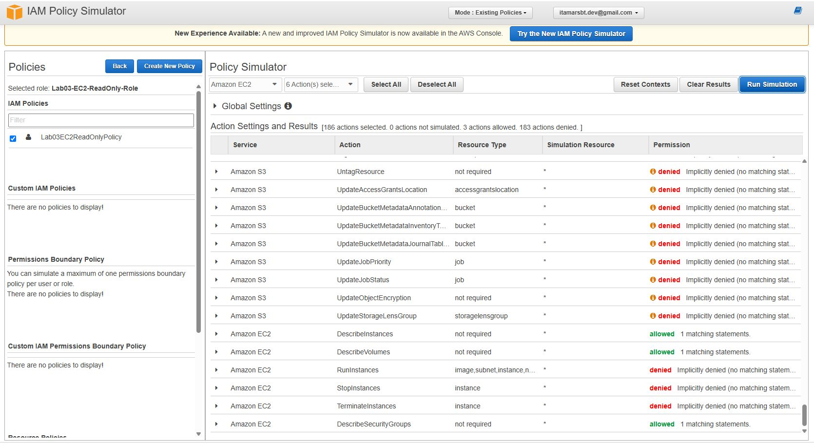


---

# Etapa 9 — Comparar o acesso de pessoas e de cargas de trabalho

The final implementation step compares the role created in this lab with the modern AWS workforce model.

## Acesso de carga de trabalho implementado neste laboratório

```text
EC2 Workload
     │
     ▼
IAM Role
     │
     ▼
Temporary Credentials
     │
     ▼
AWS APIs
```

## Acesso moderno de colaboradores

A common modern model is:

```text
Employee / Engineer
        │
        ▼
Identity Provider
        │
        ▼
AWS IAM Identity Center
        │
        ▼
Permission Set
        │
        ▼
IAM Role
        │
        ▼
Temporary Credentials
        │
        ▼
AWS Account / Resources
```

You may open the **IAM Identity Center** console to review the service and its concepts.

However, enabling or redesigning IAM Identity Center is **not required by this lab**.

Why?

An organization instance of IAM Identity Center is the recommended architecture for centralized AWS account access and is closely related to AWS Organizations and broader account governance.

That configuration should be designed intentionally rather than enabled only to complete a small IAM exercise.

The important learning objective is to recognize that modern workforce access is different from creating a permanent IAM user.

---

# Validação

Before cleanup, verify the complete Lab 03 configuration.

## Função existente da carga de trabalho

Confirm:

- `EC2-SSM-Role` still exists.
- Its trust relationship allows EC2 to assume the role.
- Existing SSM and monitoring permissions remain unchanged.
- The running EC2 instance remains accessible through Session Manager.

## Identidade da instância

Confirm:

- IMDSv2 can return the attached role name.
- The role name is `EC2-SSM-Role`.
- No static AWS credentials were created for the instance.

## Política gerenciada pelo cliente

Confirm:

- `Lab03EC2ReadOnlyPolicy` exists.
- Only selected EC2 `Describe` actions are allowed.
- No write or destructive EC2 permissions are included.
- The `aws:RequestedRegion` condition is configured for `us-east-1`.
- IAM Access Analyzer policy validation was reviewed.

## Função IAM do laboratório

Confirm:

- `Lab03-EC2-ReadOnly-Role` exists.
- Its trust relationship uses the EC2 service principal.
- `Lab03EC2ReadOnlyPolicy` is attached.
- The role was not attached to or substituted for `EC2-SSM-Role`.

## Modelo de autorização

Expected:

```text
Selected EC2 Describe actions → ALLOWED

EC2 write actions             → DENIED

EC2 destructive actions       → DENIED

Unrelated service actions     → DENIED
```

## Modelo de acesso de colaboradores

Confirm that you can explain why:

```text
IAM Identity Center / Federation
```

is generally preferred for human workforce access, while:

```text
IAM Roles
```

are used for AWS workloads such as EC2.

---

# Boas práticas de segurança aplicadas

## 1. Credenciais temporárias

The lab emphasizes temporary credentials for both human and workload access models.

No long-term access key is created.

---

## 2. Funções de cargas de trabalho em vez de credenciais incorporadas

EC2 workloads use IAM roles rather than credentials stored in:

```text
Source code
Environment files
Shell scripts
Configuration files
Git repositories
```

---

## 3. Federação para acesso humano

IAM users are not used as the default workforce model.

The lab presents federation and IAM Identity Center as the modern architecture for human access.

---

## 4. Privilégio mínimo

The customer managed policy grants only the actions required by the exercise.

It does not use:

```json
"Action": "*"
```

or:

```json
"Action": "ec2:*"
```

---

## 5. Seleção explícita de ações

The policy explicitly identifies permitted API operations.

This makes the authorization scope easier to understand, review, and audit.

---

## 6. Condições como controles adicionais

The policy uses:

```json
"aws:RequestedRegion": "us-east-1"
```

to further restrict supported requests.

---

## 7. Separação entre confiança e permissões

The lab explicitly separates:

```text
WHO may assume the role
```

from:

```text
WHAT the role may do
```

This distinction is fundamental to secure role design.

---

## 8. Validação de políticas

IAM Access Analyzer policy validation is reviewed before relying on the policy.

This adds automated policy analysis to manual review.

---

## 9. Preservação de dependências semelhantes às de produção

The lab does not replace the instance profile on the running EC2 instance merely to demonstrate another IAM role.

This avoids unnecessarily disrupting:

- Systems Manager access
- CloudWatch Agent permissions
- Existing laboratory dependencies

---

## 10. Nenhuma credencial no controle de versão

Never commit:

```text
AWS_ACCESS_KEY_ID
AWS_SECRET_ACCESS_KEY
AWS_SESSION_TOKEN
Passwords
Private keys
Authentication tokens
```

to GitHub.

The repository stores **policy definitions**, not credentials.

---

# Limpeza dos recursos

Only resources created specifically for Lab 03 should be removed.

Preserve:

```text
EC2-SSM-Role
```

and the existing EC2 instance.

Recommended cleanup order:

```text
Lab03-EC2-ReadOnly-Role
        │
        ▼
Detach Lab03EC2ReadOnlyPolicy
        │
        ▼
Delete Lab03-EC2-ReadOnly-Role
        │
        ▼
Delete Lab03EC2ReadOnlyPolicy
```

## Limpeza — Etapa 1: Desassociar a política

Navigate to:

```text
IAM
 ↓
Roles
 ↓
Lab03-EC2-ReadOnly-Role
 ↓
Permissions
```

Detach:

```text
Lab03EC2ReadOnlyPolicy
```

## Limpeza — Etapa 2: Excluir a função do laboratório

Delete:

```text
Lab03-EC2-ReadOnly-Role
```


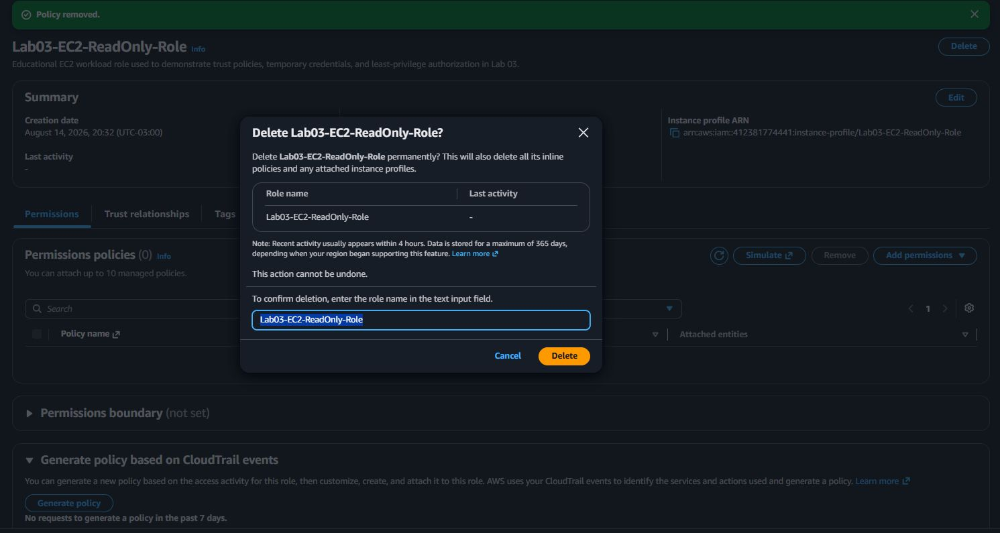


## Limpeza — Etapa 3: Excluir a política gerenciada pelo cliente

Navigate to:

```text
IAM
 ↓
Policies
```

Locate:

```text
Lab03EC2ReadOnlyPolicy
```

Delete it.


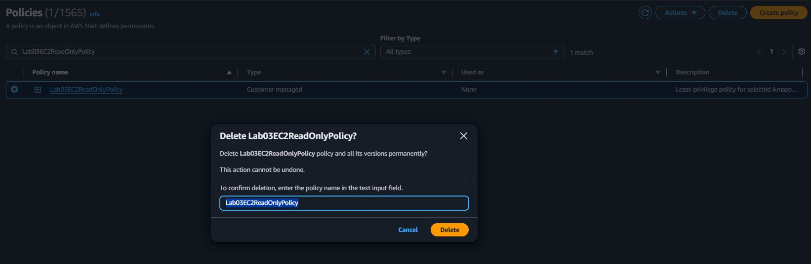


## Limpeza — Etapa 4: Preservar os recursos existentes

Confirm that:

```text
EC2-SSM-Role
```

still exists and that the EC2 instance remains accessible through Session Manager.

---

# Validação após a limpeza

Expected final state:

| Resource | Expected State |
|---|---|
| `Lab03-EC2-ReadOnly-Role` | Deleted |
| `Lab03EC2ReadOnlyPolicy` | Deleted |
| `EC2-SSM-Role` | Preserved |
| Existing EC2 instance | Preserved |


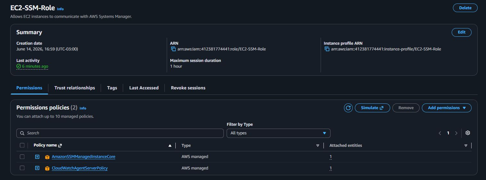

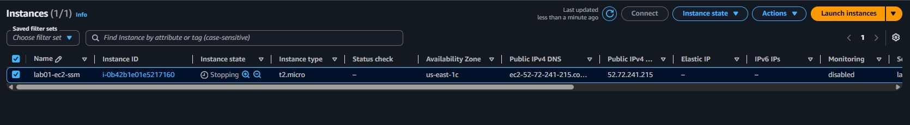


Repository policy files remain because they are documentation and reusable artifacts:

```text
policies/lab03-ec2-read-only-policy.json
policies/lab03-ec2-role-trust-policy.json
```

---

# Solução de problemas

## A função EC2-SSM-Role não existe

If the role does not exist, review Lab 01 before continuing.

Do not create a different role merely to force the current instructions to match.

The Lab 03 workflow assumes the previous EC2/SSM environment exists.

---

## O Session Manager não estabelece conexão

Check:

- The EC2 instance is running.
- SSM Agent is running.
- `EC2-SSM-Role` is still attached through the instance profile.
- `AmazonSSMManagedInstanceCore` remains available to the instance.
- Network connectivity required by Systems Manager is available.

Do not replace the existing instance profile during Lab 03.

---

## A consulta ao IMDSv2 retorna erro

Verify that:

- The command is running inside the EC2 instance.
- The token request completed successfully.
- The metadata endpoint is reachable.
- IMDS is enabled for the instance.

Use IMDSv2 rather than intentionally downgrading the laboratory to IMDSv1.

---

## O IAM Access Analyzer apresenta uma ocorrência

Do not automatically ignore validation findings.

Read:

- Finding type
- Affected policy element
- Suggested remediation
- Security impact

Some findings may be informational, while others may require a policy change.

---

## Não é possível associar a política

Confirm that:

```text
Lab03EC2ReadOnlyPolicy
```

was successfully created and that you are viewing customer managed policies.

Also confirm that your current administrative identity has permission to attach policies to roles.

---

## O simulador de políticas apresenta uma negação inesperada

Verify:

- The correct role is selected.
- The action exists in the policy.
- The policy is attached.
- The simulation context includes `aws:RequestedRegion = us-east-1` when required.
- No explicit deny applies.

Remember:

```text
Explicit DENY
     │
     ▼
Overrides ALLOW
```

---

## O simulador de políticas mostra mais permissões do que o esperado

A principal can receive permissions from multiple policy sources.

Review:

- Identity-based policies
- Permissions boundaries
- Session policies
- Resource policies
- Service control policies where applicable

The final effective permission is determined by AWS policy evaluation logic, not by a single policy viewed in isolation.

---

## O IAM Identity Center não está configurado

That is acceptable for this laboratory.

The practical lab does not require enabling IAM Identity Center.

The service is included to teach the modern workforce identity architecture.

Organization-level identity design should be intentional and should not be enabled only for a disposable lab exercise.

---

## O console AWS apresenta uma interface diferente

AWS periodically changes console navigation and visual layout.

Focus on the underlying resources and concepts rather than reproducing the interface pixel-for-pixel.

The architectural relationships remain:

```text
Workload → IAM Role → Temporary Credentials → Permissions
```

and:

```text
Federated Human → Role → Temporary Credentials → Permissions
```

---

# Principais aprendizados

## A identidade moderna na AWS é centrada em funções

Both workforce and workload access increasingly rely on role-based temporary credentials.

The identity source differs, but the security objective is similar.

---

## Identidades humanas e de cargas de trabalho são diferentes

Human access commonly begins with federation:

```text
Human
 ↓
Identity Provider
 ↓
IAM Identity Center
 ↓
Role
```

Workload access begins with the AWS service or application:

```text
EC2
 ↓
IAM Role
```

---

## Credenciais temporárias reduzem a exposição prolongada de segredos

Temporary credentials expire.

This reduces the security burden associated with permanent access keys.

---

## Funções IAM possuem duas dimensões de segurança

A role must answer:

```text
WHO / WHAT may assume me?
```

and:

```text
WHAT may I do after being assumed?
```

Trust policies answer the first question.

Permissions policies answer the second.

---

## O privilégio mínimo é uma prática de engenharia iterativa

Least privilege is not simply choosing a policy named `ReadOnly`.

It requires understanding the actual API actions a workload needs and restricting permissions accordingly.

---

## A validação automatizada de políticas agrega valor

IAM Access Analyzer can identify syntax and security issues that may be missed during manual review.

Policy validation should be part of the policy-development workflow.

---

## Usuários IAM continuam relevantes — mas o contexto importa ainda mais

Cloud engineers must understand IAM users because they exist in AWS and in real environments.

However:

```text
Understand IAM users
        ≠
Use IAM users as the default modern workforce architecture
```

---

## Dependências existentes não devem ser modificadas sem necessidade

A good laboratory should not break an existing working environment merely to demonstrate another concept.

This lab therefore creates a separate IAM role rather than replacing `EC2-SSM-Role`.

---

## O projeto de identidade faz parte da arquitetura de nuvem

Identity is not an isolated administrative task.

IAM decisions affect:

- Security
- Operations
- Automation
- CI/CD
- Incident response
- Governance
- Multi-account architecture
- Compliance

Understanding IAM architecture is therefore a core cloud engineering skill.

---

# Estrutura do repositório

The updated Lab 03 structure is intentionally compact:

```text
03-iam-roles-and-policies/
│
├── README.md
│
├── policies/
│   ├── lab03-ec2-read-only-policy.json
│   └── lab03-ec2-role-trust-policy.json
│
└── screenshots/
    └── ...
```

## `README.md`

Contains:

- Identity architecture
- IAM concepts
- Workload identity implementation
- Policy design
- Access Analyzer validation
- Authorization testing
- Security practices
- Cleanup
- Troubleshooting
- Key learnings

## `policies/`

Contains reusable policy artifacts.

### `lab03-ec2-read-only-policy.json`

Defines the selected least-privilege EC2 read permissions used by the laboratory role.

### `lab03-ec2-role-trust-policy.json`

Documents the trust relationship that allows the EC2 service to assume the laboratory role.

## `screenshots/`

Contains selected screenshots used to document the completed implementation.

Screenshots are supporting evidence only.

They are **not required to reproduce the laboratory**, and the README does not instruct readers to capture, rename, or store screenshots while following the tutorial.

---

# Próximo laboratório

## Lab 04 — Volumes e snapshots do EBS

The next laboratory explores persistent block storage for Amazon EC2.

Topics include:

- Creating EBS volumes
- Attaching volumes to EC2 instances
- Preparing Linux storage
- Mounting filesystems
- Creating EBS snapshots
- Understanding backup and restore workflows
- Restoring data from snapshots
- Applying storage lifecycle and cleanup practices

---

> This laboratory is part of the **AWS Cloud Engineering Lab**, a hands-on repository focused on practical AWS infrastructure, operations, security, observability, automation, and Infrastructure as Code skills.
