# Lab 03 — Identidade moderna na AWS, funções IAM e políticas de privilégio mínimo

> **AWS Cloud Engineering Lab — Implementação manual**

Este laboratório explora práticas modernas de gerenciamento de identidade e acesso na AWS, com foco em **credenciais temporárias**, **funções IAM**, **políticas de privilégio mínimo**, **identidades de cargas de trabalho** e no modelo atual de **acesso de colaboradores** da AWS.

A implementação evita intencionalmente a criação de usuários IAM, grupos de usuários IAM, chaves de acesso de longa duração ou credenciais permanentes como parte dos procedimentos.

Em vez disso, o laboratório utiliza a carga de trabalho EC2 já existente nos laboratórios anteriores para examinar o acesso baseado em funções. Também cria uma função IAM dedicada e uma política gerenciada pelo cliente para estudar relações de confiança, permissões, validação de políticas e comportamento da autorização.

---

## Sumário

- [Visão geral](#visão-geral)
- [Por que este laboratório utiliza um modelo moderno de identidade](#por-que-este-laboratório-utiliza-um-modelo-moderno-de-identidade)
- [Arquitetura](#arquitetura)
- [Objetivos de aprendizagem](#objetivos-de-aprendizagem)
- [Serviços e recursos da AWS](#serviços-e-recursos-da-aws)
- [Tempo estimado](#tempo-estimado)
- [Custo estimado](#custo-estimado)
- [Pré-requisitos](#pré-requisitos)
- [Conceitos fundamentais de identidade](#conceitos-fundamentais-de-identidade)
  - [Identidades humanas e de colaboradores](#identidades-humanas-e-de-colaboradores)
  - [Identidades de cargas de trabalho](#identidades-de-cargas-de-trabalho)
  - [Funções IAM](#funções-iam)
  - [Credenciais temporárias](#credenciais-temporárias)
  - [Políticas de confiança](#políticas-de-confiança)
  - [Políticas de permissões](#políticas-de-permissões)
  - [Usuários IAM](#usuários-iam)
  - [Privilégio mínimo](#privilégio-mínimo)
  - [IAM Access Analyzer](#iam-access-analyzer)
- [Recursos do laboratório](#recursos-do-laboratório)
- [Implementação passo a passo](#implementação-passo-a-passo)
  - [Etapa 1 — Analisar o modelo moderno de identidade da AWS](#etapa-1-analisar-o-modelo-moderno-de-identidade-da-aws)
  - [Etapa 2 — Inspecionar a função IAM existente da carga de trabalho EC2](#etapa-2-inspecionar-a-função-iam-existente-da-carga-de-trabalho-ec2)
  - [Etapa 3 — Verificar a identidade baseada em função a partir da instância EC2](#etapa-3-verificar-a-identidade-baseada-em-função-a-partir-da-instância-ec2)
  - [Etapa 4 — Criar uma política gerenciada pelo cliente com privilégio mínimo](#etapa-4-criar-uma-política-gerenciada-pelo-cliente-com-privilégio-mínimo)
  - [Etapa 5 — Validar a política com o IAM Access Analyzer](#etapa-5-validar-a-política-com-o-iam-access-analyzer)
  - [Etapa 6 — Criar uma função IAM dedicada ao EC2](#etapa-6-criar-uma-função-iam-dedicada-ao-ec2)
  - [Etapa 7 — Associar a política de privilégio mínimo à função](#etapa-7-associar-a-política-de-privilégio-mínimo-à-função)
  - [Etapa 8 — Avaliar ações permitidas e negadas](#etapa-8-avaliar-ações-permitidas-e-negadas)
  - [Etapa 9 — Comparar o acesso de pessoas e de cargas de trabalho](#etapa-9-comparar-o-acesso-de-pessoas-e-de-cargas-de-trabalho)
- [Validação](#validação)
- [Boas práticas de segurança aplicadas](#boas-práticas-de-segurança-aplicadas)
- [Limpeza dos recursos](#limpeza-dos-recursos)
- [Validação após a limpeza](#validação-após-a-limpeza)
- [Solução de problemas](#solução-de-problemas)
- [Principais aprendizados](#principais-aprendizados)
- [Estrutura do repositório](#estrutura-do-repositório)
- [Próximo laboratório](#próximo-laboratório)

---

# Visão geral

O AWS Identity and Access Management (**IAM**) fornece a base de autorização utilizada para controlar o acesso aos serviços e recursos da AWS.

O modelo moderno de identidade da AWS distingue duas grandes categorias:

```text
Human / Workforce Identities
        │
        ├── Federation
        ├── IAM Identity Center
        ├── Permission Sets / IAM Roles
        └── Temporary Credentials

Workload Identities
        │
        ├── IAM Roles
        ├── Trust Policies
        ├── Permissions Policies
        └── Temporary Credentials
```

Este laboratório concentra-se principalmente no **modelo de identidade de cargas de trabalho**, pois o repositório já contém uma instância EC2 que utiliza a função `EC2-SSM-Role` criada nos laboratórios anteriores.

Também é apresentado o modelo moderno de acesso humano na AWS, para que usuários IAM e credenciais de longa duração não sejam tratados como a arquitetura padrão de acesso dos colaboradores.

A implementação prática irá:

1. Inspecionar a função IAM existente do EC2.
2. Verificar que a carga de trabalho EC2 utiliza uma identidade baseada em função.
3. Criar uma política gerenciada pelo cliente com privilégio mínimo.
4. Validar a política utilizando o IAM Access Analyzer.
5. Criar uma função de serviço EC2 dedicada.
6. Associar a política à função.
7. Avaliar as ações que devem ser permitidas e negadas.
8. Comparar a identidade de carga de trabalho ao modelo moderno de acesso de colaboradores.

Não é necessário criar usuários IAM nem chaves de acesso.


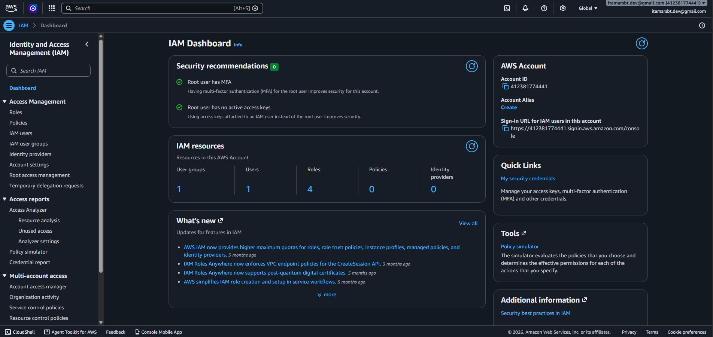


---

# Por que este laboratório utiliza um modelo moderno de identidade

Tutoriais tradicionais de IAM costumam utilizar o seguinte modelo:

```text
IAM User
   │
   ▼
IAM Group
   │
   ▼
IAM Policy
   │
   ▼
AWS Resources
```

Os usuários e grupos IAM continuam sendo conceitos válidos na AWS e podem existir em ambientes legados ou casos de uso específicos.

Entretanto, **não são o modelo padrão preferencial para o acesso moderno de colaboradores**.

Para usuários humanos, os ambientes modernos da AWS geralmente utilizam:

```text
Human User
    │
    ▼
Identity Provider / IAM Identity Center
    │
    ▼
Permission Assignment
    │
    ▼
IAM Role
    │
    ▼
Temporary Credentials
    │
    ▼
AWS Resources
```

Para cargas de trabalho AWS, como o EC2:

```text
EC2 Instance
    │
    ▼
IAM Role
    │
    ▼
Temporary Credentials
    │
    ▼
AWS APIs
```

Assim, este laboratório apresenta os usuários IAM como um conceito importante, mas **não** cria um usuário IAM como parte central do aprendizado.

---

# Arquitetura

O diagrama a seguir representa os modelos de identidade estudados neste laboratório.

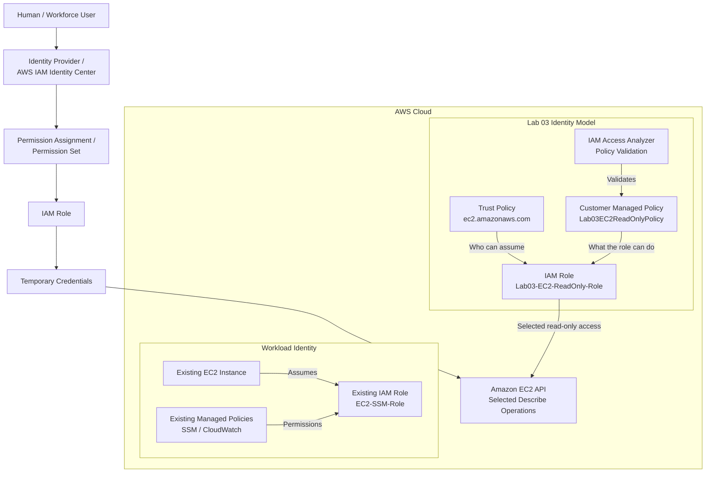

O laboratório aborda duas situações distintas de identidade:

### Acesso de colaboradores

```text
Human
  ↓
Federated Identity
  ↓
Role
  ↓
Temporary Credentials
```

### Acesso de cargas de trabalho

```text
AWS Workload
  ↓
IAM Role
  ↓
Temporary Credentials
```

O princípio de segurança comum é:

> Sempre que possível, dê preferência a credenciais temporárias e acesso baseado em funções em vez de credenciais estáticas de longa duração.

---

# Objetivos de aprendizagem

Ao concluir este laboratório, será possível:

- Explicar a diferença entre autenticação e autorização.
- Distinguir identidades humanas de identidades de cargas de trabalho.
- Explicar por que credenciais temporárias são preferíveis às de longa duração.
- Compreender a função do AWS IAM Identity Center no acesso moderno de colaboradores.
- Explicar por que funções IAM são preferíveis para cargas de trabalho na AWS.
- Compreender a relação entre perfis de instância EC2 e funções IAM.
- Explicar a diferença entre uma política de confiança e uma política de permissões.
- Criar uma política IAM gerenciada pelo cliente.
- Aplicar o princípio do privilégio mínimo.
- Utilizar condições IAM para restringir permissões.
- Validar políticas IAM utilizando o IAM Access Analyzer.
- Criar uma função de serviço EC2.
- Avaliar ações que devem ser permitidas e negadas.
- Reconhecer casos em que usuários IAM ainda podem existir, sem tratá-los como modelo padrão de acesso humano.
- Remover com segurança os recursos IAM temporários do laboratório.

---

# Serviços e recursos da AWS

| Serviço / Recurso | Finalidade |
|---|---|
| AWS IAM | Gerenciamento de identidade e acesso |
| Funções IAM | Identidades temporárias baseadas em funções |
| Políticas IAM | Definem as permissões de autorização |
| Políticas de confiança IAM | Definem quem ou o que pode assumir uma função |
| IAM Access Analyzer | Validação de políticas e identificação de ocorrências de segurança |
| AWS STS | Serviço de credenciais de segurança temporárias |
| Amazon EC2 | Carga de trabalho existente e serviço de API de destino |
| Perfil de instância EC2 | Disponibiliza uma função IAM para uma instância EC2 |
| AWS Systems Manager | Acesso seguro à instância EC2 existente |
| IAM Identity Center | Modelo moderno de acesso centralizado de colaboradores |

---

# Tempo estimado

Aproximadamente:

```text
45–60 minutes
```

A duração real depende da familiaridade com IAM, EC2 e o AWS Management Console.

---

# Custo estimado

Os recursos IAM criados neste laboratório normalmente não geram cobranças adicionais.

Custo estimado dos recursos IAM do Lab 03:

```text
$0.00
```

A instância EC2 existente e outros recursos utilizados nos laboratórios anteriores podem continuar gerando cobranças independentemente.

> Consulte sempre o **AWS Billing and Cost Management** ao manter ambientes de laboratório na nuvem.

---

# Pré-requisitos

Antes de iniciar este laboratório, é necessário ter:

- Uma conta AWS ativa.
- Acesso ao AWS Management Console.
- Permissões administrativas ou delegadas suficientes para gerenciar os recursos IAM utilizados.
- Concluído ou revisado o **Lab 01 — Instância EC2 com acesso via SSM**.
- Concluído ou revisado o **Lab 02 — Monitoramento de EC2 com CloudWatch Agent**.
- Uma instância EC2 existente dos laboratórios anteriores.
- Uma função IAM existente com o nome:

```text
EC2-SSM-Role
```

- Acesso à instância pelo **AWS Systems Manager Session Manager**.
- Conhecimento básico da sintaxe JSON.

Região recomendada para os recursos regionais:

```text
us-east-1
```

> **Importante:** o IAM é predominantemente um serviço global da AWS. A política de privilégio mínimo criada neste laboratório utiliza uma condição IAM para restringir as solicitações compatíveis da API EC2 à região `us-east-1`.


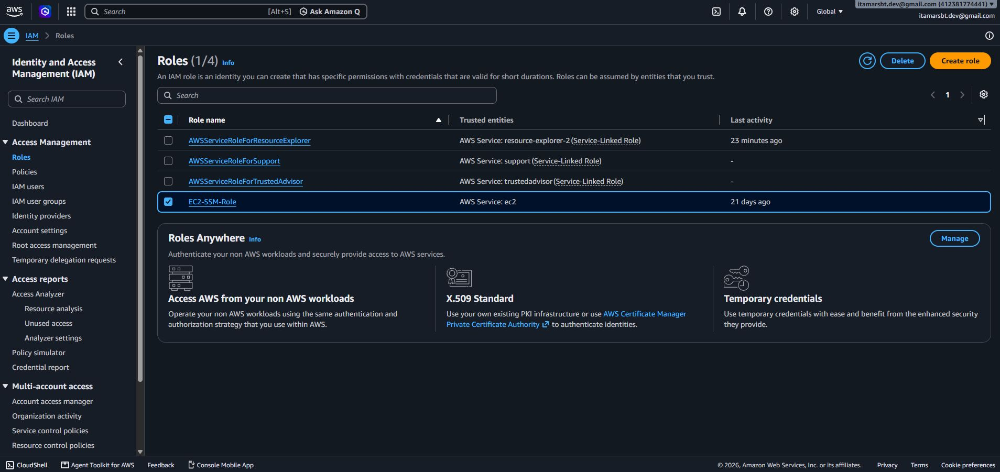


---

# Conceitos fundamentais de identidade

## Identidades humanas e de colaboradores

Uma **identidade humana** representa uma pessoa que precisa acessar a AWS.

Alguns exemplos:

- Engenheiros de nuvem
- Desenvolvedores
- Administradores de sistemas
- Engenheiros de segurança
- Operadores
- Auditores

Em ambientes modernos da AWS, os usuários humanos geralmente devem acessar a AWS por **federação** e receber **credenciais temporárias**.

Uma arquitetura comum utiliza:

```text
Corporate / External Identity Provider
             │
             ▼
      IAM Identity Center
             │
             ▼
       Permission Set
             │
             ▼
          IAM Role
             │
             ▼
    Temporary Credentials
```

O IAM Identity Center oferece gerenciamento centralizado de acesso e pode integrar-se a provedores externos de identidade.

Conjuntos de permissões (*permission sets*) definem as permissões recebidas pelos colaboradores ao acessar contas AWS.


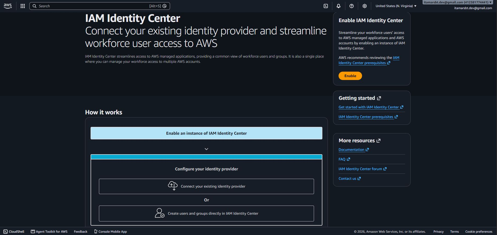


---

## Identidades de cargas de trabalho

Uma **identidade de carga de trabalho** representa um software ou infraestrutura que precisa chamar APIs da AWS.

Alguns exemplos:

- Instâncias EC2
- Funções Lambda
- Tarefas ECS
- Cargas de trabalho EKS
- Pipelines de CI/CD
- Aplicações executadas fora da AWS

Sempre que possível, as cargas de trabalho devem utilizar mecanismos que forneçam **credenciais temporárias**, em vez de chaves de acesso estáticas.

Para o EC2:

```text
EC2 Instance
     │
     ▼
Instance Profile
     │
     ▼
IAM Role
     │
     ▼
Temporary Credentials
```

A carga de trabalho pode utilizar essas credenciais para chamar APIs da AWS conforme as políticas associadas à função IAM.

---

## Funções IAM

Uma **função IAM** é uma identidade AWS que pode ser assumida por uma entidade principal confiável.

As funções não possuem credenciais permanentes associadas.

Quando uma função é assumida, o AWS Security Token Service (**STS**) fornece credenciais de segurança temporárias para a sessão dessa função.

Casos comuns de uso de funções incluem:

- Acesso de cargas de trabalho EC2
- Execução de funções Lambda
- Funções de tarefas ECS
- Acesso entre contas
- Acesso federado de colaboradores
- Pipelines de CI/CD
- Cargas de trabalho externas por mecanismos baseados em funções

---

## Credenciais temporárias

As credenciais temporárias de segurança contêm:

```text
Access Key ID
Secret Access Key
Session Token
Expiration
```

Diferentemente das chaves de acesso de longa duração dos usuários IAM, as credenciais temporárias possuem validade limitada.

Aplicações executadas em serviços compatíveis de computação AWS geralmente podem obter e renovar credenciais temporárias automaticamente.

Isso reduz a necessidade de:

- Criar chaves de acesso permanentes.
- Armazenar segredos em arquivos de configuração.
- Fazer rotação manual de credenciais estáticas.
- Enviar credenciais acidentalmente ao controle de versão.

---

## Políticas de confiança

A **política de confiança** de uma função determina:

> **QUEM ou O QUE tem permissão para assumir essa função?**

No caso de uma função de serviço EC2, a entidade principal confiável normalmente é:

```text
ec2.amazonaws.com
```

Exemplo:

```json
{
  "Version": "2012-10-17",
  "Statement": [
    {
      "Effect": "Allow",
      "Principal": {
        "Service": "ec2.amazonaws.com"
      },
      "Action": "sts:AssumeRole"
    }
  ]
}
```

Conceitualmente:

```text
Trust Policy
     │
     └── WHO can assume the role?
```

---

## Políticas de permissões

Uma política de permissões determina:

> **O QUE a identidade pode fazer após receber as permissões?**

Por exemplo:

```json
{
  "Effect": "Allow",
  "Action": "ec2:DescribeInstances",
  "Resource": "*"
}
```

Conceitualmente:

```text
Permissions Policy
        │
        └── WHAT actions are allowed?
```

Portanto:

```text
Trust Policy       → WHO / WHAT can assume the role

Permissions Policy → WHAT the role is allowed to do
```

Essas são decisões de autorização distintas.

---

## Usuários IAM

Um **usuário IAM** é uma identidade persistente em uma conta AWS.

Usuários IAM podem possuir credenciais de longa duração, como:

- Senhas do console
- Chaves de acesso

Usuários IAM continuam sendo compatíveis com a AWS e podem ser necessários em casos de uso específicos.

Entretanto, este laboratório não cria um usuário IAM, pois o acesso moderno de colaboradores normalmente deve usar federação e credenciais temporárias quando possível.

Assim, os usuários IAM devem ser entendidos como:

```text
Important IAM concept
        │
        ├── Still supported
        ├── Present in legacy environments
        ├── Required for some specific use cases
        └── Not the preferred default for workforce access
```

---

## Privilégio mínimo

O **princípio do privilégio mínimo** significa conceder apenas as permissões necessárias para uma tarefa específica.

Em vez de:

```text
AdministratorAccess
```

ou:

```json
"Action": "*"
```

este laboratório cria uma política que contém apenas determinadas operações de leitura do EC2.

O modelo da política é:

```text
Amazon EC2 only
       +
Selected Describe actions only
       +
us-east-1 condition
```

Nenhuma permissão de escrita ou destrutiva do EC2 é concedida intencionalmente.

---

## IAM Access Analyzer

O IAM Access Analyzer oferece ferramentas que ajudam a avaliar políticas IAM e configurações de acesso.

Neste laboratório, ele é utilizado para validar a política gerenciada pelo cliente antes de confiar nela.

A validação de políticas pode identificar:

- Erros de sintaxe
- Alertas de segurança
- Avisos gerais
- Sugestões
- Elementos da política que podem não funcionar conforme o esperado

A validação da política é um complemento importante da revisão manual.


---

# Recursos do laboratório

Serão criados os seguintes recursos temporários:

| Recurso | Nome | Finalidade |
|---|---|---|
| Política gerenciada pelo cliente | `Lab03EC2ReadOnlyPolicy` | Permissões de leitura EC2 com privilégio mínimo |
| Função IAM | `Lab03-EC2-ReadOnly-Role` | Demonstra a identidade de carga de trabalho EC2 |
| Arquivo de política de confiança | `lab03-ec2-role-trust-policy.json` | Documenta a relação de confiança do EC2 |
| Arquivo de política de permissões | `lab03-ec2-read-only-policy.json` | Artefato de política reutilizável |

O seguinte recurso existente será apenas inspecionado:

| Recurso | Nome |
|---|---|
| Função IAM | `EC2-SSM-Role` |
| Instância EC2 | Instância existente dos Labs 01 e 02 |


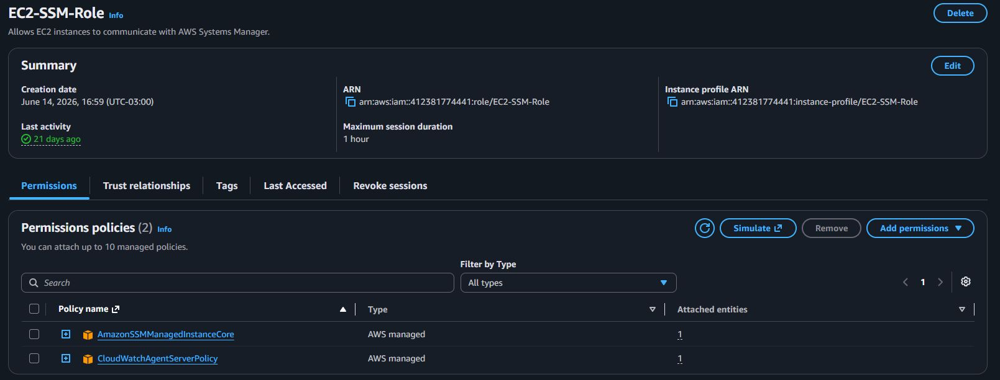

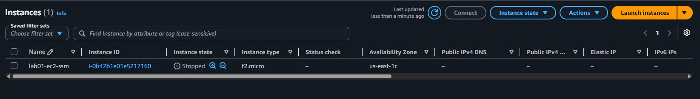


> **Não exclua nem substitua `EC2-SSM-Role`.** Essa função faz parte dos laboratórios anteriores e poderá ser necessária novamente.


---

# Implementação passo a passo

# Etapa 1 — Analisar o modelo moderno de identidade da AWS

Antes de alterar qualquer configuração do IAM, é importante identificar o modelo de identidade utilizado ao longo deste laboratório.

O laboratório distingue intencionalmente:

```text
HUMANS
  │
  └── Federation / IAM Identity Center
          │
          └── IAM Roles
                 │
                 └── Temporary Credentials
```

de:

```text
WORKLOADS
   │
   └── IAM Roles
          │
          └── Temporary Credentials
```

A parte prática se concentra na **identidade de cargas de trabalho**, enquanto o IAM Identity Center é analisado como a arquitetura moderna preferencial para acesso de colaboradores.

Não é necessário criar usuários IAM nem chaves de acesso de longa duração.


---

# Etapa 2 — Inspecionar a função IAM existente da carga de trabalho EC2

Acesse:

```text
AWS Management Console
        ↓
IAM
        ↓
Roles
```

Pesquise por:

```text
EC2-SSM-Role
```

Abra a função.


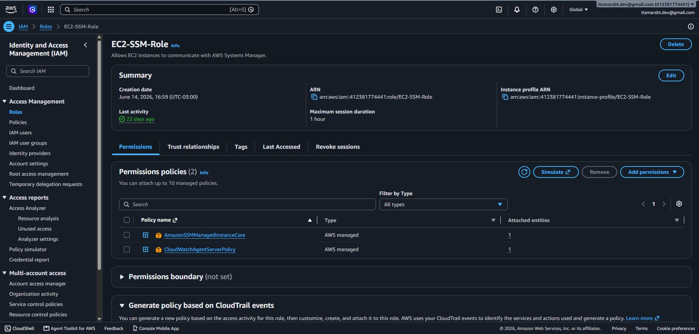


## Examinar as permissões associadas

Abra a seção **Permissions** (Permissões).

Dependendo dos laboratórios anteriores, as políticas associadas podem incluir:

```text
AmazonSSMManagedInstanceCore
CloudWatchAgentServerPolicy
```

Essas políticas determinam o que a carga de trabalho EC2 pode fazer após receber as credenciais da função IAM.

Não modifique a função existente.


## Examinar a relação de confiança

Abra:

```text
Trust relationships
```

A política de confiança deve identificar o EC2 como uma entidade principal de serviço confiável.

Procure por:

```text
ec2.amazonaws.com
```

Isso significa que a função foi criada para ser assumida pelo serviço EC2.

A relação é:

```text
EC2
 │
 │ sts:AssumeRole
 ▼
EC2-SSM-Role
 │
 ▼
Temporary Role Credentials
```

Esse é o padrão de identidade de carga de trabalho utilizado pela instância EC2 existente.


---

# Etapa 3 — Verificar a identidade baseada em função a partir da instância EC2

Acesse a instância EC2 existente pelo **AWS Systems Manager Session Manager**.

O objetivo é verificar se a instância possui uma função IAM disponível por meio do EC2 Instance Metadata Service, sem expor os valores das credenciais.

## Consultar o nome da função no perfil de instância

Execute:

```bash
TOKEN=$(curl -sS -X PUT \
  -H "X-aws-ec2-metadata-token-ttl-seconds: 21600" \
  http://169.254.169.254/latest/api/token)
```

Em seguida:

```bash
curl -sS \
  -H "X-aws-ec2-metadata-token: $TOKEN" \
  http://169.254.169.254/latest/meta-data/iam/security-credentials/
```

Saída esperada:

```text
EC2-SSM-Role
```

Isso demonstra que a instância EC2 pode utilizar uma função IAM por meio de seu perfil de instância.

> **Observação de segurança:** não solicite, exiba, copie, salve nem envie ao controle de versão os valores de credenciais retornados pelo endpoint de metadados mais profundo `/iam/security-credentials/<role-name>`. O nome da função é suficiente para este laboratório.


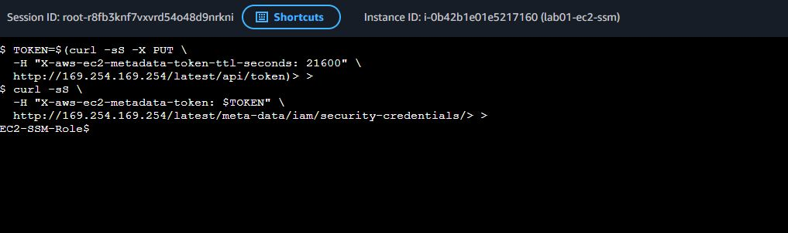


## Opcional — Verificar a identidade de quem chama a API AWS

Se a AWS CLI já estiver instalada na instância, execute:

```bash
aws sts get-caller-identity
```

O resultado deve identificar uma sessão de função assumida associada a `EC2-SSM-Role`.

Não instale nem configure credenciais estáticas apenas para realizar essa verificação opcional.

O princípio importante é:

```text
No ~/.aws static access keys required
              │
              ▼
EC2 role credentials are provided automatically
```

---

# Etapa 4 — Criar uma política gerenciada pelo cliente com privilégio mínimo

Acesse:

```text
IAM
 ↓
Policies
 ↓
Create policy
```


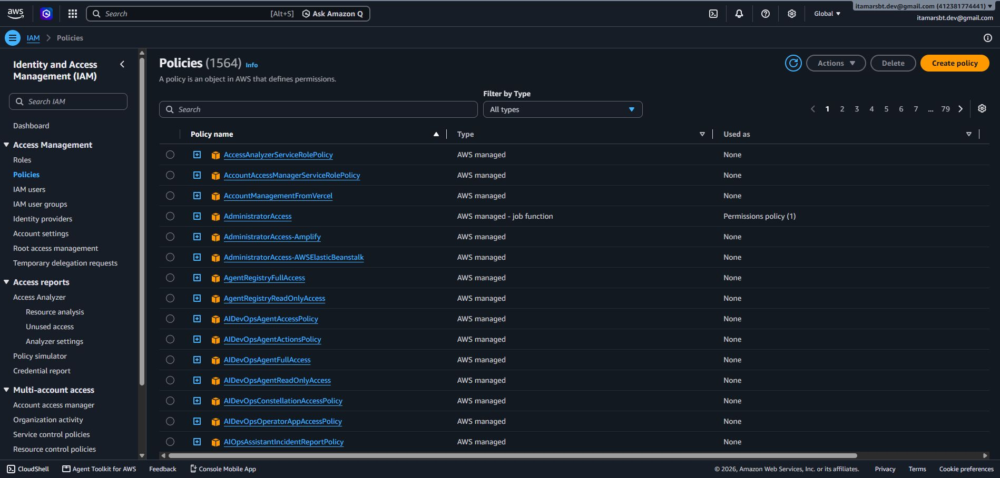


Selecione o editor de políticas **JSON**.

Utilize:

```json
{
  "Version": "2012-10-17",
  "Statement": [
    {
      "Sid": "AllowSelectedEC2ReadOnlyActions",
      "Effect": "Allow",
      "Action": [
        "ec2:DescribeInstances",
        "ec2:DescribeInstanceStatus",
        "ec2:DescribeVolumes",
        "ec2:DescribeSnapshots",
        "ec2:DescribeSecurityGroups",
        "ec2:DescribeVpcs",
        "ec2:DescribeSubnets",
        "ec2:DescribeRouteTables",
        "ec2:DescribeTags"
      ],
      "Resource": "*",
      "Condition": {
        "StringEquals": {
          "aws:RequestedRegion": "us-east-1"
        }
      }
    }
  ]
}
```

Uma cópia é mantida no repositório em:

```text
policies/lab03-ec2-read-only-policy.json
```


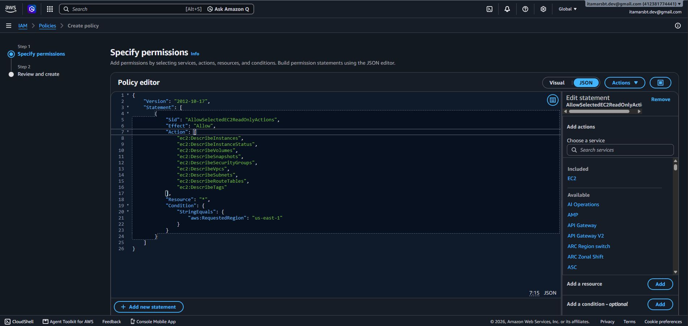


Clique em:
```text
Next
```


## Estrutura da política

### Ações explícitas

Apenas operações de leitura selecionadas do EC2 são permitidas.

A política **não** inclui:

```text
ec2:RunInstances
ec2:StartInstances
ec2:StopInstances
ec2:TerminateInstances
```

### Recurso

A declaração utiliza:

```json
"Resource": "*"
```

porque muitas APIs `Describe` do EC2 não oferecem suporte a permissões por recurso individual.

O escopo permanece restrito pela lista explícita de ações permitidas.

### Condição regional

A condição:

```json
"aws:RequestedRegion": "us-east-1"
```

acrescenta outra restrição de autorização.

Portanto, o modelo de permissões previsto é:

```text
Selected EC2 read APIs
          +
       us-east-1
```


---

# Etapa 5 — Validar a política com o IAM Access Analyzer

Antes de criar a política, examine os resultados de validação exibidos pelo console IAM.

A validação de políticas do IAM Access Analyzer verifica o documento quanto à sintaxe das políticas IAM e às boas práticas de segurança.

Analise todas as ocorrências.

Observe especialmente:

```text
ERROR
SECURITY_WARNING
WARNING
SUGGESTION
```

Se aparecer um erro, não prossiga até compreendê-lo e corrigi-lo.

Após examinar as ocorrências, crie a política com:

```text
Policy name:
Lab03EC2ReadOnlyPolicy
```

Descrição sugerida:

```text
Least-privilege policy for selected Amazon EC2 read operations in us-east-1 used by AWS Cloud Engineering Lab 03.
```


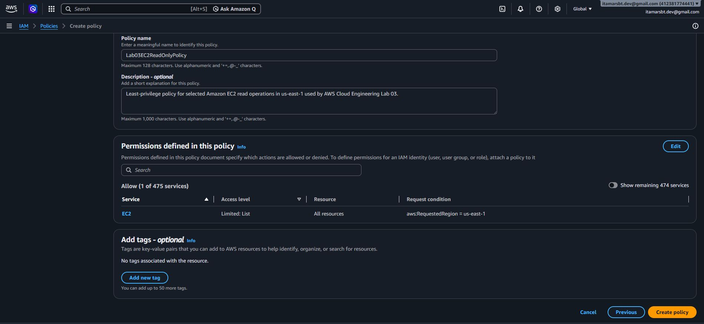


Após a criação, confirme que a política aparece em **Customer managed policies** (Políticas gerenciadas pelo cliente).

> A validação de políticas ajuda a identificar problemas, mas não substitui os testes de autorização nem uma revisão de segurança mais ampla.


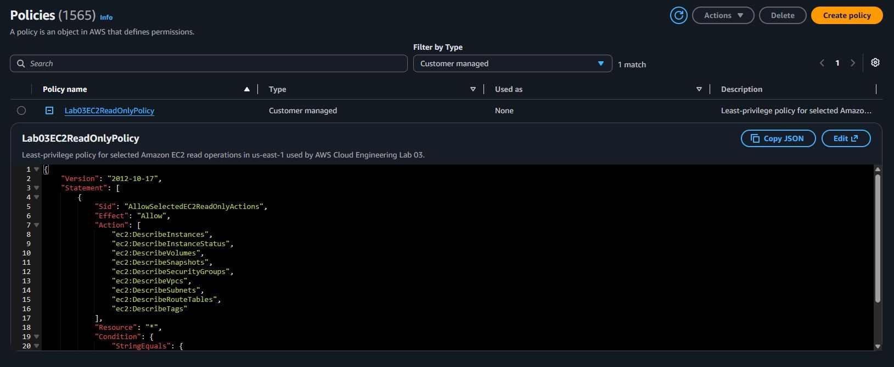


---

# Etapa 6 — Criar uma função IAM dedicada ao EC2

Crie uma função IAM específica para demonstrar a identidade de carga de trabalho sem modificar a instância em execução dos laboratórios anteriores.

Acesse:

```text
IAM
 ↓
Roles
 ↓
Create role
```

Selecione:

```text
Trusted entity type:
AWS service
```

Escolha:

```text
Service or use case:
EC2
```


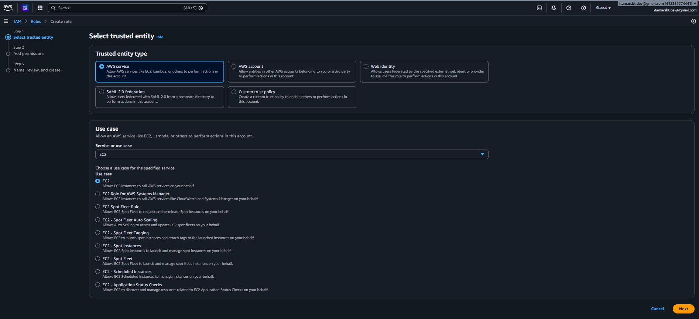


A relação de confiança resultante deve permitir que:

```text
ec2.amazonaws.com
```

assuma a função.

Utilize o nome de função:

```text
Lab03-EC2-ReadOnly-Role
```

Descrição sugerida:

```text
Educational EC2 workload role used to demonstrate trust policies, temporary credentials, and least-privilege authorization in Lab 03.
```

A política de confiança equivalente é mantida em:

```text
policies/lab03-ec2-role-trust-policy.json
```

A relação importante é:

```text
EC2 Service Principal
        │
        │ Allowed by trust policy
        ▼
Lab03-EC2-ReadOnly-Role
```

> Esta função intencionalmente **não é associada à instância EC2 existente dos Labs 01 e 02**. Substituir o perfil de instância poderia interromper o acesso por SSM ou o monitoramento. A função existente `EC2-SSM-Role` permanece inalterada.


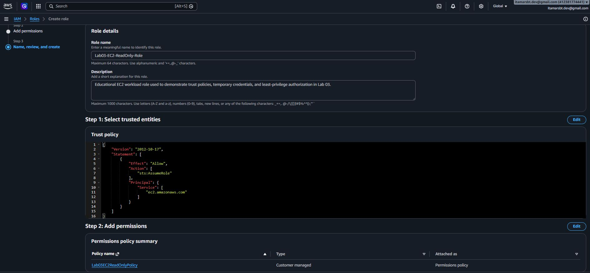


---

# Etapa 7 — Associar a política de privilégio mínimo à função

Abra:

```text
IAM
 ↓
Roles
 ↓
Lab03-EC2-ReadOnly-Role
 ↓
Permissions
```


Associe:

```text
Lab03EC2ReadOnlyPolicy
```


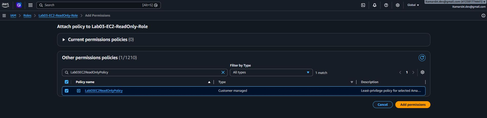


Agora a função contém duas relações de segurança distintas:

```text
Trust Policy
     │
     └── EC2 may assume the role
```

e:

```text
Permissions Policy
        │
        └── Role may perform selected EC2 Describe actions
```

O modelo completo de autorização é:

```text
EC2
 │
 │ Trust relationship
 ▼
Lab03-EC2-ReadOnly-Role
 │
 │ Permissions policy
 ▼
Lab03EC2ReadOnlyPolicy
 │
 ▼
Selected EC2 Describe APIs
 │
 ▼
us-east-1
```


---

# Etapa 8 — Avaliar ações permitidas e negadas

Quando disponível, utilize o **IAM Policy Simulator** ou outro procedimento adequado de avaliação de políticas IAM para examinar as permissões associadas a:

```text
Lab03-EC2-ReadOnly-Role
```

Ao avaliar a condição regional, verifique se o contexto da simulação contém:

```text
aws:RequestedRegion = us-east-1
```

O modelo de autorização esperado é:

| Ação | Resultado esperado | Motivo |
|---|---|---|
| `ec2:DescribeInstances` | PERMITIDO | Concedido explicitamente |
| `ec2:DescribeVolumes` | PERMITIDO | Concedido explicitamente |
| `ec2:DescribeSecurityGroups` | PERMITIDO | Concedido explicitamente |
| `ec2:RunInstances` | NEGADO | Não concedido |
| `ec2:StopInstances` | NEGADO | Não concedido |
| `ec2:TerminateInstances` | NEGADO | Não concedido |
| `s3:DeleteBucket` | NEGADO | Nenhuma permissão para S3 |

Uma solicitação fora de `us-east-1` não deve satisfazer a condição regional das ações controladas por esta política.

Isso demonstra:

```text
Explicitly allowed action
          │
          ▼
        ALLOW
```

enquanto:

```text
Permission not granted
          │
          ▼
     IMPLICIT DENY
```

Uma **negação explícita** aplicável de outra camada de política prevaleceria sobre uma permissão.


---

# Etapa 9 — Comparar o acesso de pessoas e de cargas de trabalho

A última etapa da implementação compara a função criada neste laboratório com o modelo moderno de acesso de colaboradores da AWS.

## Acesso de carga de trabalho implementado neste laboratório

```text
EC2 Workload
     │
     ▼
IAM Role
     │
     ▼
Temporary Credentials
     │
     ▼
AWS APIs
```

## Acesso moderno de colaboradores

Um modelo moderno comum é:

```text
Employee / Engineer
        │
        ▼
Identity Provider
        │
        ▼
AWS IAM Identity Center
        │
        ▼
Permission Set
        │
        ▼
IAM Role
        │
        ▼
Temporary Credentials
        │
        ▼
AWS Account / Resources
```

É possível abrir o console do **IAM Identity Center** para examinar o serviço e seus conceitos.

Entretanto, habilitar ou redesenhar o IAM Identity Center **não é exigido neste laboratório**.

Por quê?

Uma instância organizacional do IAM Identity Center é a arquitetura recomendada para acesso centralizado a contas AWS e está diretamente relacionada ao AWS Organizations e à governança mais ampla das contas.

Essa configuração deve ser planejada intencionalmente, e não habilitada apenas para concluir um pequeno exercício de IAM.

O aprendizado importante é reconhecer que o acesso moderno de colaboradores é diferente de criar um usuário IAM permanente.

---

# Validação

Antes da limpeza, verifique toda a configuração do Lab 03.

## Função existente da carga de trabalho

Confirme:

- A função `EC2-SSM-Role` continua existindo.
- Sua relação de confiança permite que o EC2 assuma a função.
- As permissões existentes de SSM e monitoramento permanecem inalteradas.
- A instância EC2 em execução continua acessível pelo Session Manager.

## Identidade da instância

Confirme:

- O IMDSv2 consegue retornar o nome da função associada.
- O nome da função é `EC2-SSM-Role`.
- Nenhuma credencial AWS estática foi criada para a instância.

## Política gerenciada pelo cliente

Confirme:

- A política `Lab03EC2ReadOnlyPolicy` existe.
- Apenas as ações `Describe` selecionadas do EC2 estão permitidas.
- Nenhuma permissão de escrita ou destrutiva do EC2 foi incluída.
- A condição `aws:RequestedRegion` está configurada para `us-east-1`.
- A validação da política pelo IAM Access Analyzer foi examinada.

## Função IAM do laboratório

Confirme:

- A função `Lab03-EC2-ReadOnly-Role` existe.
- Sua relação de confiança utiliza a entidade principal do serviço EC2.
- A política `Lab03EC2ReadOnlyPolicy` está associada.
- A função não foi associada à instância nem utilizada para substituir `EC2-SSM-Role`.

## Modelo de autorização

Esperado:

```text
Selected EC2 Describe actions → ALLOWED

EC2 write actions             → DENIED

EC2 destructive actions       → DENIED

Unrelated service actions     → DENIED
```

## Modelo de acesso de colaboradores

Confirme que consegue explicar por que:

```text
IAM Identity Center / Federation
```

geralmente é preferível para o acesso humano de colaboradores, enquanto:

```text
IAM Roles
```

são utilizadas para cargas de trabalho AWS, como o EC2.

---

# Boas práticas de segurança aplicadas

## 1. Credenciais temporárias

O laboratório enfatiza o uso de credenciais temporárias tanto no acesso humano quanto no de cargas de trabalho.

Nenhuma chave de acesso de longa duração é criada.

---

## 2. Funções de cargas de trabalho em vez de credenciais incorporadas

Cargas de trabalho EC2 utilizam funções IAM em vez de credenciais armazenadas em:

```text
Source code
Environment files
Shell scripts
Configuration files
Git repositories
```

---

## 3. Federação para acesso humano

Usuários IAM não são utilizados como modelo padrão de acesso de colaboradores.

O laboratório apresenta a federação e o IAM Identity Center como arquitetura moderna para acesso humano.

---

## 4. Privilégio mínimo

A política gerenciada pelo cliente concede apenas as ações necessárias ao exercício.

Ela não utiliza:

```json
"Action": "*"
```

nem:

```json
"Action": "ec2:*"
```

---

## 5. Seleção explícita de ações

A política identifica explicitamente as operações de API permitidas.

Isso facilita compreender, revisar e auditar o escopo da autorização.

---

## 6. Condições como controles adicionais

A política utiliza:

```json
"aws:RequestedRegion": "us-east-1"
```

para restringir adicionalmente as solicitações compatíveis.

---

## 7. Separação entre confiança e permissões

O laboratório distingue explicitamente:

```text
WHO may assume the role
```

de:

```text
WHAT the role may do
```

Essa diferença é fundamental para projetar funções IAM seguras.

---

## 8. Validação de políticas

A validação de políticas do IAM Access Analyzer é examinada antes de confiar na política.

Isso acrescenta uma análise automatizada à revisão manual.

---

## 9. Preservação de dependências semelhantes às de produção

O laboratório não substitui o perfil de instância da EC2 em execução apenas para demonstrar outra função IAM.

Isso evita interromper desnecessariamente:

- O acesso pelo Systems Manager
- As permissões do CloudWatch Agent
- As dependências dos laboratórios existentes

---

## 10. Nenhuma credencial no controle de versão

Nunca envie ao controle de versão:

```text
AWS_ACCESS_KEY_ID
AWS_SECRET_ACCESS_KEY
AWS_SESSION_TOKEN
Passwords
Private keys
Authentication tokens
```

no GitHub.

O repositório armazena **definições de políticas**, não credenciais.

---

# Limpeza dos recursos

Apenas os recursos criados especificamente para o Lab 03 devem ser removidos.

Preserve:

```text
EC2-SSM-Role
```

e a instância EC2 existente.

Ordem recomendada de limpeza:

```text
Lab03-EC2-ReadOnly-Role
        │
        ▼
Detach Lab03EC2ReadOnlyPolicy
        │
        ▼
Delete Lab03-EC2-ReadOnly-Role
        │
        ▼
Delete Lab03EC2ReadOnlyPolicy
```

## Limpeza — Etapa 1: Desassociar a política

Acesse:

```text
IAM
 ↓
Roles
 ↓
Lab03-EC2-ReadOnly-Role
 ↓
Permissions
```

Desassocie:

```text
Lab03EC2ReadOnlyPolicy
```

## Limpeza — Etapa 2: Excluir a função do laboratório

Exclua:

```text
Lab03-EC2-ReadOnly-Role
```


## Limpeza — Etapa 3: Excluir a política gerenciada pelo cliente

Acesse:

```text
IAM
 ↓
Policies
```

Localize:

```text
Lab03EC2ReadOnlyPolicy
```

Exclua a política.


## Limpeza — Etapa 4: Preservar os recursos existentes

Confirme que:

```text
EC2-SSM-Role
```

continua existindo e que a instância EC2 permanece acessível pelo Session Manager.

---

# Validação após a limpeza

Estado final esperado:

| Recurso | Estado esperado |
|---|---|
| `Lab03-EC2-ReadOnly-Role` | Excluída |
| `Lab03EC2ReadOnlyPolicy` | Excluída |
| `EC2-SSM-Role` | Preservada |
| Instância EC2 existente | Preservada |


Os arquivos de políticas continuam no repositório porque são documentos e artefatos reutilizáveis:

```text
policies/lab03-ec2-read-only-policy.json
policies/lab03-ec2-role-trust-policy.json
```

---

# Solução de problemas

## A função EC2-SSM-Role não existe

Se a função não existir, revise o Lab 01 antes de continuar.

Não crie uma função diferente apenas para forçar a correspondência com as instruções atuais.

O procedimento do Lab 03 pressupõe a existência do ambiente EC2/SSM dos laboratórios anteriores.

---

## O Session Manager não estabelece conexão

Verifique:

- A instância EC2 está em execução.
- O SSM Agent está em execução.
- A função `EC2-SSM-Role` continua associada pelo perfil de instância.
- A política `AmazonSSMManagedInstanceCore` continua disponível para a instância.
- A conectividade de rede necessária ao Systems Manager está disponível.

Não substitua o perfil de instância existente durante o Lab 03.

---

## A consulta ao IMDSv2 retorna erro

Verifique se:

- O comando está sendo executado dentro da instância EC2.
- A solicitação do token foi concluída com sucesso.
- O endpoint de metadados pode ser acessado.
- O IMDS está habilitado para a instância.

Utilize o IMDSv2 em vez de rebaixar intencionalmente o laboratório para o IMDSv1.

---

## O IAM Access Analyzer apresenta uma ocorrência

Não ignore automaticamente as ocorrências apontadas na validação.

Examine:

- Tipo da ocorrência
- Elemento da política afetado
- Correção sugerida
- Impacto na segurança

Algumas ocorrências podem ser apenas informativas, enquanto outras exigem alteração da política.

---

## Não é possível associar a política

Confirme que:

```text
Lab03EC2ReadOnlyPolicy
```

foi criada com sucesso e que você está visualizando as políticas gerenciadas pelo cliente.

Confirme também que a identidade administrativa em uso possui permissão para associar políticas às funções.

---

## O simulador de políticas apresenta uma negação inesperada

Verifique:

- A função correta está selecionada.
- A ação está presente na política.
- A política está associada.
- O contexto da simulação inclui `aws:RequestedRegion = us-east-1` quando necessário.
- Nenhuma negação explícita aplicável está presente.

Lembre-se:

```text
Explicit DENY
     │
     ▼
Overrides ALLOW
```

---

## O simulador de políticas mostra mais permissões do que o esperado

Uma entidade principal pode receber permissões de várias fontes de políticas.

Examine:

- Políticas baseadas em identidade
- Limites de permissões (*permissions boundaries*)
- Políticas de sessão
- Políticas de recursos
- Políticas de controle de serviço, quando aplicáveis

A permissão efetiva final é determinada pela lógica de avaliação de políticas da AWS, não por uma única política examinada isoladamente.

---

## O IAM Identity Center não está configurado

Isso é aceitável neste laboratório.

O laboratório prático não exige a habilitação do IAM Identity Center.

O serviço é apresentado para ensinar a arquitetura moderna de identidade de colaboradores.

O modelo de identidade em nível organizacional deve ser planejado de forma intencional e não deve ser habilitado apenas para um exercício temporário.

---

## O console AWS apresenta uma interface diferente

A AWS altera periodicamente a navegação e o aspecto visual do console.

Concentre-se nos recursos e conceitos envolvidos, em vez de reproduzir a interface pixel a pixel.

As relações de arquitetura permanecem:

```text
Workload → IAM Role → Temporary Credentials → Permissions
```

e:

```text
Federated Human → Role → Temporary Credentials → Permissions
```

---

# Principais aprendizados

## A identidade moderna na AWS é centrada em funções

O acesso de colaboradores e de cargas de trabalho depende cada vez mais de credenciais temporárias baseadas em funções IAM.

A origem da identidade é diferente, mas o objetivo de segurança é semelhante.

---

## Identidades humanas e de cargas de trabalho são diferentes

O acesso humano normalmente começa com federação:

```text
Human
 ↓
Identity Provider
 ↓
IAM Identity Center
 ↓
Role
```

O acesso de cargas de trabalho começa pelo serviço AWS ou pela aplicação:

```text
EC2
 ↓
IAM Role
```

---

## Credenciais temporárias reduzem a exposição prolongada de segredos

Credenciais temporárias expiram.

Isso reduz a carga de segurança associada às chaves de acesso permanentes.

---

## Funções IAM possuem duas dimensões de segurança

Uma função precisa responder:

```text
WHO / WHAT may assume me?
```

e:

```text
WHAT may I do after being assumed?
```

Políticas de confiança respondem à primeira pergunta.

Políticas de permissões respondem à segunda.

---

## O privilégio mínimo é uma prática de engenharia iterativa

Privilégio mínimo não significa apenas escolher uma política denominada `ReadOnly`.

É necessário compreender quais ações de API a carga de trabalho realmente precisa executar e restringir as permissões de acordo.

---

## A validação automatizada de políticas agrega valor

O IAM Access Analyzer pode identificar problemas de sintaxe e segurança que passariam despercebidos em uma revisão manual.

A validação deve integrar o processo de desenvolvimento das políticas.

---

## Usuários IAM continuam relevantes — mas o contexto importa ainda mais

Engenheiros de nuvem precisam compreender usuários IAM porque eles existem na AWS e em ambientes reais.

Entretanto:

```text
Understand IAM users
        ≠
Use IAM users as the default modern workforce architecture
```

---

## Dependências existentes não devem ser modificadas sem necessidade

Um bom laboratório não deve comprometer um ambiente funcional apenas para demonstrar outro conceito.

Por isso, este laboratório cria uma função IAM separada em vez de substituir `EC2-SSM-Role`.

---

## O projeto de identidade faz parte da arquitetura de nuvem

O projeto de identidade não é uma tarefa administrativa isolada.

As decisões do IAM afetam:

- Segurança
- Operações
- Automação
- CI/CD
- Resposta a incidentes
- Governança
- Arquitetura de múltiplas contas
- Conformidade

Compreender a arquitetura do IAM é, portanto, uma competência fundamental para engenharia de nuvem.

---

# Estrutura do repositório

A estrutura atualizada do Lab 03 é intencionalmente compacta:

```text
03-iam-roles-and-policies/
│
├── README.md
│
├── policies/
│   ├── lab03-ec2-read-only-policy.json
│   └── lab03-ec2-role-trust-policy.json
│
└── screenshots/
    └── ...
```

## `README.md`

Contém:

- Arquitetura de identidade
- Conceitos de IAM
- Implementação da identidade de carga de trabalho
- Estrutura da política
- Validação com Access Analyzer
- Testes de autorização
- Práticas de segurança
- Limpeza dos recursos
- Solução de problemas
- Principais aprendizados

## `policies/`

Contém artefatos de políticas reutilizáveis.

### `lab03-ec2-read-only-policy.json`

Define as permissões selecionadas de leitura EC2 com privilégio mínimo, utilizadas pela função IAM do laboratório.

### `lab03-ec2-role-trust-policy.json`

Documenta a relação de confiança que permite que o serviço EC2 assuma a função IAM do laboratório.

## `screenshots/`

Contém capturas de tela selecionadas para documentar a implementação concluída.

As capturas de tela são evidências complementares.

Elas **não são necessárias para reproduzir o laboratório**, e o README não orienta os leitores a capturar, renomear ou armazenar imagens ao acompanhar o tutorial.

---

# Próximo laboratório

## Lab 04 — Volumes e snapshots do EBS

O próximo laboratório aborda armazenamento persistente em blocos para Amazon EC2.

Os temas incluem:

- Criação de volumes EBS
- Associação de volumes a instâncias EC2
- Preparação do armazenamento Linux
- Montagem de sistemas de arquivos
- Criação de snapshots do EBS
- Compreensão dos fluxos de backup e restauração
- Restauração de dados a partir de snapshots
- Aplicação de práticas de ciclo de vida e limpeza de armazenamento

---

> Este laboratório faz parte do **AWS Cloud Engineering Lab**, repositório prático dedicado a infraestrutura AWS, operações, segurança, observabilidade, automação e Infraestrutura como Código.
