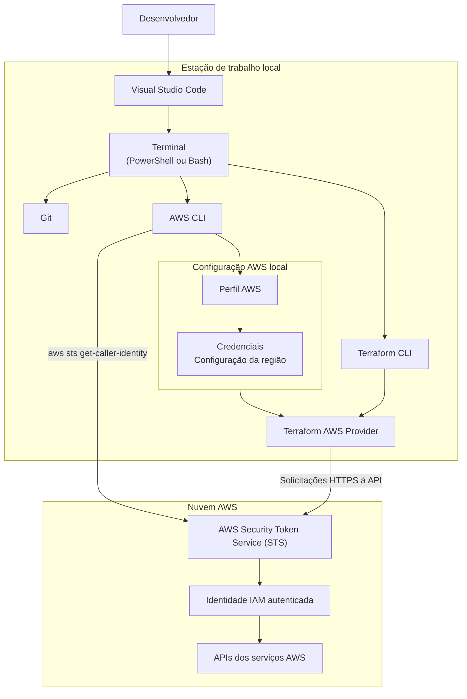
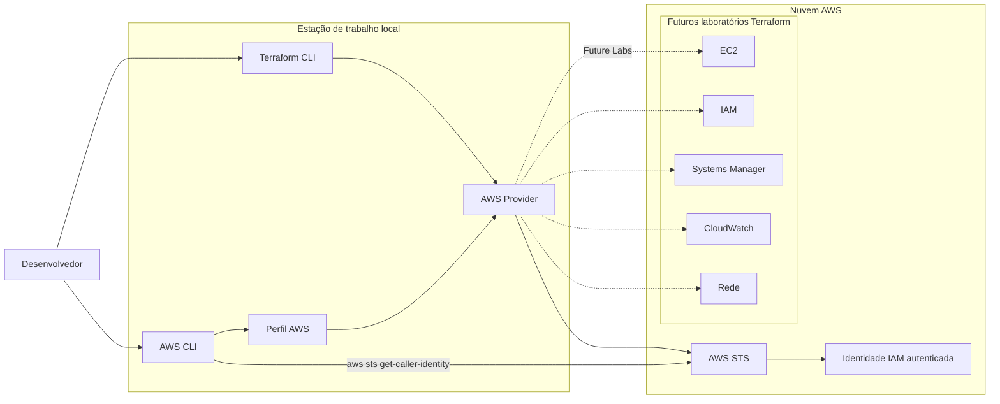
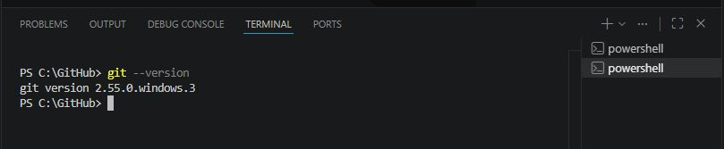
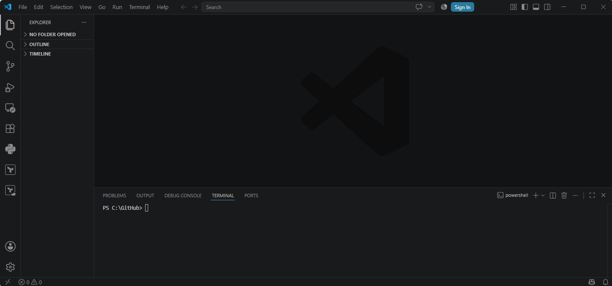
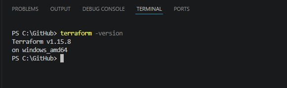
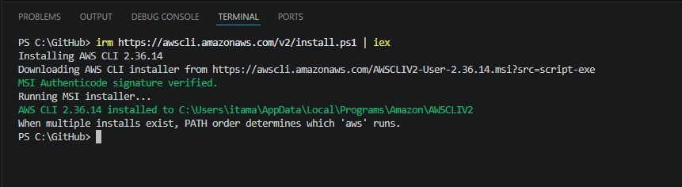
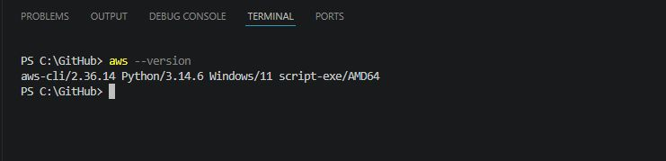
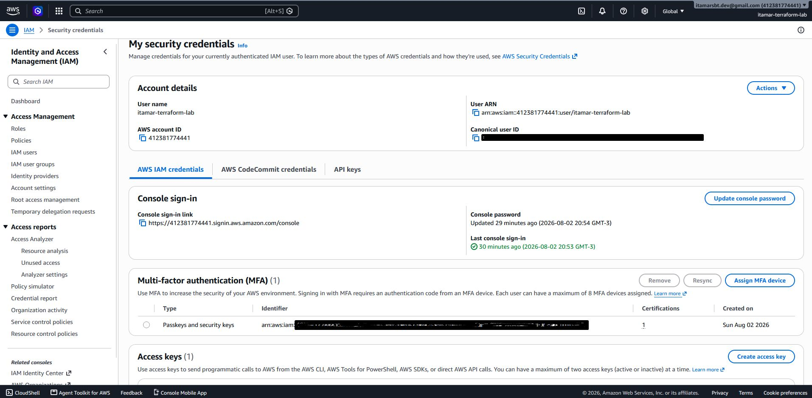

# Lab 00 — Preparação da estação de trabalho para Terraform e autenticação AWS

**Idioma:** [English (principal)](README.md) | **Português (Brasil)**

Prepare seu ambiente local de desenvolvimento para provisionar infraestrutura na AWS de maneira segura com Terraform.

---

## Visão geral

Antes de provisionar infraestrutura na AWS com Terraform, a estação de trabalho local precisa estar devidamente preparada. Este laboratório apresenta a instalação das ferramentas necessárias, a configuração da autenticação AWS e a validação do ambiente local.

Diferentemente dos demais laboratórios deste repositório, **o Lab 00 não provisiona infraestrutura de computação ou rede**. Seu propósito é estabelecer uma base segura para os próximos laboratórios Terraform. Se as etapas de configuração do usuário IAM forem executadas, elas poderão criar identidades IAM e chaves de acesso na conta AWS.

Ao concluir este laboratório, a estação de trabalho estará configurada para se comunicar com segurança com a AWS utilizando a AWS CLI e o provedor AWS do Terraform.

---

## Objetivos de aprendizagem

Ao concluir este laboratório, será possível:

- Instalar e verificar os programas necessários ao desenvolvimento com Terraform.
- Compreender a função do Git, do Visual Studio Code, da Terraform CLI e da AWS CLI.
- Configurar um perfil seguro na AWS CLI.
- Validar a identidade AWS antes de provisionar infraestrutura.
- Compreender como o Terraform se autentica na AWS.
- Aplicar boas práticas de segurança no gerenciamento de credenciais AWS.
- Preparar a estação de trabalho para os laboratórios seguintes deste repositório.

---

## Arquitetura do laboratório

Este laboratório concentra-se na preparação do ambiente local de desenvolvimento. O diagrama a seguir ilustra como o Terraform se autentica e se comunica com a AWS durante o provisionamento de infraestrutura.



E nos **"futuros laboratórios Terraform"**:




---

## Tempo estimado

Aproximadamente **30 a 45 minutos**.

A duração depende dos programas já instalados e da configuração prévia de uma conta AWS.

---

## Custo estimado na AWS

**Custo estimado: US$ 0,00**

Este laboratório **não** provisiona infraestrutura na AWS e, portanto, não gera cobranças em sua conta AWS.

---

## Pré-requisitos

Antes de iniciar este laboratório, certifique-se de possuir:

- Uma conta AWS ativa.
- Permissão para criar ou utilizar um usuário IAM existente.
- Acesso à internet.
- Privilégios administrativos no computador local para instalar programas.
- Uma conta no GitHub (recomendada para os próximos laboratórios).

---

## Programas necessários

Este laboratório exige os seguintes programas:

| Programa | Finalidade |
|----------|---------|
| **Git** | Sistema de controle de versões utilizado para clonar repositórios, acompanhar alterações e colaborar com outros desenvolvedores. |
| **Visual Studio Code** | Editor de código-fonte utilizado para criar, editar e gerenciar projetos Terraform. |
| **Terraform CLI** | Ferramenta de Infraestrutura como Código (IaC) para definir, provisionar e gerenciar infraestrutura AWS. |
| **AWS CLI** | Interface de linha de comando para autenticar-se na AWS e interagir com seus serviços. |

> **Observação:**
>
> Todos os programas instalados neste laboratório serão reutilizados nos demais laboratórios Terraform deste repositório.

---

## Etapa 1 — Instalar os programas necessários

Antes de provisionar infraestrutura na AWS com Terraform, é necessário instalar as ferramentas de desenvolvimento na estação de trabalho.

Nesta etapa, serão instalados e validados os programas utilizados ao longo de toda a trilha de aprendizado de Terraform.

As ferramentas devem ser instaladas na seguinte ordem:

1. Git
2. Visual Studio Code
3. Terraform CLI
4. AWS CLI

---

### Passo 1 — Instalar o Git

O Git é o sistema distribuído de controle de versões utilizado em todo este repositório.

Ele permite:

- Clonar repositórios do GitHub.
- Acompanhar alterações no código.
- Criar branches.
- Colaborar com outros desenvolvedores.
- Sincronizar repositórios locais e remotos.

Baixe o Git no site oficial:

https://git-scm.com/

Após a instalação, abra um terminal e verifique se o Git está instalado:

```powershell
git --version
```

Saída esperada:

```text
git version 2.xx.x.windows.x
```

A versão instalada pode ser diferente.





---

### Passo 2 — Instalar o Visual Studio Code

O Visual Studio Code (VS Code) será utilizado como ambiente principal de desenvolvimento ao longo deste repositório.

Embora projetos Terraform possam ser editados em qualquer editor de texto, o VS Code oferece recursos que melhoram a produtividade, incluindo:

- Destaque de sintaxe
- Formatação automática
- Terminal integrado
- Integração com Git
- Extensões para Terraform
- AWS Toolkit

Baixe o Visual Studio Code no site oficial:

https://code.visualstudio.com/

Após a instalação, verifique se o VS Code abre corretamente.





---

### Passo 3 — Instalar a Terraform CLI

O Terraform é uma ferramenta de Infraestrutura como Código (IaC) desenvolvida pela HashiCorp.

Em vez de criar infraestrutura manualmente pelo AWS Management Console, o Terraform permite descrever a infraestrutura como código.

Essa abordagem oferece diversas vantagens:

- Reprodutibilidade
- Controle de versões
- Automação
- Consistência
- Documentação
- Redução de erros humanos

Baixe o Terraform no site oficial:

https://developer.hashicorp.com/terraform/downloads

Após a instalação, verifique a versão instalada:

```powershell
terraform version
```

Saída esperada:

```text
Terraform v1.x.x
```

A versão instalada pode ser diferente da mostrada acima.





---

### Passo 4 — Instalar a AWS CLI

A AWS Command Line Interface (AWS CLI) é a principal ferramenta utilizada para autenticar a estação de trabalho local na AWS.

O Terraform não realiza diretamente a autenticação na AWS.

Em vez disso, o provedor AWS utiliza credenciais já disponíveis na estação de trabalho, normalmente configuradas pela AWS CLI.

Baixe a versão 2 da AWS CLI no site oficial:

https://aws.amazon.com/cli/

Após a instalação, verifique se a AWS CLI está disponível:

```powershell
aws --version
```

Saída esperada:

```text
aws-cli/2.xx.x
```

A versão instalada pode ser diferente da mostrada acima.





Caso ocorra algum erro, feche completamente o prompt de comando ou o VS Code.

Abra uma nova janela do PowerShell e teste novamente o comando: `aws --version`.





---

## Etapa 2 — Criar uma identidade AWS segura

Antes que o Terraform possa provisionar infraestrutura, a AWS precisa saber **quem** está realizando a solicitação e **quais ações** essa identidade tem permissão para executar.

Na AWS, cada chamada de API está associada a uma identidade autenticada e é avaliada conforme um conjunto de permissões. Compreender esse modelo de autenticação é essencial antes de utilizar o Terraform.

Nesta etapa, será criada ou configurada uma identidade AWS que o Terraform poderá utilizar para provisionar infraestrutura de maneira segura ao longo desta trilha de aprendizado.


---


### Passo 1 — Compreender as identidades AWS

A AWS oferece diferentes tipos de identidade, cada um destinado a uma finalidade específica.

Os tipos de identidade mais comuns são:

| Identidade | Finalidade |
|----------|---------|
| **Usuário raiz (Root User)** | Proprietário original da conta, com acesso irrestrito aos serviços AWS. |
| **Usuário IAM** | Identidade permanente utilizada por pessoas ou aplicações. |
| **Função IAM** | Identidade temporária que pode ser assumida por serviços AWS, usuários ou aplicações. |

Ao longo deste repositório, essas identidades serão utilizadas para diferentes finalidades.

Compreender as diferenças entre elas é essencial antes de provisionar infraestrutura com Terraform.


---


### Passo 2 — Compreender o usuário raiz

Quando uma conta AWS é criada, a AWS cria automaticamente um **usuário raiz (Root User)**.

O usuário raiz possui acesso irrestrito aos serviços e recursos AWS.

Por causa desses privilégios, o usuário raiz **nunca** deve ser utilizado em tarefas administrativas cotidianas ou implantações com Terraform.

Utilize o usuário raiz apenas em atividades excepcionais de gerenciamento da conta, como:

- Encerrar a conta AWS.
- Gerenciar informações de faturamento.
- Recuperar o acesso à conta.
- Configurar determinadas definições de segurança em nível de conta.

Para as demais atividades, utilize identidades IAM.


---


### Passo 3 — Criar um usuário IAM

O Terraform deve se autenticar por meio de uma identidade IAM, em vez do usuário raiz.

Se ainda não existir um usuário IAM para as atividades de laboratório, crie um agora.

Nome sugerido:

```text
terraform-lab
```

Esse usuário será utilizado ao longo da trilha de aprendizado de Terraform.


---


### Passo 4 — Conceder permissões

Para concluir os laboratórios deste repositório, o usuário IAM precisa ter permissão para criar e gerenciar recursos AWS.

Para simplificar o processo de aprendizado, muitos estudantes optam por associar a política gerenciada pela AWS **AdministratorAccess** ao usuário IAM do laboratório.

> **Importante**
>
> Essa abordagem simplifica o aprendizado, mas **não** é considerada uma boa prática para ambientes de produção.

Em ambientes de produção, siga sempre o princípio do privilégio mínimo, concedendo somente as permissões necessárias a cada carga de trabalho.

Os próximos laboratórios apresentarão políticas IAM mais restritivas.


---


### Passo 5 — Habilitar a autenticação multifator (MFA)

Sempre que possível, habilite a autenticação multifator (MFA) para o usuário IAM.

A MFA acrescenta um fator de verificação durante a autenticação, reduzindo significativamente o risco de acesso não autorizado.

Embora a MFA não seja obrigatória para concluir este laboratório, ela é fortemente recomendada para qualquer conta AWS.





---

> **Observação de segurança**
>
> Nunca:
>
> - Envie credenciais AWS ao GitHub.
> - Armazene credenciais dentro de arquivos Terraform.
> - Compartilhe credenciais com outros usuários.
> - Publique capturas de tela contendo IDs de chaves de acesso ou chaves de acesso secretas.


---


## Resumo da etapa

Até este ponto, foram realizadas as seguintes atividades:

- Estudo das diferenças entre os tipos de identidade AWS.
- Compreensão de por que o usuário raiz não deve ser utilizado.
- Criação de um usuário IAM para atividades de laboratório.
- Concessão das permissões necessárias.
- Habilitação da MFA (recomendada).
- Geração de chaves de acesso para autenticação com a AWS CLI.

Na próxima etapa, essas credenciais serão configuradas localmente com a AWS CLI.


---


# Etapa 3 — Configurar a autenticação da AWS CLI

Após criar um usuário IAM e gerar uma chave de acesso, o próximo passo consiste em configurar a estação de trabalho para que a AWS CLI e o Terraform consigam se autenticar com segurança na conta AWS.

Nesta etapa, será configurado um perfil na AWS CLI, validada a identidade e confirmada a preparação da estação de trabalho para provisionar infraestrutura.

> **Importante!**
>
> Esta etapa armazena as credenciais apenas no computador local. Nenhum recurso AWS é criado.

---

## Passo 1 — Compreender os perfis da AWS CLI

Um perfil da AWS CLI é um conjunto nomeado de configurações e credenciais armazenadas na estação de trabalho.

Um perfil normalmente contém:

- ID da chave de acesso AWS
- Chave de acesso secreta AWS
- Região AWS padrão
- Formato de saída padrão

Os perfis permitem trabalhar com várias contas AWS sem modificar o código Terraform.

Nesta trilha de aprendizado, recomenda-se criar um perfil dedicado ao ambiente de laboratório.

Nome sugerido para o perfil:

```text
terraform-lab
```

Um perfil dedicado reduz o risco de provisionar infraestrutura acidentalmente na conta AWS errada.

---

## Passo 2 — Configurar o perfil da AWS CLI

Abra um terminal e execute:

```powershell
aws configure --profile terraform-lab
```

A AWS CLI solicitará quatro valores:

```text
AWS Access Key ID [None]:
AWS Secret Access Key [None]:
Default region name [None]:
Default output format [None]:
```

Informe os seguintes dados:

| Campo | Exemplo |
|--------|----------|
| ID da chave de acesso AWS | AKIA... |
| Chave de acesso secreta AWS | Sua chave de acesso secreta |
| Região padrão | us-east-1 |
| Formato de saída padrão | json |

> **Observação**
>
> Substitua os valores de exemplo pelas credenciais da sua conta AWS.


---

## Passo 3 — Compreender onde a AWS CLI armazena as credenciais

A AWS CLI armazena a configuração localmente.

### Windows

```text
C:\Users\<YOUR_USERNAME>\.aws\
```

### Linux e macOS

```text
~/.aws/
```

Nesse diretório, normalmente existem dois arquivos:

| Arquivo | Finalidade |
|------|---------|
| `credentials` | Armazena o ID da chave de acesso e a chave de acesso secreta. |
| `config` | Armazena a região padrão, o formato de saída e os perfis nomeados. |

O Terraform lê automaticamente esses arquivos por meio do SDK da AWS quando um perfil nomeado é utilizado.

> **Observação de segurança**
>
> Nunca envie esses arquivos ao GitHub nem os compartilhe com outros usuários.


---

## Passo 4 — Validar a identidade configurada

Antes de provisionar infraestrutura, verifique se o perfil configurado consegue se autenticar corretamente.

Execute:

```powershell
aws sts get-caller-identity --profile terraform-lab
```

Exemplo de saída:

```json
{
    "UserId": "AIDAEXAMPLE123456789",
    "Account": "123456789012",
    "Arn": "arn:aws:iam::123456789012:user/terraform-lab"
}
```

Este comando confirma:

- A conta AWS em uso.
- A identidade IAM autenticada.
- O Amazon Resource Name (ARN) de quem realizou a chamada.

> **Importante**
>
> Este comando **não** cria, modifica nem exclui recursos AWS.


---

## Passo 5 — Verificar a região AWS padrão

Confirme que a região AWS esperada está configurada.

Execute:

```powershell
aws configure get region --profile terraform-lab
```

Saída esperada:

```text
us-east-1
```

Se outra região for exibida, atualize a configuração da AWS CLI antes de continuar.


---

## Passo 6 — Exibir a configuração ativa da AWS CLI

Para revisar a configuração atual, execute:

```powershell
aws configure list --profile terraform-lab
```

Este comando exibe:

- O ID da chave de acesso configurada (parcialmente mascarado)
- A região padrão
- O formato de saída
- A origem da configuração

Revise essas informações cuidadosamente antes de prosseguir para a próxima etapa.


---

## Validação da etapa

Antes de continuar, confirme que:

- [ ] O perfil `terraform-lab` foi criado na AWS CLI.
- [ ] O ID da chave de acesso e a chave de acesso secreta foram armazenados corretamente.
- [ ] O comando `aws sts get-caller-identity` retorna a conta AWS esperada.
- [ ] O usuário IAM exibido é o correto.
- [ ] A região AWS padrão está configurada corretamente.
- [ ] O comando `aws configure list` exibe a configuração esperada.

Se todas as verificações forem aprovadas, a estação de trabalho estará corretamente autenticada e pronta para ser utilizada pelo Terraform.

