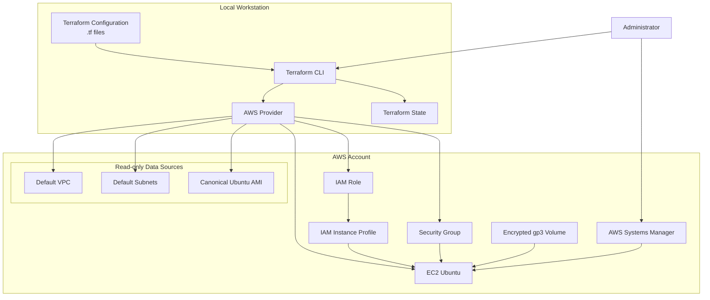
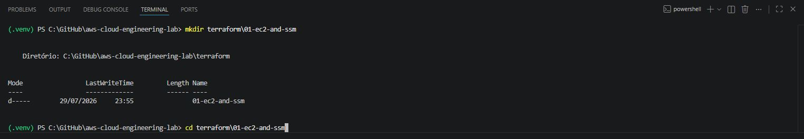
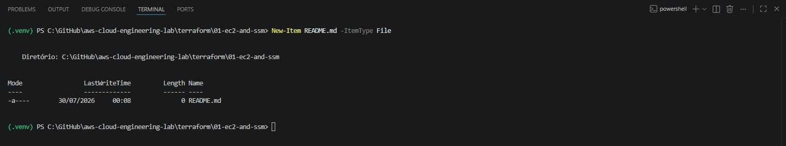
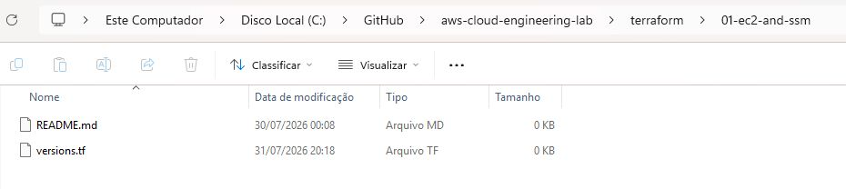
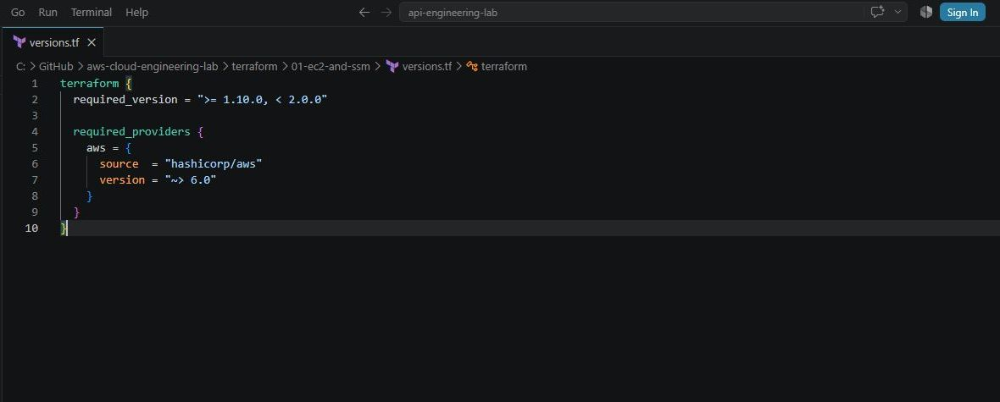
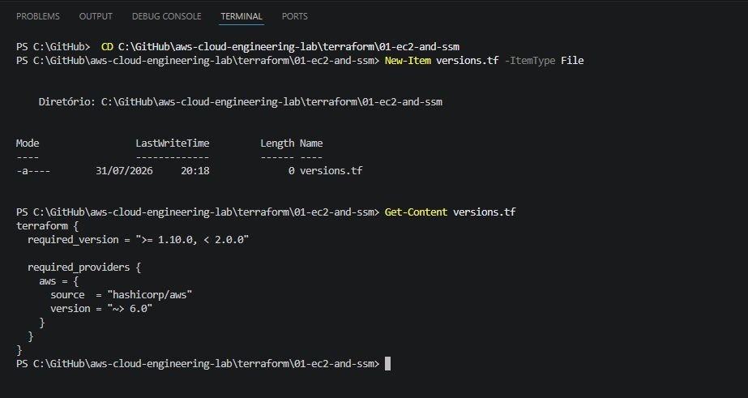
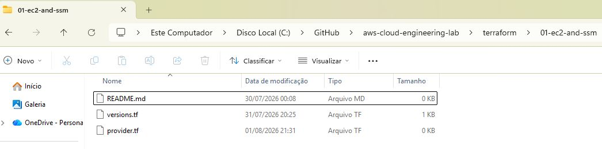
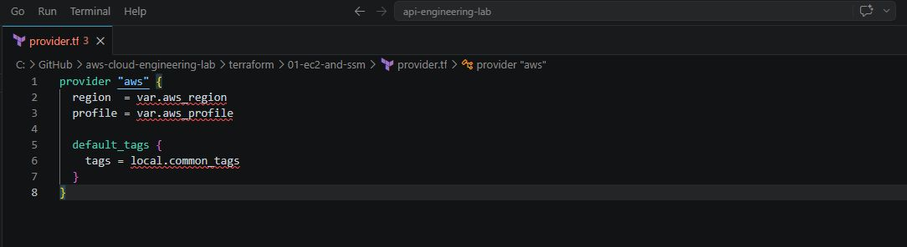

# Lab 01 — EC2 e SSM com Terraform

> Implementação com Terraform do **Lab 01 — EC2 e SSM** manual deste repositório AWS Cloud Engineering Lab.

---

## Visão geral

Na versão manual do Lab 01, a infraestrutura é criada passo a passo pelo AWS Management Console.

Neste laboratório, a mesma arquitetura será reproduzida com **Terraform**, permitindo provisionar, validar e destruir a infraestrutura por meio de Infraestrutura como Código (IaC).

Em vez de apenas executar arquivos Terraform prontos, o tutorial explica como cada arquivo é estruturado, por que existe e como os componentes do Terraform funcionam em conjunto.

Ao final do laboratório, será possível compreender não apenas **como provisionar infraestrutura com Terraform**, mas também **como o Terraform representa recursos AWS**, acompanha o estado da infraestrutura e possibilita implantações reproduzíveis.

---

## Público-alvo

Este laboratório destina-se a:

- Estudantes de AWS e Infraestrutura como Código.
- Iniciantes na área de DevOps ou Engenharia de Nuvem.
- Recrutadores que avaliam projetos práticos de engenharia de nuvem.
- Líderes técnicos que analisam a organização do Terraform, as decisões de engenharia e a qualidade da documentação.

---

## Objetivos de aprendizagem

Ao concluir este laboratório, será possível:

- Compreender a estrutura de um projeto Terraform.
- Organizar configurações Terraform segundo boas práticas de engenharia.
- Provisionar infraestrutura AWS com Infraestrutura como Código.
- Comparar o provisionamento manual com o automatizado.
- Validar os recursos implantados.
- Destruir a infraestrutura com segurança.
- Compreender a relação entre a configuração Terraform, o estado do Terraform (*Terraform State*) e os recursos AWS.

---

## Relação com o laboratório manual

Esta implementação Terraform reproduz a arquitetura criada manualmente em:

➡️ **labs/01-ec2-and-ssm**

A implementação manual permanece inalterada.

O Terraform cria uma segunda infraestrutura, com nomes de recursos distintos, para permitir a comparação lado a lado das implementações antes de remover somente os recursos gerenciados pelo Terraform.

---


## Roteiro do laboratório

Este laboratório está dividido em quatro etapas.

### Etapa 1 — Construir o projeto Terraform

Criar a estrutura do projeto e compreender a finalidade de cada arquivo Terraform.

### Etapa 2 — Provisionar infraestrutura

Implantar uma instância EC2 utilizando Terraform.

### Etapa 3 — Validar a infraestrutura

Examinar os recursos implantados utilizando Terraform, AWS CLI e o console da AWS.

### Etapa 4 — Destruir a infraestrutura

Analisar o plano de destruição e remover com segurança apenas os recursos gerenciados pelo Terraform.


---


## Antes de começar

O Terraform não interage diretamente com o código-fonte da aplicação.

Em vez disso, compara:

- a configuração do Terraform;
- seu estado atual;
- a infraestrutura real em execução na AWS.

Quando são detectadas diferenças, o Terraform gera um plano de execução que descreve quais recursos devem ser criados, atualizados ou destruídos.

Compreender esse fluxo é muito mais importante do que memorizar a sintaxe do Terraform.


---

## Arquitetura




Este diagrama acrescenta três conceitos importantes:

1. **Configuração Terraform** (os arquivos `.tf`).
2. **Estado do Terraform (*Terraform State*)**, demonstrando que ele faz parte da arquitetura.
3. **Provedor AWS (*AWS Provider*)**, mostrando que funciona como ponte entre o Terraform e a AWS.

Além disso, diferencia visualmente os componentes apenas consultados (*Data Sources*) daqueles que são criados (*Resources*).


---


# Etapa 1 — Construir o projeto Terraform do zero

As seções seguintes constroem progressivamente o projeto Terraform.

Em vez de copiar uma solução pronta, cada arquivo Terraform será criado do zero, explicado em detalhes e validado antes da próxima etapa.

Essa abordagem se aproxima da maneira como a infraestrutura é desenvolvida, revisada e mantida por equipes profissionais de engenharia.


---


## Passo 1 — Criar o diretório do projeto

Antes de escrever código Terraform, crie o diretório que conterá o laboratório.

A partir da raiz do repositório:

```powershell
mkdir terraform\01-ec2-and-ssm
cd terraform\01-ec2-and-ssm
```




Neste momento, o diretório deve conter apenas:

```text
terraform/
└── 01-ec2-and-ssm/
    └── README.md
```




Os demais arquivos serão criados progressivamente durante o laboratório.

> [!NOTE]
> Embora o repositório já contenha os arquivos Terraform elaborados, este tutorial os constrói do zero para explicar cada decisão de projeto antes de qualquer provisionamento de infraestrutura.


---


## Passo 2 — Criar o primeiro arquivo Terraform (`versions.tf`)

O primeiro arquivo deste projeto será `versions.tf`.


Esse arquivo define:

- quais versões da Terraform CLI podem executar a configuração;
- quais provedores externos o projeto exige;
- de onde o Terraform deve obter esses provedores;
- quais versões dos provedores são consideradas compatíveis com o projeto.

Definir esses requisitos antes de criar recursos AWS melhora a consistência e ajuda a evitar a execução do projeto com versões incompatíveis.

---

### Compreendendo os provedores Terraform

O Terraform não contém instruções nativas para criar instâncias EC2, funções IAM ou grupos de segurança.

Em vez disso, utiliza plugins chamados **provedores (*providers*)** para se comunicar com plataformas e serviços externos.

Neste laboratório, o Terraform utilizará o provedor AWS:

```text
Terraform Configuration
        ↓
Terraform CLI
        ↓
AWS Provider
        ↓
AWS APIs
        ↓
AWS Resources
```

O provedor AWS traduz a infraestrutura declarada nos arquivos `.tf` em solicitações às APIs da AWS.

> [!IMPORTANT]
> Declarar o provedor AWS como dependência do projeto é diferente de configurá-lo.
>
> Em `versions.tf`, declaramos qual provedor o projeto exige.
>
> No arquivo seguinte, `provider.tf`, configuraremos detalhes como a região AWS e o perfil local da AWS CLI.

---

### Criar `versions.tf`

A partir do diretório do laboratório, crie o arquivo com PowerShell:

```powershell
New-Item versions.tf -ItemType File
```


Como alternativa, crie o arquivo diretamente pelo Explorer do VS Code:

1. Clique com o botão direito no diretório `01-ec2-and-ssm`.
2. Selecione **New File** (Novo arquivo).
3. Informe:

```text
versions.tf
```




Neste momento, a estrutura do projeto deve ser:

```text
terraform/
└── 01-ec2-and-ssm/
    ├── README.md
    └── versions.tf
```

---

### Adicionar os requisitos de versões do Terraform

Abra `versions.tf` e acrescente:

```hcl
terraform {
  required_version = ">= 1.10.0, < 2.0.0"

  required_providers {
    aws = {
      source  = "hashicorp/aws"
      version = "~> 6.0"
    }
  }
}
```

Salve o arquivo.





---

### Compreendendo o bloco `terraform`

O bloco `terraform`, no nível superior, configura o comportamento e os requisitos do projeto Terraform.

```hcl
terraform {
  # Terraform settings are declared here.
}
```

Ele não cria infraestrutura na AWS.

Em vez disso, define requisitos que o Terraform deve avaliar antes de processar os recursos declarados nos demais arquivos.

Nesse bloco, somente valores constantes podem ser utilizados. Ele não pode depender de recursos, variáveis ou valores que o Terraform calculará posteriormente.

---

### Compreendendo `required_version`

A linha a seguir define quais versões da Terraform CLI podem executar esta configuração:

```hcl
required_version = ">= 1.10.0, < 2.0.0"
```

Ela contém duas restrições:

```text
>= 1.10.0
```

A versão instalada da Terraform CLI deve ser `1.10.0` ou superior.

```text
< 2.0.0
```

A versão instalada deve permanecer abaixo do Terraform `2.0.0`.

Em conjunto, essas restrições significam:

```text
Terraform 1.10.0 or newer
        AND
Terraform earlier than 2.0.0
```

Exemplos:

| Installed version | Accepted? | Reason |
|---|---:|---|
| `1.9.8` | No | Earlier than `1.10.0` |
| `1.10.0` | Yes | Meets both constraints |
| `1.12.3` | Yes | Within the accepted range |
| `2.0.0` | No | Excluded by `< 2.0.0` |

> [!NOTE]
> `required_version` se aplica à Terraform CLI instalada na estação de trabalho. Não determina a versão do provedor AWS.

Ao utilizar uma versão incompatível da Terraform CLI, o Terraform interrompe a execução antes do planejamento ou de qualquer alteração na infraestrutura.

---

### Compreendendo `required_providers`

O bloco `required_providers` declara os plugins externos necessários ao projeto:

```hcl
required_providers {
  aws = {
    source  = "hashicorp/aws"
    version = "~> 6.0"
  }
}
```

No momento, este projeto exige apenas um provedor:

```text
aws
```

O nome `aws` passa a ser o identificador local do provedor neste módulo Terraform.

Posteriormente, os recursos AWS utilizarão esse provedor implicitamente:

```hcl
resource "aws_instance" "lab01" {
  # EC2 configuration
}
```

O prefixo `aws_` indica que o tipo de recurso pertence ao provedor AWS.

---

### Compreendendo a origem do provedor

A declaração a seguir identifica a origem do provedor:

```hcl
source = "hashicorp/aws"
```

O endereço contém duas partes:

```text
hashicorp / aws
    │        │
    │        └── Provider type
    │
    └── Provider namespace
```

Como nenhum hostname de registro é especificado, o Terraform utiliza por padrão o Terraform Registry público.

O endereço completo da origem é:

```text
registry.terraform.io/hashicorp/aws
```

Essa declaração evita ambiguidades e informa ao Terraform qual pacote de provedor deve ser instalado.

---

### Compreendendo a restrição de versão do provedor AWS

A linha a seguir define as versões aceitas do provedor AWS:

```hcl
version = "~> 6.0"
```

O operador de restrição pessimista `~>` permite atualizações compatíveis dentro da mesma versão principal.

Neste caso:

```text
~> 6.0
```

equivale a:

```text
>= 6.0.0, < 7.0.0
```

Exemplos:

| AWS Provider version | Accepted? | Reason |
|---|---:|---|
| `5.100.0` | No | Earlier major version |
| `6.0.0` | Yes | Minimum accepted version |
| `6.8.0` | Yes | Compatible 6.x release |
| `6.99.0` | Yes | Still within the 6.x series |
| `7.0.0` | No | New major version |

Versões principais de provedores podem introduzir alterações incompatíveis. Impedir a atualização automática para a versão `7.x` reduz o risco de incompatibilidade inesperada.

---

### Por que não utilizar `latest`?

O Terraform não utiliza uma declaração como:

```hcl
version = "latest"
```

As restrições de versão descrevem um intervalo de versões aceitáveis.

Durante a inicialização, o Terraform seleciona uma versão do provedor que atende à restrição declarada. Em seguida, registra a versão escolhida no arquivo de bloqueio de dependências:

```text
.terraform.lock.hcl
```

Isso produz uma combinação importante:

```text
versions.tf
    ↓
Defines the acceptable version range

.terraform.lock.hcl
    ↓
Records the version actually selected
```

Por exemplo, a configuração pode aceitar qualquer versão do provedor da série `6.x`, enquanto o arquivo de bloqueio registra a versão exata instalada na estação de trabalho.

Normalmente, o arquivo de bloqueio deve ser versionado no Git para que outros colaboradores e ambientes automatizados utilizem a mesma versão selecionada do provedor.

> [!IMPORTANT]
> O arquivo `.terraform.lock.hcl` será criado posteriormente, quando o comando `terraform init` for executado.
>
> Não crie esse arquivo manualmente.

---

### Nome do arquivo e comportamento de carregamento do Terraform

O nome `versions.tf` é uma convenção de organização do projeto.

O Terraform lê automaticamente todos os arquivos com extensão `.tf` do diretório de trabalho atual e avalia suas declarações em conjunto, como um único módulo.

Portanto, o Terraform não executa os arquivos nesta sequência:

```text
versions.tf
provider.tf
variables.tf
compute.tf
```

Em vez disso, carrega todas as declarações em conjunto:

```text
All .tf files in the directory
              ↓
      One Terraform module
```

Dividir a configuração em vários arquivos facilita a navegação e a manutenção, mas não define a ordem de execução.

> [!NOTE]
> O guia de estilo da HashiCorp costuma utilizar `terraform.tf` para o bloco `terraform` de nível superior. Este laboratório utiliza `versions.tf`, outra convenção amplamente compreendida, pois a função do arquivo é centralizar os requisitos de versões do Terraform e do provedor.
>
> A consistência dentro do repositório é mais importante do que tratar o nome do arquivo como requisito do Terraform.

---

### Notas de engenharia

**Finalidade**

Definir as versões compatíveis da Terraform CLI e declarar a dependência do provedor AWS.

**Por que este arquivo existe**

Sem requisitos explícitos de versão, diferentes colaboradores poderiam executar o mesmo projeto com versões incompatíveis do Terraform ou dos provedores.

As restrições de versão tornam as expectativas de compatibilidade visíveis no código-fonte.

**Decisão de projeto**

Este laboratório aceita:

```text
Terraform CLI >= 1.10.0 and < 2.0.0
AWS Provider >= 6.0.0 and < 7.0.0
```

As restrições permitem melhorias compatíveis, evitando a adoção automática de uma nova versão principal.

**Considerações para produção**

Ambientes de produção podem utilizar restrições mais rígidas, ferramentas automatizadas de atualização de dependências e pipelines de validação antes de adotar novas versões do Terraform ou dos provedores.

Por exemplo:

```hcl
version = "~> 6.3.0"
```

permitiria atualizações da série `6.3.x`, mas rejeitaria `6.4.0`.

Uma restrição exata, como:

```hcl
version = "= 6.3.0"
```

aceitaria apenas uma versão do provedor.

A estratégia adequada depende dos processos de teste, atualização e publicação da equipe.

---

### Verificar o arquivo

Confirme que `versions.tf` contém:

```hcl
terraform {
  required_version = ">= 1.10.0, < 2.0.0"

  required_providers {
    aws = {
      source  = "hashicorp/aws"
      version = "~> 6.0"
    }
  }
}
```

Também é possível exibir o arquivo no PowerShell:

```powershell
Get-Content versions.tf
```

A saída esperada é:

```text
terraform {
  required_version = ">= 1.10.0, < 2.0.0"

  required_providers {
    aws = {
      source  = "hashicorp/aws"
      version = "~> 6.0"
    }
  }
}
```





Neste ponto:

- nenhum recurso AWS foi criado;
- nenhum provedor foi baixado;
- nenhum arquivo de estado do Terraform existe;
- nenhuma credencial AWS foi adicionada ao projeto;
- `terraform init` ainda não foi executado.

O projeto declara apenas os requisitos de compatibilidade e a primeira dependência externa.

> [!WARNING]
> Não execute `terraform init` ainda.
>
> Primeiro serão criados os demais arquivos básicos e, depois, o projeto completo será inicializado em uma etapa controlada.


---

### Por que ainda não executamos `terraform fmt`?

Embora `terraform fmt` não crie recursos, seu primeiro uso foi reservado para depois da criação de alguns arquivos. Assim, será possível demonstrar uma diferença real entre:

```text
manually written code
    ↓
terraform fmt
    ↓
canonical formatting
```

O comando `terraform validate` também não foi utilizado porque a validação completa geralmente exige inicializar o diretório e instalar os provedores declarados. A documentação oficial confirma que `required_version` controla a versão permitida da CLI, enquanto `required_providers` declara a origem e o intervalo de versões dos plugins; `terraform init` instalará a versão compatível e atualizará o arquivo de dependências.

Com este Passo 2, são apresentados quatro fundamentos antes da criação de qualquer recurso:

```text
Terraform CLI
Provider
Version constraint
Dependency lock file
```


---


---

## Step 3 — Configure the AWS Provider (`provider.tf`)

In the previous step, the `versions.tf` file declared that this project requires the AWS Provider.

The next step is to configure how Terraform will use that provider.

This configuration will define:

- the AWS Region where the laboratory will be deployed;
- an optional AWS CLI profile;
- common tags that will be automatically applied to supported AWS resources.

The provider configuration acts as the connection layer between the Terraform project and the AWS APIs.

```text
versions.tf
    ↓
Declares the AWS Provider dependency

provider.tf
    ↓
Configures how the AWS Provider will operate

AWS Provider
    ↓
Authenticates and sends requests to AWS APIs
```

> [!IMPORTANT]
> The provider configuration does not create an AWS resource.
>
> It defines how resources and data sources belonging to the AWS Provider will communicate with AWS.

---

### Declaring and Configuring a Provider

Declaring a provider and configuring a provider are related but separate operations.

In `versions.tf`, the project declares:

```hcl
required_providers {
  aws = {
    source  = "hashicorp/aws"
    version = "~> 6.0"
  }
}
```

This tells Terraform:

```text
Provider local name: aws
Provider source:     hashicorp/aws
Accepted versions:   6.x
```

In `provider.tf`, the project configures that provider:

```hcl
provider "aws" {
  # AWS Provider settings
}
```

This block answers operational questions such as:

```text
Which AWS Region should be used?

Should Terraform use a named AWS CLI profile?

Which common tags should be applied to supported resources?
```

The distinction can be summarized as:

| File | Responsibility |
|---|---|
| `versions.tf` | Declares the provider source and compatible versions |
| `provider.tf` | Configures how the provider communicates with AWS |

---

### Create `provider.tf`

From the laboratory directory, create the file using PowerShell:

```powershell
New-Item provider.tf -ItemType File
```


Alternatively, create it through the VS Code Explorer:

1. Right-click the `01-ec2-and-ssm` directory.
2. Select **New File**.
3. Enter:

```text
provider.tf
```




The directory should now contain:

```text
terraform/
└── 01-ec2-and-ssm/
    ├── README.md
    ├── provider.tf
    └── versions.tf
```

---

### Add the AWS Provider Configuration

Open `provider.tf` and add:

```hcl
provider "aws" {
  region  = var.aws_region
  profile = var.aws_profile

  default_tags {
    tags = local.common_tags
  }
}
```

Save the file.





> [!NOTE]
> This configuration references values that have not been declared yet:
>
> - `var.aws_region`;
> - `var.aws_profile`;
> - `local.common_tags`.
>
> These values will be created in the next steps through `variables.tf` and `locals.tf`.
>
> Terraform loads all `.tf` files in the working directory as one module. Therefore, referenced declarations do not need to be located in the same file or written before the provider configuration.

---

### Understanding the `provider` Block

The provider block begins with:

```hcl
provider "aws" {
}
```

The label:

```text
aws
```

refers to the local provider name declared earlier in `required_providers`:

```hcl
required_providers {
  aws = {
    source  = "hashicorp/aws"
    version = "~> 6.0"
  }
}
```

Together, the declarations mean:

```text
Local provider name
        ↓
       aws

Provider package
        ↓
registry.terraform.io/hashicorp/aws
```

The `provider "aws"` block configures the default AWS Provider instance for this Terraform module.

Later, resources beginning with `aws_` will use this default provider configuration automatically:

```hcl
resource "aws_instance" "lab01" {
  # This resource uses the default AWS Provider configuration.
}
```

Examples of other AWS resource types include:

```text
aws_iam_role
aws_security_group
aws_instance
aws_vpc_security_group_egress_rule
```

No provider **alias** is required in this laboratory because all resources will be created in one AWS Region using one provider configuration.

---

### Understanding the AWS Region

The first argument is:

```hcl
region = var.aws_region
```

An AWS Region is the geographic area in which the provider sends supported service requests and creates regional resources.

Examples include:

```text
us-east-1
us-east-2
us-west-2
sa-east-1
```

This laboratory will initially use:

```text
us-east-1
```

However, the Region is not written directly in `provider.tf`.

Instead, it is referenced through:

```hcl
var.aws_region
```

This expression means:

```text
var
 │
 └── Reference an input variable

aws_region
 │
 └── Name of the input variable
```

The corresponding variable will be declared later in `variables.tf`.

This design is preferable to writing:

```hcl
provider "aws" {
  region = "us-east-1"
}
```

Both forms are technically possible, but using an input variable makes the configuration easier to reuse in another Region without editing the provider file.

For example:

```text
Default execution
└── us-east-1

Alternative execution
└── sa-east-1
```

> [!IMPORTANT]
> The Region used by Terraform must contain or support the resources queried and created by the laboratory.
>
> This implementation expects a default VPC and default subnets in the selected Region.

---

### Understanding the Optional AWS CLI Profile

The second argument is:

```hcl
profile = var.aws_profile
```

An AWS profile is a named collection of AWS CLI and SDK configuration values.

For example, a workstation could contain:

```text
default
personal-lab
development
production-read-only
```

A named profile can help separate:

- different AWS accounts;
- different roles;
- different authentication methods;
- different development environments.

The provider will receive the profile name from:

```hcl
var.aws_profile
```

The variable will initially use:

```hcl
default = null
```

When its value is `null`, the configuration does not force a specific named profile. The AWS Provider can then use the available AWS credential mechanisms in the execution environment.

When a profile is required, a local value can later be supplied through `terraform.tfvars`:

```hcl
aws_profile = "personal-lab"
```

> [!CAUTION]
> A profile name is not a credential.
>
> It is only a reference to configuration available in the local AWS environment.
>
> Files containing AWS credentials must never be committed to the repository.

---

### Understanding the AWS Credential Provider Chain

Terraform must authenticate before it can read or modify resources in an AWS account.

The AWS Provider can obtain credentials through supported mechanisms such as:

- environment variables;
- shared AWS credentials files;
- shared AWS configuration files;
- AWS CLI profiles;
- IAM roles attached to AWS compute environments;
- container credentials;
- temporary role credentials.

Conceptually:

```text
Terraform
    ↓
AWS Provider
    ↓
Searches supported credential sources
    ↓
Finds valid credentials
    ↓
Authenticates with AWS APIs
```

The provider stops using the search process when it finds a valid credential source accepted for that execution environment.

This behavior allows the same Terraform configuration to be used in different contexts:

```text
Developer workstation
└── AWS CLI profile or environment authentication

CI/CD pipeline
└── Temporary federated credentials

EC2 execution environment
└── IAM role credentials

Container workload
└── Container credential provider
```

The Terraform source code does not need to contain permanent credentials for these scenarios.

---

### Never Hardcode AWS Credentials

Do not write credentials directly in `provider.tf`.

The following is an insecure example and must not be used:

```hcl
provider "aws" {
  region     = "us-east-1"
  access_key = "EXAMPLE_ACCESS_KEY"
  secret_key = "EXAMPLE_SECRET_KEY"
}
```

Problems with this approach include:

- credentials may be committed to Git;
- repository history can preserve deleted secrets;
- screenshots may expose them;
- copied projects may distribute them;
- multiple users may begin sharing one identity;
- credential rotation becomes harder;
- long-lived credentials increase the impact of accidental exposure.

The laboratory therefore uses:

```hcl
provider "aws" {
  region  = var.aws_region
  profile = var.aws_profile
}
```

Authentication remains outside the Terraform source code.

> [!WARNING]
> Never include the following values in Terraform files, Markdown documentation, screenshots or Git commits:
>
> ```text
> AWS_ACCESS_KEY_ID
> AWS_SECRET_ACCESS_KEY
> AWS_SESSION_TOKEN
> access_key
> secret_key
> session_token
> ```

---

### Validate the Active AWS Identity Before Provisioning

Before any infrastructure is created, the active AWS identity should be checked with the AWS CLI:

```powershell
aws sts get-caller-identity
```

The response identifies the active:

```text
AWS account
AWS principal
AWS ARN
```

A simplified response resembles:

```json
{
  "UserId": "EXAMPLE",
  "Account": "123456789012",
  "Arn": "arn:aws:iam::123456789012:user/example"
}
```

This command does not create resources.

It helps prevent Terraform from being executed against the wrong AWS account.

> [!CAUTION]
> Mask account IDs, user identifiers and ARNs before publishing screenshots unless they are intentionally required as evidence.

To list available local profiles:

```powershell
aws configure list-profiles
```

To inspect the active AWS CLI configuration:

```powershell
aws configure list
```

These commands will be executed later during the environment-validation stage.

---

### Understanding `default_tags`

The provider configuration also contains:

```hcl
default_tags {
  tags = local.common_tags
}
```

The AWS Provider can automatically apply default tags to resources that support tagging.

Instead of repeating a common set of tags in every resource:

```hcl
resource "aws_instance" "example" {
  tags = {
    Project     = "aws-cloud-engineering-lab"
    Environment = "lab"
    ManagedBy   = "Terraform"
  }
}
```

the provider can centralize them:

```hcl
provider "aws" {
  default_tags {
    tags = local.common_tags
  }
}
```

The common tags will later be defined in `locals.tf`.

The intended tag set will include information such as:

```text
Project
Environment
Lab
ManagedBy
Provisioning
Implementation
Repository
```

Conceptually:

```text
local.common_tags
        ↓
provider default_tags
        ↓
Supported Terraform-managed AWS resources
```

This improves:

- resource identification;
- ownership visibility;
- cost allocation preparation;
- inventory searches;
- operational organization;
- cleanup verification.

> [!NOTE]
> Default tags are applied only to resources supported by the AWS Provider's tagging behavior.
>
> They do not automatically tag data sources or AWS objects that Terraform only reads.

---

### Why Use `local.common_tags`?

The following expression:

```hcl
tags = local.common_tags
```

references a local value.

A local value allows an expression to be defined once and reused throughout the module.

Without a local value, common tags could be duplicated:

```hcl
tags = {
  Project     = "aws-cloud-engineering-lab"
  Environment = "lab"
  ManagedBy   = "Terraform"
}
```

Repeated in several places, duplicated tags become harder to maintain.

With a local value:

```hcl
locals {
  common_tags = {
    Project     = "aws-cloud-engineering-lab"
    Environment = "lab"
    ManagedBy   = "Terraform"
  }
}
```

the provider can reference:

```hcl
local.common_tags
```

If a common tag changes, it can be updated in one location.

The complete local value will be created in a later step.

---

### Provider Configuration and Dependency Order

The provider configuration references:

```hcl
var.aws_region
var.aws_profile
local.common_tags
```

Those declarations will exist in separate files:

```text
provider.tf
├── var.aws_region
├── var.aws_profile
└── local.common_tags

variables.tf
├── variable "aws_region"
└── variable "aws_profile"

locals.tf
└── locals {
      common_tags = ...
    }
```

Terraform does not depend on filenames to establish an execution sequence.

It loads all `.tf` files in the directory and constructs one configuration:

```text
versions.tf
provider.tf
variables.tf
locals.tf
data.tf
iam.tf
network.tf
compute.tf
outputs.tf
        ↓
One Terraform root module
```

Terraform then analyzes references and constructs its dependency graph.

Therefore:

```text
provider.tf does not need to appear after variables.tf
```

and:

```text
variables.tf does not need to be named before provider.tf
```

The files are separated for human readability and maintenance.

---

### Why We Use a Default Provider Configuration

The block:

```hcl
provider "aws" {
}
```

has no `alias`.

It is therefore the default AWS Provider configuration in this module.

Resources such as:

```hcl
resource "aws_instance" "lab01" {
}
```

will use it automatically.

A provider alias would be useful in a multi-region or multi-account design:

```hcl
provider "aws" {
  region = "us-east-1"
}

provider "aws" {
  alias  = "secondary"
  region = "us-west-2"
}
```

A resource could then explicitly select:

```hcl
provider = aws.secondary
```

This laboratory intentionally uses only one provider configuration because its goal is to reproduce one EC2 and SSM architecture in a single Region.

Introducing aliases here would add complexity without supporting the current learning objective.

---

### Engineering Notes

**Purpose**

Configure how the AWS Provider selects a Region, obtains authentication information and applies common tags.

**Why this file exists**

The provider declaration in `versions.tf` tells Terraform which plugin to install.

The configuration in `provider.tf` tells that plugin how it should operate.

**Security decision**

No access key, secret key or session token is stored in the Terraform configuration.

Authentication remains external to the version-controlled source code.

**Reusability decision**

The Region and optional profile are represented by input variables instead of fixed values.

This allows the same project to be executed in different approved environments without editing `provider.tf`.

**Tagging decision**

Common tags are centralized through `default_tags` and `local.common_tags`.

This creates a consistent ownership and identification baseline for supported resources.

**Scope decision**

This laboratory uses one default AWS Provider configuration.

Provider aliases and multi-region configurations will be introduced only when a later architecture requires them.

**Production considerations**

Production environments commonly use short-lived credentials, role assumption, workload identity or federated authentication rather than permanent IAM user access keys.

Automated environments should also separate deployment permissions by environment and apply least-privilege policies.

---

### Verify `provider.tf`

Confirm that the file contains:

```hcl
provider "aws" {
  region  = var.aws_region
  profile = var.aws_profile

  default_tags {
    tags = local.common_tags
  }
}
```

Display the file with PowerShell:

```powershell
Get-Content provider.tf
```

Expected output:

```text
provider "aws" {
  region  = var.aws_region
  profile = var.aws_profile

  default_tags {
    tags = local.common_tags
  }
}
```

The project structure should now be:

```text
terraform/
└── 01-ec2-and-ssm/
    ├── README.md
    ├── provider.tf
    └── versions.tf
```

At this stage:

- the AWS Provider has been declared;
- its configuration has been written;
- the AWS Region variable has not yet been declared;
- the AWS profile variable has not yet been declared;
- the common tags have not yet been defined;
- no provider has been downloaded;
- no AWS authentication request has been made by Terraform;
- no Terraform State exists;
- no AWS resource has been created.

> [!WARNING]
> Do not run `terraform init`, `terraform validate`, `terraform plan` or `terraform apply` yet.
>
> The provider configuration still references input variables and local values that will be created in the next steps.

---

### Concepts Learned in Step 3

```text
Provider declaration versus provider configuration
AWS Region selection
Optional AWS CLI profiles
AWS credential provider chain
Externalized authentication
Default provider configuration
Default resource tags
Input-variable references
Local-value references
Terraform module loading behavior
```


