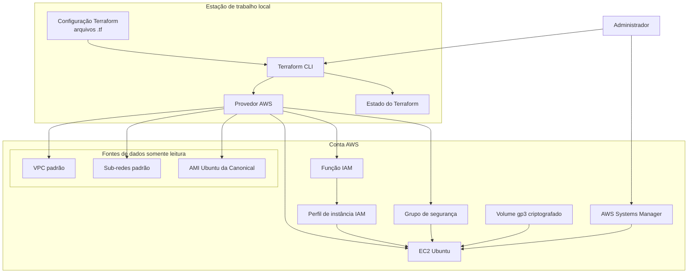
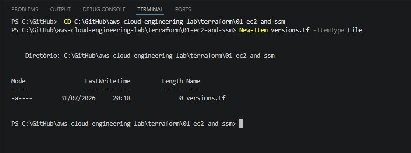
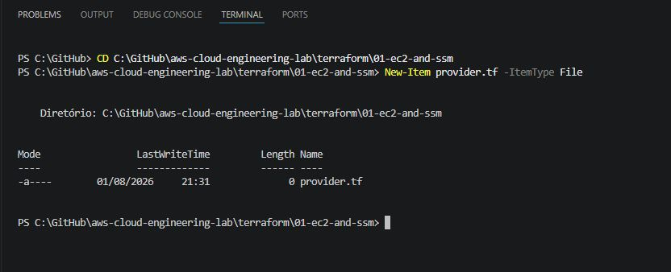

# Lab 01 — EC2 e SSM com Terraform

**Idioma:** [English (principal)](README.md) | **Português (Brasil)**

> Implementação com Terraform do **Lab 01 — EC2 e SSM** manual deste repositório AWS Cloud Engineering Lab.

---

## Visão geral

Na versão manual do Lab 01, a infraestrutura é criada passo a passo pelo AWS Management Console.

Neste laboratório, a mesma arquitetura será reproduzida com **Terraform**, permitindo provisionar, validar e destruir a infraestrutura por meio de Infraestrutura como Código (IaC).

Em vez de apenas executar arquivos Terraform prontos, o tutorial explica como cada arquivo é estruturado, por que existe e como os componentes do Terraform funcionam em conjunto.

Ao final do laboratório, será possível compreender não apenas **como provisionar infraestrutura com Terraform**, mas também **como o Terraform representa recursos AWS**, acompanha o estado da infraestrutura e possibilita implantações reproduzíveis.

---

## Público-alvo

Este laboratório destina-se a:

- Estudantes de AWS e Infraestrutura como Código.
- Iniciantes na área de DevOps ou Engenharia de Nuvem.
- Recrutadores que avaliam projetos práticos de engenharia de nuvem.
- Líderes técnicos que analisam a organização do Terraform, as decisões de engenharia e a qualidade da documentação.

---

## Objetivos de aprendizagem

Ao concluir este laboratório, será possível:

- Compreender a estrutura de um projeto Terraform.
- Organizar configurações Terraform segundo boas práticas de engenharia.
- Provisionar infraestrutura AWS com Infraestrutura como Código.
- Comparar o provisionamento manual com o automatizado.
- Validar os recursos implantados.
- Destruir a infraestrutura com segurança.
- Compreender a relação entre a configuração Terraform, o estado do Terraform (*Terraform State*) e os recursos AWS.

---

## Relação com o laboratório manual

Esta implementação Terraform reproduz a arquitetura criada manualmente em:

➡️ **labs/01-ec2-and-ssm**

A implementação manual permanece inalterada.

O Terraform cria uma segunda infraestrutura, com nomes de recursos distintos, para permitir a comparação lado a lado das implementações antes de remover somente os recursos gerenciados pelo Terraform.

---


## Roteiro do laboratório

Este laboratório está dividido em quatro etapas.

### Etapa 1 — Construir o projeto Terraform

Criar a estrutura do projeto e compreender a finalidade de cada arquivo Terraform.

### Etapa 2 — Provisionar infraestrutura

Implantar uma instância EC2 utilizando Terraform.

### Etapa 3 — Validar a infraestrutura

Examinar os recursos implantados utilizando Terraform, AWS CLI e o console da AWS.

### Etapa 4 — Destruir a infraestrutura

Analisar o plano de destruição e remover com segurança apenas os recursos gerenciados pelo Terraform.


---


## Antes de começar

O Terraform não interage diretamente com o código-fonte da aplicação.

Em vez disso, compara:

- a configuração do Terraform;
- seu estado atual;
- a infraestrutura real em execução na AWS.

Quando são detectadas diferenças, o Terraform gera um plano de execução que descreve quais recursos devem ser criados, atualizados ou destruídos.

Compreender esse fluxo é muito mais importante do que memorizar a sintaxe do Terraform.


---

## Arquitetura




Este diagrama acrescenta três conceitos importantes:

1. **Configuração Terraform** (os arquivos `.tf`).
2. **Estado do Terraform (*Terraform State*)**, demonstrando que ele faz parte da arquitetura.
3. **Provedor AWS (*AWS Provider*)**, mostrando que funciona como ponte entre o Terraform e a AWS.

Além disso, diferencia visualmente os componentes apenas consultados (*Data Sources*) daqueles que são criados (*Resources*).


---


# Etapa 1 — Construir o projeto Terraform do zero

As seções seguintes constroem progressivamente o projeto Terraform.

Em vez de copiar uma solução pronta, cada arquivo Terraform será criado do zero, explicado em detalhes e validado antes da próxima etapa.

Essa abordagem se aproxima da maneira como a infraestrutura é desenvolvida, revisada e mantida por equipes profissionais de engenharia.


---


## Passo 1 — Criar o diretório do projeto

Antes de escrever código Terraform, crie o diretório que conterá o laboratório.

A partir da raiz do repositório:

```powershell
mkdir terraform\01-ec2-and-ssm
cd terraform\01-ec2-and-ssm
```


Neste momento, o diretório deve conter apenas:

```text
terraform/
└── 01-ec2-and-ssm/
    └── README.md
```


Os demais arquivos serão criados progressivamente durante o laboratório.

> [!NOTE]
> Embora o repositório já contenha os arquivos Terraform elaborados, este tutorial os constrói do zero para explicar cada decisão de projeto antes de qualquer provisionamento de infraestrutura.


---


## Passo 2 — Criar o primeiro arquivo Terraform (`versions.tf`)

O primeiro arquivo deste projeto será `versions.tf`.


Esse arquivo define:

- quais versões da Terraform CLI podem executar a configuração;
- quais provedores externos o projeto exige;
- de onde o Terraform deve obter esses provedores;
- quais versões dos provedores são consideradas compatíveis com o projeto.

Definir esses requisitos antes de criar recursos AWS melhora a consistência e ajuda a evitar a execução do projeto com versões incompatíveis.

---

### Compreendendo os provedores Terraform

O Terraform não contém instruções nativas para criar instâncias EC2, funções IAM ou grupos de segurança.

Em vez disso, utiliza plugins chamados **provedores (*providers*)** para se comunicar com plataformas e serviços externos.

Neste laboratório, o Terraform utilizará o provedor AWS:

```text
Configuração Terraform
        ↓
Terraform CLI
        ↓
Provedor AWS
        ↓
AWS APIs
        ↓
Recursos AWS
```

O provedor AWS traduz a infraestrutura declarada nos arquivos `.tf` em solicitações às APIs da AWS.

> [!IMPORTANT]
> Declarar o provedor AWS como dependência do projeto é diferente de configurá-lo.
>
> Em `versions.tf`, declaramos qual provedor o projeto exige.
>
> No arquivo seguinte, `provider.tf`, configuraremos detalhes como a região AWS e o perfil local da AWS CLI.

---

### Criar `versions.tf`

A partir do diretório do laboratório, crie o arquivo com PowerShell:

```powershell
New-Item versions.tf -ItemType File
```




Como alternativa, crie o arquivo diretamente pelo Explorer do VS Code:

1. Clique com o botão direito no diretório `01-ec2-and-ssm`.
2. Selecione **New File** (Novo arquivo).
3. Informe:

```text
versions.tf
```


Neste momento, a estrutura do projeto deve ser:

```text
terraform/
└── 01-ec2-and-ssm/
    ├── README.md
    └── versions.tf
```

---

### Adicionar os requisitos de versões do Terraform

Abra `versions.tf` e acrescente:

```hcl
terraform {
  required_version = ">= 1.10.0, < 2.0.0"

  required_providers {
    aws = {
      source  = "hashicorp/aws"
      version = "~> 6.0"
    }
  }
}
```

Salve o arquivo.


---

### Compreendendo o bloco `terraform`

O bloco `terraform`, no nível superior, configura o comportamento e os requisitos do projeto Terraform.

```hcl
terraform {
  # Terraform settings are declared here.
}
```

Ele não cria infraestrutura na AWS.

Em vez disso, define requisitos que o Terraform deve avaliar antes de processar os recursos declarados nos demais arquivos.

Nesse bloco, somente valores constantes podem ser utilizados. Ele não pode depender de recursos, variáveis ou valores que o Terraform calculará posteriormente.

---

### Compreendendo `required_version`

A linha a seguir define quais versões da Terraform CLI podem executar esta configuração:

```hcl
required_version = ">= 1.10.0, < 2.0.0"
```

Ela contém duas restrições:

```text
>= 1.10.0
```

A versão instalada da Terraform CLI deve ser `1.10.0` ou superior.

```text
< 2.0.0
```

A versão instalada deve permanecer abaixo do Terraform `2.0.0`.

Em conjunto, essas restrições significam:

```text
Terraform 1.10.0 ou superior
        E
Terraform anterior a 2.0.0
```

Exemplos:

| Versão instalada | Aceita? | Motivo |
|---|---:|---|
| `1.9.8` | Não | Anterior à versão `1.10.0` |
| `1.10.0` | Sim | Atende às duas restrições |
| `1.12.3` | Sim | Dentro do intervalo aceito |
| `2.0.0` | Não | Excluída pela restrição `< 2.0.0` |

> [!NOTE]
> `required_version` se aplica à Terraform CLI instalada na estação de trabalho. Não determina a versão do provedor AWS.

Ao utilizar uma versão incompatível da Terraform CLI, o Terraform interrompe a execução antes do planejamento ou de qualquer alteração na infraestrutura.

---

### Compreendendo `required_providers`

O bloco `required_providers` declara os plugins externos necessários ao projeto:

```hcl
required_providers {
  aws = {
    source  = "hashicorp/aws"
    version = "~> 6.0"
  }
}
```

No momento, este projeto exige apenas um provedor:

```text
aws
```

O nome `aws` passa a ser o identificador local do provedor neste módulo Terraform.

Posteriormente, os recursos AWS utilizarão esse provedor implicitamente:

```hcl
resource "aws_instance" "lab01" {
  # EC2 configuration
}
```

O prefixo `aws_` indica que o tipo de recurso pertence ao provedor AWS.

---

### Compreendendo a origem do provedor

A declaração a seguir identifica a origem do provedor:

```hcl
source = "hashicorp/aws"
```

O endereço contém duas partes:

```text
hashicorp / aws
    │        │
    │        └── Tipo de provedor
    │
    └── Namespace do provedor
```

Como nenhum hostname de registro é especificado, o Terraform utiliza por padrão o Terraform Registry público.

O endereço completo da origem é:

```text
registry.terraform.io/hashicorp/aws
```

Essa declaração evita ambiguidades e informa ao Terraform qual pacote de provedor deve ser instalado.

---

### Compreendendo a restrição de versão do provedor AWS

A linha a seguir define as versões aceitas do provedor AWS:

```hcl
version = "~> 6.0"
```

O operador de restrição pessimista `~>` permite atualizações compatíveis dentro da mesma versão principal.

Neste caso:

```text
~> 6.0
```

equivale a:

```text
>= 6.0.0, < 7.0.0
```

Exemplos:

| Versão do provedor AWS | Aceita? | Motivo |
|---|---:|---|
| `5.100.0` | Não | Versão principal anterior |
| `6.0.0` | Sim | Versão mínima aceita |
| `6.8.0` | Sim | Versão compatível da série 6.x |
| `6.99.0` | Sim | Ainda dentro da série 6.x |
| `7.0.0` | Não | Nova versão principal |

Versões principais de provedores podem introduzir alterações incompatíveis. Impedir a atualização automática para a versão `7.x` reduz o risco de incompatibilidade inesperada.

---

### Por que não utilizar `latest`?

O Terraform não utiliza uma declaração como:

```hcl
version = "latest"
```

As restrições de versão descrevem um intervalo de versões aceitáveis.

Durante a inicialização, o Terraform seleciona uma versão do provedor que atende à restrição declarada. Em seguida, registra a versão escolhida no arquivo de bloqueio de dependências:

```text
.terraform.lock.hcl
```

Isso produz uma combinação importante:

```text
versions.tf
    ↓
Define o intervalo de versões aceitáveis

.terraform.lock.hcl
    ↓
Registra a versão efetivamente selecionada
```

Por exemplo, a configuração pode aceitar qualquer versão do provedor da série `6.x`, enquanto o arquivo de bloqueio registra a versão exata instalada na estação de trabalho.

Normalmente, o arquivo de bloqueio deve ser versionado no Git para que outros colaboradores e ambientes automatizados utilizem a mesma versão selecionada do provedor.

> [!IMPORTANT]
> O arquivo `.terraform.lock.hcl` será criado posteriormente, quando o comando `terraform init` for executado.
>
> Não crie esse arquivo manualmente.

---

### Nome do arquivo e comportamento de carregamento do Terraform

O nome `versions.tf` é uma convenção de organização do projeto.

O Terraform lê automaticamente todos os arquivos com extensão `.tf` do diretório de trabalho atual e avalia suas declarações em conjunto, como um único módulo.

Portanto, o Terraform não executa os arquivos nesta sequência:

```text
versions.tf
provider.tf
variables.tf
compute.tf
```

Em vez disso, carrega todas as declarações em conjunto:

```text
Todos os arquivos .tf do diretório
              ↓
      Um único módulo Terraform
```

Dividir a configuração em vários arquivos facilita a navegação e a manutenção, mas não define a ordem de execução.

> [!NOTE]
> O guia de estilo da HashiCorp costuma utilizar `terraform.tf` para o bloco `terraform` de nível superior. Este laboratório utiliza `versions.tf`, outra convenção amplamente compreendida, pois a função do arquivo é centralizar os requisitos de versões do Terraform e do provedor.
>
> A consistência dentro do repositório é mais importante do que tratar o nome do arquivo como requisito do Terraform.

---

### Notas de engenharia

**Finalidade**

Definir as versões compatíveis da Terraform CLI e declarar a dependência do provedor AWS.

**Por que este arquivo existe**

Sem requisitos explícitos de versão, diferentes colaboradores poderiam executar o mesmo projeto com versões incompatíveis do Terraform ou dos provedores.

As restrições de versão tornam as expectativas de compatibilidade visíveis no código-fonte.

**Decisão de projeto**

Este laboratório aceita:

```text
Terraform CLI >= 1.10.0 and < 2.0.0
AWS Provider >= 6.0.0 and < 7.0.0
```

As restrições permitem melhorias compatíveis, evitando a adoção automática de uma nova versão principal.

**Considerações para produção**

Ambientes de produção podem utilizar restrições mais rígidas, ferramentas automatizadas de atualização de dependências e pipelines de validação antes de adotar novas versões do Terraform ou dos provedores.

Por exemplo:

```hcl
version = "~> 6.3.0"
```

permitiria atualizações da série `6.3.x`, mas rejeitaria `6.4.0`.

Uma restrição exata, como:

```hcl
version = "= 6.3.0"
```

aceitaria apenas uma versão do provedor.

A estratégia adequada depende dos processos de teste, atualização e publicação da equipe.

---

### Verificar o arquivo

Confirme que `versions.tf` contém:

```hcl
terraform {
  required_version = ">= 1.10.0, < 2.0.0"

  required_providers {
    aws = {
      source  = "hashicorp/aws"
      version = "~> 6.0"
    }
  }
}
```

Também é possível exibir o arquivo no PowerShell:

```powershell
Get-Content versions.tf
```

A saída esperada é:

```text
terraform {
  required_version = ">= 1.10.0, < 2.0.0"

  required_providers {
    aws = {
      source  = "hashicorp/aws"
      version = "~> 6.0"
    }
  }
}
```


Neste ponto:

- nenhum recurso AWS foi criado;
- nenhum provedor foi baixado;
- nenhum arquivo de estado do Terraform existe;
- nenhuma credencial AWS foi adicionada ao projeto;
- `terraform init` ainda não foi executado.

O projeto declara apenas os requisitos de compatibilidade e a primeira dependência externa.

> [!WARNING]
> Não execute `terraform init` ainda.
>
> Primeiro serão criados os demais arquivos básicos e, depois, o projeto completo será inicializado em uma etapa controlada.


---

### Por que ainda não executamos `terraform fmt`?

Embora `terraform fmt` não crie recursos, seu primeiro uso foi reservado para depois da criação de alguns arquivos. Assim, será possível demonstrar uma diferença real entre:

```text
código escrito manualmente
    ↓
terraform fmt
    ↓
formatação padronizada
```

O comando `terraform validate` também não foi utilizado porque a validação completa geralmente exige inicializar o diretório e instalar os provedores declarados. A documentação oficial confirma que `required_version` controla a versão permitida da CLI, enquanto `required_providers` declara a origem e o intervalo de versões dos plugins; `terraform init` instalará a versão compatível e atualizará o arquivo de dependências.

Com este Passo 2, são apresentados quatro fundamentos antes da criação de qualquer recurso:

```text
Terraform CLI
Provider
Restrição de versão
Arquivo de bloqueio de dependências
```


---


---

## Passo 3 — Configurar o provedor AWS (`provider.tf`)

No passo anterior, o arquivo `versions.tf` declarou que este projeto exige o provedor AWS.

O próximo passo é configurar como o Terraform utilizará esse provedor.

Essa configuração definirá:

- a região AWS em que o laboratório será implantado;
- um perfil opcional da AWS CLI;
- tags comuns que serão aplicadas automaticamente aos recursos AWS compatíveis.

A configuração do provedor atua como camada de conexão entre o projeto Terraform e as APIs da AWS.

```text
versions.tf
    ↓
Declara a dependência do provedor AWS

provider.tf
    ↓
Configura como o provedor AWS funcionará

AWS Provider
    ↓
Autentica-se e envia solicitações às APIs AWS
```

> [!IMPORTANT]
> A configuração do provedor não cria recursos AWS.
>
> Ela define como recursos e fontes de dados desse provedor se comunicam com a AWS.

---

### Declarar e configurar um provedor

Declarar um provedor e configurá-lo são operações relacionadas, mas distintas.

Em `versions.tf`, o projeto declara:

```hcl
required_providers {
  aws = {
    source  = "hashicorp/aws"
    version = "~> 6.0"
  }
}
```

Isso informa ao Terraform:

```text
Nome local do provedor: aws
Origem do provedor:     hashicorp/aws
Versões aceitas:   6.x
```

Em `provider.tf`, o projeto configura esse provedor:

```hcl
provider "aws" {
  # AWS Provider settings
}
```

Esse bloco responde a perguntas operacionais como:

```text
Qual região AWS deve ser utilizada?

O Terraform deve utilizar um perfil nomeado da AWS CLI?

Quais tags comuns devem ser aplicadas aos recursos compatíveis?
```

A diferença pode ser resumida assim:

| Arquivo | Responsabilidade |
|---|---|
| `versions.tf` | Declara a origem do provedor e as versões compatíveis |
| `provider.tf` | Configura como o provedor se comunica com a AWS |

---

### Criar `provider.tf`

A partir do diretório do laboratório, crie o arquivo usando PowerShell:

```powershell
New-Item provider.tf -ItemType File
```




Como alternativa, crie-o pelo Explorer do VS Code:

1. Clique com o botão direito no diretório `01-ec2-and-ssm`.
2. Selecione **New File** (Novo arquivo).
3. Informe:

```text
provider.tf
```


Agora o diretório deve conter:

```text
terraform/
└── 01-ec2-and-ssm/
    ├── README.md
    ├── provider.tf
    └── versions.tf
```

---

### Adicionar a configuração do provedor AWS

Abra `provider.tf` e acrescente:

```hcl
provider "aws" {
  region  = var.aws_region
  profile = var.aws_profile

  default_tags {
    tags = local.common_tags
  }
}
```

Salve o arquivo.


> [!NOTE]
> Esta configuração faz referência a valores que ainda não foram declarados:
>
> - `var.aws_region`;
> - `var.aws_profile`;
> - `local.common_tags`.
>
> Eles serão criados nos passos seguintes por meio de `variables.tf` e `locals.tf`.
>
> O Terraform carrega todos os arquivos `.tf` do diretório de trabalho como um único módulo. Portanto, as declarações referenciadas não precisam estar no mesmo arquivo nem ser escritas antes da configuração do provedor.

---

### Compreendendo o bloco `provider`

O bloco do provedor começa com:

```hcl
provider "aws" {
}
```

O rótulo:

```text
aws
```

refere-se ao nome local do provedor, declarado anteriormente em `required_providers`:

```hcl
required_providers {
  aws = {
    source  = "hashicorp/aws"
    version = "~> 6.0"
  }
}
```

Em conjunto, essas declarações significam:

```text
Nome local do provedor
        ↓
       aws

Pacote do provedor
        ↓
registry.terraform.io/hashicorp/aws
```

O bloco `provider "aws"` configura a instância padrão do provedor AWS para este módulo Terraform.

Posteriormente, os recursos cujos tipos começam com `aws_` utilizarão automaticamente essa configuração padrão:

```hcl
resource "aws_instance" "lab01" {
  # This resource uses the default AWS Provider configuration.
}
```

Exemplos de outros tipos de recursos AWS:

```text
aws_iam_role
aws_security_group
aws_instance
aws_vpc_security_group_egress_rule
```

Não é necessário um **alias** de provedor neste laboratório, pois todos os recursos serão criados em uma única região AWS, usando uma só configuração.

---

### Compreendendo a região AWS

O primeiro argumento é:

```hcl
region = var.aws_region
```

Uma região AWS é uma área geográfica na qual o provedor envia chamadas compatíveis aos serviços e cria recursos regionais.

Alguns exemplos:

```text
us-east-1
us-east-2
us-west-2
sa-east-1
```

Este laboratório utilizará inicialmente:

```text
us-east-1
```

Entretanto, a região não é escrita diretamente em `provider.tf`.

Em vez disso, é referenciada por:

```hcl
var.aws_region
```

Essa expressão significa:

```text
var
 │
 └── Referência a uma variável de entrada

aws_region
 │
 └── Nome da variável de entrada
```

A variável correspondente será declarada posteriormente em `variables.tf`.

Esse projeto é preferível a escrever:

```hcl
provider "aws" {
  region = "us-east-1"
}
```

Ambas as formas são tecnicamente possíveis, mas usar uma variável de entrada facilita a reutilização da configuração em outra região, sem modificar o arquivo do provedor.

Por exemplo:

```text
Execução padrão
└── us-east-1

Execução alternativa
└── sa-east-1
```

> [!IMPORTANT]
> A região utilizada pelo Terraform precisa conter ou oferecer suporte aos recursos consultados e criados pelo laboratório.
>
> Esta implementação espera encontrar uma VPC padrão e sub-redes padrão na região selecionada.

---

### Compreendendo o perfil opcional da AWS CLI

O segundo argumento é:

```hcl
profile = var.aws_profile
```

Um perfil AWS é um conjunto nomeado de valores de configuração da AWS CLI e do SDK da AWS.

Por exemplo, uma estação de trabalho pode conter:

```text
default
personal-lab
development
production-read-only
```

Um perfil nomeado ajuda a separar:

- diferentes contas AWS;
- diferentes funções IAM;
- diferentes métodos de autenticação;
- diferentes ambientes de desenvolvimento.

O provedor receberá o nome do perfil de:

```hcl
var.aws_profile
```

A variável utilizará inicialmente:

```hcl
default = null
```

Quando seu valor é `null`, a configuração não impõe um perfil nomeado específico. Nesse caso, o provedor AWS pode utilizar os mecanismos de credenciais disponíveis no ambiente de execução.

Quando um perfil for necessário, será possível fornecer um valor local por `terraform.tfvars`:

```hcl
aws_profile = "personal-lab"
```

> [!CAUTION]
> O nome do perfil não é uma credencial.
>
> Ele é apenas uma referência à configuração disponível no ambiente AWS local.
>
> Arquivos que contêm credenciais AWS nunca devem ser enviados ao repositório.

---

### Compreendendo a cadeia de provedores de credenciais AWS

O Terraform precisa se autenticar antes de consultar ou modificar recursos em uma conta AWS.

O provedor AWS pode obter credenciais por mecanismos compatíveis, como:

- variáveis de ambiente;
- arquivos compartilhados de credenciais AWS;
- arquivos compartilhados de configuração AWS;
- perfis da AWS CLI;
- funções IAM associadas a ambientes computacionais AWS;
- credenciais de contêineres;
- credenciais temporárias de funções IAM.

Conceitualmente:

```text
Terraform
    ↓
Provedor AWS
    ↓
Procura origens de credenciais compatíveis
    ↓
Encontra credenciais válidas
    ↓
Autentica-se nas APIs da AWS
```

O provedor interrompe a busca ao encontrar uma origem de credenciais válidas e aceita naquele ambiente de execução.

Esse comportamento permite utilizar a mesma configuração Terraform em contextos diferentes:

```text
Estação de trabalho do desenvolvedor
└── Perfil AWS CLI ou autenticação do ambiente

CI/CD pipeline
└── Credenciais federadas temporárias

Ambiente de execução EC2
└── Credenciais de função IAM

Carga de trabalho de contêiner
└── Provedor de credenciais de contêiner
```

O código-fonte Terraform não precisa conter credenciais permanentes para esses cenários.

---

### Nunca inserir credenciais AWS diretamente no código

Não escreva credenciais diretamente em `provider.tf`.

O exemplo a seguir é inseguro e não deve ser utilizado:

```hcl
provider "aws" {
  region     = "us-east-1"
  access_key = "EXAMPLE_ACCESS_KEY"
  secret_key = "EXAMPLE_SECRET_KEY"
}
```

Entre os problemas dessa abordagem estão:

- as credenciais podem ser enviadas ao Git;
- o histórico do repositório pode preservar segredos excluídos;
- capturas de tela podem expor essas informações;
- projetos copiados podem distribuir as credenciais;
- diferentes usuários podem acabar compartilhando uma mesma identidade;
- a rotação de credenciais se torna mais difícil;
- credenciais de longa duração aumentam o impacto de exposições acidentais.

Por isso, o laboratório utiliza:

```hcl
provider "aws" {
  region  = var.aws_region
  profile = var.aws_profile
}
```

A autenticação permanece fora do código-fonte Terraform.

> [!WARNING]
> Nunca inclua os valores a seguir em arquivos Terraform, documentos Markdown, capturas de tela ou commits do Git:
>
> ```text
> AWS_ACCESS_KEY_ID
> AWS_SECRET_ACCESS_KEY
> AWS_SESSION_TOKEN
> access_key
> secret_key
> session_token
> ```

---

### Validar a identidade AWS ativa antes do provisionamento

Antes de criar qualquer infraestrutura, verifique a identidade AWS ativa com a AWS CLI:

```powershell
aws sts get-caller-identity
```

A resposta identifica:

```text
Conta AWS
Entidade principal AWS
AWS ARN
```

Uma resposta simplificada se parece com:

```json
{
  "UserId": "EXAMPLE",
  "Account": "123456789012",
  "Arn": "arn:aws:iam::123456789012:user/example"
}
```

Esse comando não cria recursos.

Ele ajuda a evitar que o Terraform seja executado na conta AWS errada.

> [!CAUTION]
> Oculte IDs de conta, identificadores de usuários e ARNs antes de publicar capturas de tela, a menos que sejam intencionalmente necessários como evidência.

Para listar os perfis locais disponíveis:

```powershell
aws configure list-profiles
```

Para inspecionar a configuração ativa da AWS CLI:

```powershell
aws configure list
```

Esses comandos serão executados posteriormente na etapa de validação do ambiente.

---

### Compreendendo `default_tags`

A configuração do provedor também contém:

```hcl
default_tags {
  tags = local.common_tags
}
```

O provedor AWS pode aplicar automaticamente tags padrão aos recursos que oferecem suporte a elas.

Em vez de repetir um conjunto de tags comuns em cada recurso:

```hcl
resource "aws_instance" "example" {
  tags = {
    Project     = "aws-cloud-engineering-lab"
    Environment = "lab"
    ManagedBy   = "Terraform"
  }
}
```

o provedor pode centralizá-las:

```hcl
provider "aws" {
  default_tags {
    tags = local.common_tags
  }
}
```

As tags comuns serão definidas posteriormente em `locals.tf`.

O conjunto planejado de tags incluirá informações como:

```text
Project
Environment
Lab
ManagedBy
Provisioning
Implementation
Repository
```

Conceitualmente:

```text
local.common_tags
        ↓
provider default_tags
        ↓
Recursos AWS compatíveis gerenciados pelo Terraform
```

Isso melhora:

- a identificação dos recursos;
- a visibilidade dos responsáveis;
- a preparação da alocação de custos;
- as pesquisas de inventário;
- a organização operacional;
- a verificação da limpeza dos recursos.

> [!NOTE]
> Tags padrão são aplicadas apenas aos recursos compatíveis com o comportamento de tagging do provedor AWS.
>
> Elas não adicionam tags automaticamente a fontes de dados nem a objetos AWS que o Terraform apenas consulta.

---

### Por que utilizar `local.common_tags`?

A expressão a seguir:

```hcl
tags = local.common_tags
```

faz referência a um valor local.

Um valor local permite definir uma expressão uma vez e reutilizá-la ao longo do módulo.

Sem um valor local, as tags comuns poderiam ser repetidas:

```hcl
tags = {
  Project     = "aws-cloud-engineering-lab"
  Environment = "lab"
  ManagedBy   = "Terraform"
}
```

Repetidas em vários lugares, essas tags se tornam mais difíceis de manter.

Com um valor local:

```hcl
locals {
  common_tags = {
    Project     = "aws-cloud-engineering-lab"
    Environment = "lab"
    ManagedBy   = "Terraform"
  }
}
```

o provedor pode referenciar:

```hcl
local.common_tags
```

Se uma tag comum mudar, ela poderá ser atualizada em um único lugar.

O valor local completo será criado em um passo posterior.

---

### Configuração do provedor e ordem de dependências

A configuração do provedor faz referência a:

```hcl
var.aws_region
var.aws_profile
local.common_tags
```

Essas declarações existirão em arquivos separados:

```text
provider.tf
├── var.aws_region
├── var.aws_profile
└── local.common_tags

variables.tf
├── variable "aws_region"
└── variable "aws_profile"

locals.tf
└── locals {
      common_tags = ...
    }
```

O Terraform não depende dos nomes dos arquivos para estabelecer a ordem de execução.

Ele carrega todos os arquivos `.tf` do diretório e constrói uma única configuração:

```text
versions.tf
provider.tf
variables.tf
locals.tf
data.tf
iam.tf
network.tf
compute.tf
outputs.tf
        ↓
Um único módulo raiz Terraform
```

Em seguida, o Terraform analisa as referências e constrói seu grafo de dependências.

Portanto:

```text
provider.tf não precisa aparecer depois de variables.tf
```

e:

```text
variables.tf não precisa ter nome anterior ao de provider.tf
```

Os arquivos são separados para facilitar a leitura e a manutenção.

---

### Por que utilizar uma configuração padrão do provedor?

O bloco:

```hcl
provider "aws" {
}
```

não possui `alias`.

Portanto, representa a configuração padrão do provedor AWS neste módulo.

Recursos como:

```hcl
resource "aws_instance" "lab01" {
}
```

irão utilizá-la automaticamente.

Um alias de provedor seria útil em uma arquitetura com várias regiões ou contas:

```hcl
provider "aws" {
  region = "us-east-1"
}

provider "aws" {
  alias  = "secondary"
  region = "us-west-2"
}
```

Um recurso poderia então selecionar explicitamente:

```hcl
provider = aws.secondary
```

Este laboratório utiliza intencionalmente uma só configuração do provedor, pois seu objetivo é reproduzir uma arquitetura de EC2 e SSM em uma única região.

Introduzir aliases aqui acrescentaria complexidade sem contribuir para o objetivo de aprendizagem atual.

---

### Notas de engenharia

**Finalidade**

Configurar como o provedor AWS seleciona uma região, obtém informações de autenticação e aplica tags comuns.

**Por que este arquivo existe**

A declaração do provedor em `versions.tf` informa ao Terraform qual plugin deve ser instalado.

A configuração em `provider.tf` informa ao plugin como ele deve funcionar.

**Decisão de segurança**

Nenhuma chave de acesso, chave secreta ou token de sessão é armazenado na configuração Terraform.

A autenticação permanece externa ao código-fonte versionado.

**Decisão de reutilização**

A região e o perfil opcional são representados por variáveis de entrada, em vez de valores fixos.

Isso permite executar o mesmo projeto em diferentes ambientes aprovados sem editar `provider.tf`.

**Decisão sobre tags**

As tags comuns são centralizadas por meio de `default_tags` e `local.common_tags`.

Isso cria uma base consistente de identificação e responsabilidade pelos recursos compatíveis.

**Decisão de escopo**

Este laboratório utiliza uma única configuração padrão do provedor AWS.

Aliases de provedores e configurações multirregião serão introduzidos apenas quando uma arquitetura posterior exigir esses recursos.

**Considerações para produção**

Ambientes de produção geralmente utilizam credenciais de curta duração, assunção de funções, identidades de cargas de trabalho ou autenticação federada, em vez de chaves permanentes de usuários IAM.

Ambientes automatizados também devem separar permissões de implantação por ambiente e aplicar políticas de privilégio mínimo.

---

### Verificar `provider.tf`

Confirme que o arquivo contém:

```hcl
provider "aws" {
  region  = var.aws_region
  profile = var.aws_profile

  default_tags {
    tags = local.common_tags
  }
}
```

Exiba o arquivo com PowerShell:

```powershell
Get-Content provider.tf
```

Saída esperada:

```text
provider "aws" {
  region  = var.aws_region
  profile = var.aws_profile

  default_tags {
    tags = local.common_tags
  }
}
```

A estrutura do projeto agora deve ser:

```text
terraform/
└── 01-ec2-and-ssm/
    ├── README.md
    ├── provider.tf
    └── versions.tf
```

Neste momento:

- o provedor AWS foi declarado;
- sua configuração foi escrita;
- a variável de região AWS ainda não foi declarada;
- a variável do perfil AWS ainda não foi declarada;
- as tags comuns ainda não foram definidas;
- nenhum provedor foi baixado;
- nenhuma solicitação de autenticação AWS foi feita pelo Terraform;
- nenhum arquivo de estado Terraform existe;
- nenhum recurso AWS foi criado.

> [!WARNING]
> Não execute `terraform init`, `terraform validate`, `terraform plan` ou `terraform apply` ainda.
>
> A configuração do provedor ainda referencia variáveis de entrada e valores locais que serão criados nos passos seguintes.

---

### Conceitos aprendidos no Passo 3

```text
Declaração versus configuração do provedor
Seleção da região AWS
Perfis opcionais da AWS CLI
Cadeia de provedores de credenciais AWS
Autenticação externa ao código
Configuração padrão do provedor
Tags padrão dos recursos
Referências a variáveis de entrada
Referências a valores locais
Comportamento de carregamento de módulos Terraform
```


